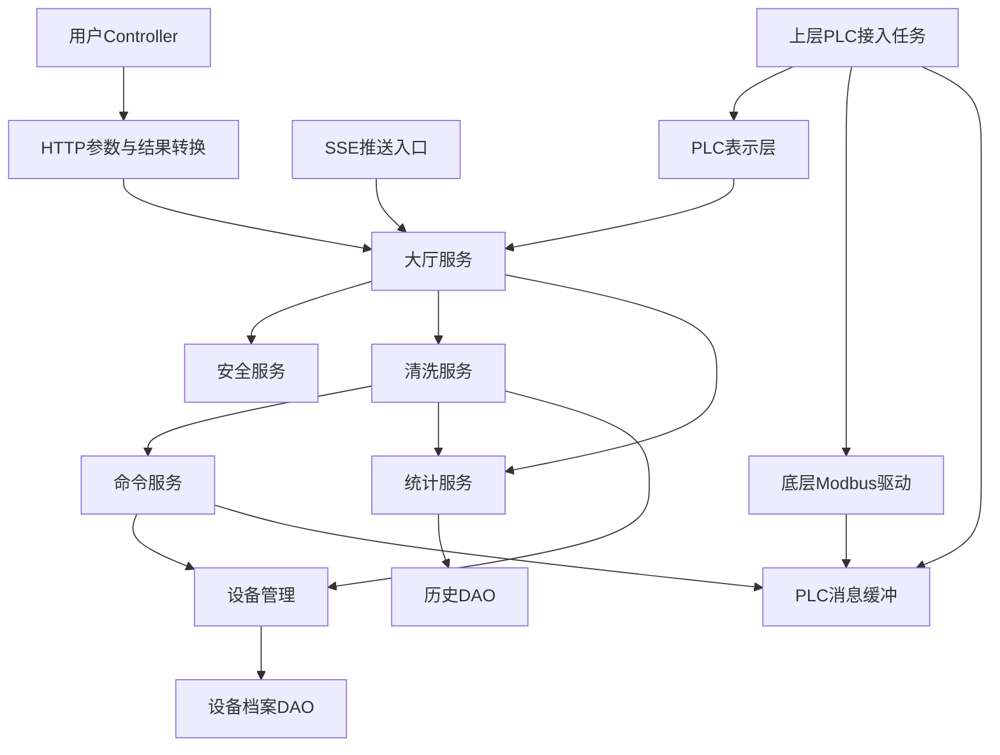

# 业务核心与单向调用

本文描述当前代码组织。新版点位状态、上行用途、历史保存和统计的统一设计见[新版统一方案](unified-plc-business-and-data-plan.md)，尚未因文档更新而写入实现。

2026-10-24页面职责修订见[对齐说明](frontend-backend-contract-alignment.md)和[目标页面接口](external-api-contract.md)。后端最终状态、名称、ROPE_TOTAL、告警/比较统计及新首页每秒完整推送属于待实现要求；下面保留现有代码行为，尤其当前SSE仍是新序号推送、同序号保活。详细现状见[当前接口参考](current-api-reference.md)。

面向页面与一次上行生命周期的目标流程见[业务流程与页面数据总览](business-flow-and-page-data-overview.md)，区分当前实现和后续记录、历史、统计及导出职责。

系统采用一个大厅入口和四个清洗业务服务：清洗、命令、安全、统计。账号服务属于认证基础功能，不参与清洗业务编排。每个业务模块有自己的辅助类，服务门面负责组合调用，不承担协议解析、逐字段转换、累加计算或共享状态写入。

## 职责和状态归属

| 入口/服务 | 职责 | 专属辅助类 | 明确边界 |
|---|---|---|---|
| CleaningLobbyService | 统一接收用户查询/操作和内部设备事实，选择业务路径 | 无独立状态 | 不写系统状态，不读写DAO |
| CleaningService | 业务编排、当前状态和操作申请 | CleaningSystemState、CleaningOperationPlanner、CleaningDeviceConverter | 只有本模块修改系统状态和参数视图 |
| CleaningCommandService | 命令登记、幂等、仲裁、入队、结果与超时 | CommandState、CommandSubmission、PlcCommandEncoder | 只有本模块修改命令生命周期；不修改设备运行状态 |
| CleaningSafetyService | 账号操作权限与请求边界 | OperationAccessPolicy | 安全规则不散落在Controller；当前不假设现场联锁条件已经验证 |
| CleaningStatisticsService | 实际样本统计和已有历史保存 | SampleStatistics、HistoryBatchPersistence | 不修改清洗状态；不将进程样本统计冒充完整轮次 |

`CleaningSystemState`、`CleaningOperationPlanner`、`CleaningDeviceConverter`、`CommandState`、`CommandSubmission`、`PlcCommandEncoder`、`OperationAccessPolicy`、`SampleStatistics`和`HistoryBatchPersistence`为各自包内类型，不作为可跨模块注入的Spring组件。对外传递的TelemetrySample、SystemRealtimeStatusBo、CleaningCommandStatusBo等是不可变读模型，不是可修改的状态容器。

系统状态与命令状态必须分开：急停写入成功只改变命令结果；运行/故障/急停状态继续由真实上行采集决定。参数写入确认也不自动等于实际配置已生效和版本已保存。

## 校验放在规则所属的位置

内部调用按明确契约传递数据，每项规则只在所属模块检查。不要在每一层重复判空、检查同一参数范围，也不为尚未开放的功能增加预留校验。

| 位置 | 负责的检查 |
|---|---|
| HTTP入口与转换 | Spring检查必需请求体；转换器处理必需字段和时间格式，读取真实登录账号 |
| 安全服务 | 读取/操作权限、设备和请求编号 |
| 清洗服务的操作规则 | 参数完整性、业务范围；统一生成命令编号和有效期 |
| 命令服务 | 请求幂等、过期、配置版本冲突、队列容量和命令状态流转 |
| PLC配置与协议 | 写入开关、点位、编码范围和读写应答是否匹配 |
| 数据保存 | DAO事务和唯一键去重 |

命令提交不再复查清洗服务生成的编号和有效期结构，PLC编码也不重复清洗参数的业务范围检查。过期判断与编号是否缺失不同，仍由命令服务按提交时间处理。

SSE首次请求必须登录，发送期间继续检查账号权限；Servlet异步收尾沿用该请求，不再重复鉴权，避免已发送响应后因权限拦截导致连接异常中断。

## 代码目录

```text
controller/                   用户HTTP入口
presentation/web/             HTTP参数/结果转换、SSE推送连接
presentation/plc/             上层PLC接入任务、采集DTO转换
service/
  Cleaning*Service.java        大厅与四个业务契约
  lobby/                      大厅门面
  cleaning/                   清洗门面、系统状态、操作和状态转换规则
  command/                    命令门面、命令状态、提交与编码规则
  safety/                     安全门面、权限策略
  statistics/                 统计门面、样本累计、历史保存
  tasks/                      上层登记的命令超时/历史保存任务
repository/device/            设备管理
repository/cleaning/          档案和历史DAO
info/buffer/                  只保存待处理数据的技术缓冲
info/thread/core/             不依赖业务类型的通用线程中心
infrastructure/plc/           底层Modbus读写驱动
domain/、dto/、vo/             共享数据和边界对象
```

## 调用方向

下面的箭头表示调用依赖，不是报文传输方向：



repository、info和infrastructure不能依赖service、presentation或controller。业务服务不能依赖Controller或表示层。Controller和表示层不绕过业务服务直接使用设备管理/DAO。

数据从PLC返回时，上层接入任务主动取缓冲并调用表示层。不是DAO、底层驱动或缓冲持有Service再回调上层。通用线程中心只执行上层登记的Runnable，不引用具体业务服务；登记和业务分发属于上层任务。

架构测试会检查这些依赖方向和状态辅助类的可见性，避免后续新增代码重新形成反向调用。

## 四条主流程

**设备事实与系统状态**

```text
底层PLC驱动读取 → 快照缓冲
上层PlcDataIngress主动取出 → PlcDevicePresentation转换
→ 大厅接收内部事实 → 清洗服务
→ 设备管理保存不可变采集事实
→ 清洗专属转换器计算业务状态
→ CleaningSystemState更新最新业务快照
→ 统计服务累计已接受的样本
```

设备管理保存“读到了什么”，清洗状态保存“这些事实对应什么业务状态”。重复或旧序号不能覆盖清洗最新状态，也不能重复计入统计。没有新增任何固定高度范围、轮次完成或自恢复次数判断。

**用户操作与命令结果**

```text
用户Controller → HTTP转换及真实登录身份 → 大厅
→ 安全服务检查 → 清洗服务操作规则和编排
→ 命令服务登记、编码、非阻塞入队
→ PLC驱动取队列下发 → 写结果缓冲
→ 上层接入任务取结果 → PLC表示层 → 大厅 → 清洗服务
→ 命令服务关联并更新命令状态
→ 清洗服务按已确认结果更新自身参数视图
```

命令服务不回调清洗服务；清洗编排主动调用命令服务处理结果，并根据返回的只读状态决定自己的下一步。命令查询仍经清洗服务编排，命令状态实际由命令模块提供。

**实时查询和首页推送**

```text
查询：Controller → 大厅 → 读取权限检查 → 清洗服务只读快照 → VO
推送：上层SSE任务 → 大厅 → 读取权限检查 → 同一个清洗服务快照 → SSE事件
```

SSE接口为GET `/api/cleaning/devices/{deviceId}/realtime/stream`。首次连接发送当前完整视图，没有数据则available=false；之后按配置间隔检查新序号并推送，未变化时发送保活注释。连接游标属于网络连接状态，不是系统状态。

连接需要Bearer访问令牌，不能把刷新令牌当访问令牌，也不将令牌放URL。浏览器使用支持Authorization头的SSE客户端或fetch流读取。连接最长60秒后由客户端重新鉴权连接；推送期间重新检查真实账号和权限，账号禁用或令牌过期时停止发送。上限64条连接，推送使用独立技术工作者，不占PLC I/O线程。首次订阅与周期发送通过连接自身的串行区避免同一连接交错发送，不持清洗/命令状态锁进行网络I/O。

**统计和历史**

```text
已接受实时快照 → 清洗服务 → 统计服务 → SampleStatistics
用户统计查询 → 大厅 → 读取权限检查 → 统计服务 → 统计VO
已整理历史批次 → 大厅 → 统计服务 → 历史队列
→ 上层保存任务 → 统计服务 → HistoryBatchPersistence → DAO事务
```

GET `/api/cleaning/devices/{deviceId}/statistics` 返回scope=PROCESS的进程观测统计：已接受帧数、首末样本时间，各路有效值数量、最小/最大和采样算术平均。不称为完整作业、全过程时间加权平均或日/月/年统计；进程重启后从空开始。原始测点无效时不补零、不计入有效测量均值。

历史批次保存仍是已有能力，PLC采集到作业/轮次识别、可靠留点生成、原始归档和历史曲线尚未实现；不把实时累计当作已持久保存。持久化任务仍默认关闭，数据库仍使用现有7表，本次没有修改数据库结构或迁移已有数据。
