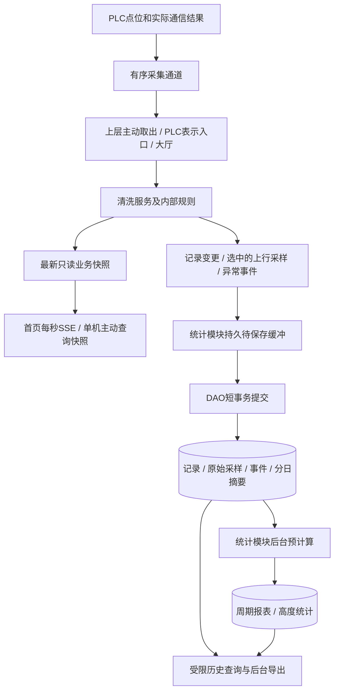

# 页面、PLC与业务层流程总览

日期：2026-10-25。本文回答业务层如何组织、一次记录怎样形成、页面展示什么、原始历史保存什么、历史统计计算什么。

依据为2026-10-24上传的《前后端职责与页面接口修订说明》、最新《当前项目总结与详情拉力对比图数据处理说明》、PLC点位表及当前仓库代码。附件提供前端现状和截图数值说明，本仓库未独立验证前端源码或其255项测试。本文是实施前方案；已明确的上行归档、下行异常、未知PLC语义不猜及不校验采集时间继续保留。职责变化见[前后端对齐](frontend-backend-contract-alignment.md)，详情取点与统计见[拉力对比处理说明](detail-force-comparison-processing.md)，点位事实见[新版统一方案](unified-plc-business-and-data-plan.md)。

最新附件报告前端已清理字段并取消详情定时刷新，但总拉力及右侧统计仍由前端计算、生产首页尚未接通每秒后端推送、历史CSV仍由浏览器生成。不能将这些目标当作已实现，也不能用模拟曲线不变证明后端计算已迁移。

目标HTTP路径、输入值、返回字段及JSON示例见[对外接口说明](external-api-contract.md)；现有Java接口单独见[当前接口参考](current-api-reference.md)，不将目标契约当成已实现能力。

## 1. 先把业务对象分清

一套系统、一台PLC、四台动力设备、八路索拉力，后端通过Modbus TCP直连PLC。系统、动力设备、钢绳和传感器使用已配置的身份关系，不恢复盒子身份或MQTT链路。

页面统一使用公开`systemCode`（如配置中的QJXT-01）、`winchCode`、`sensorCode`，后端解析到内部`system_id`、`deviceId`、`winch_id`和传感器ID。公开系统编号不是四台设备共用的编号，也不由前端回退为TANK-03。实际名称、身份关系和当前系统选择由后端提供，前端不按组号拼名称。内部主键不因页面命名修订而改写。

| 对象 | 回答的问题 | 生命周期 |
|---|---|---|
| 最新业务快照 | 现在是什么状态、读数是多少？ | 持续更新供首页推送；单机详情只在主动查询时取得快照 |
| 上行运行记录 | 哪一次生产上行、何时开始、最终怎样？ | 建立后持续补充，结束后仍可因明确的新事实修正 |
| 上行原始采样 | 那次上行的每个已采到的点是什么？ | 长期保存，关联本机、来源、分段及用途 |
| 异常事件 | 什么时候发生什么问题，后来怎样？ | 发生、持续、恢复或终止，保存必要事件点 |
| 运行设备分日摘要 | 某次、某台、某日、某用途的测量汇总是什么？ | 从已保存事实维护，可重建 |
| 周期报表与高度平均 | 一天、一个月等范围的数量、结果和曲线是什么？ | 后台预先计算、保存版本，查询直接读取 |
| 导出任务与文件 | 用户导出了什么范围，文件是否完整可下载？ | 排队、生成、完成或失败，文件固定于本次快照 |

本版页面的一条RUN表示**一次已识别的生产上行单程**，四台同步上行仍只生成一条系统记录。完整往返清洗CYCLE另有业务含义；当前点位尚不足以确定所有完整周期及上行起止组合，因此页面应明确标为“上行运行记录”，不将条数标成已确认完整清洗次数。

系统实时状态、运行记录结果、命令状态分别管理。例如，上行记录已经结束，设备继续正常下降时，系统仍可能显示“运行”。急停命令收到写应答，也不等于这条记录已经终止或设备已经停下。

## 2. 业务层分别负责什么

保持大厅入口与清洗、命令、安全、统计四个业务服务。服务门面组合调用，具体转换、记录整理、保存和计算交给各自内部辅助类。

后端提供可直接展示的最终状态、中文名称、业务结论、总拉力、统计和提示。前端负责渲染、查询条件、图例/单位切换、分页、操作确认和简单提醒，可以做必填及格式检查；不再判断阈值、汇总系统工况、推断历史结果、配对两索或计算业务统计。已知规则在所属后端模块检查一次，不因职责后移而逐层重复校验。

| 模块 | 业务职责 | 状态与辅助类的归属 |
|---|---|---|
| 大厅入口 | 接收页面请求和内部采集事实，选择业务路径 | 不另持有系统状态，不直接操作DAO |
| 清洗服务 | 解释PLC事实与有效配置，输出系统/单机/传感器状态和原因，识别记录、异常和阈值事实，编排查询与操作 | 系统状态类、点位/测点规则、操作规则；记录整理、用途分段、事件整理和归档选择均放本模块 |
| 安全服务 | 读取和操作权限，使用真实登录身份及已确定规则 | 权限策略集中在本模块，不逐层重复校验 |
| 命令服务 | 登记请求、幂等、入队、下发状态与结果 | 只修改命令状态；编码、提交规则及命令状态类属于本模块 |
| 统计服务 | 可靠保存、两索配对合计、分日/周期/高度统计、告警统计、同期比较、归档双图、历史查询与导出 | 配对/统计计算器、保存器、查询器和导出器属于本模块；不自行修改运行结果 |
| 设备管理与DAO | 管理系统/四机/八索编码与名称、有效配置和事实读取及数据库事务 | 不持有业务服务并回调，不负责决定状态、告警或某次运行是否完成 |

当前已有`CleaningSystemState`、`CleaningDeviceConverter`、`CleaningOperationPlanner`、`CommandState`、`SampleStatistics`、`HistoryBatchPersistence`等内部辅助类。记录整理、可靠归档、周期计算、导出等是后续需补的职责，这里不把拟议职责说成现有类。

网络边界分两类：PLC表示入口将采集结果交给业务；HTTP Controller及Web表示组件处理用户请求、响应和SSE推送。状态判断和历史计算不放在Controller、SSE连接、Modbus驱动或DAO中。

目标调用路径如下；底层返回数据由上层主动读取和分发，不让底层调用上层服务：

```text
设备事实：上层采集任务取PLC结果 → PLC表示入口 → 大厅 → 清洗服务
页面查询：Controller/表示层 → 大厅 → 安全服务 → 清洗服务 → 快照或统计查询
用户操作：Controller/登录身份 → 大厅 → 安全服务 → 清洗服务 → 命令服务 → 写队列
历史保存：清洗服务整理事实 → 统计服务可靠接收 → 保存器 → DAO事务
后台计算：上层登记任务 → 统计服务计算器 → DAO读取事实/更新统计结果
```

当前代码的进程统计由大厅直接调用统计服务；后续页面历史查询统一由清洗服务编排，再委派统计查询器。具体当前依赖见[核心架构](architecture.md)，不要把目标路径误认为已经全部完成。

## 3. PLC一帧数据怎样流转



这张图表示数据流。底层通道和DAO只提供读取、保存和确认能力；业务接入、消费和计算由上层任务主动发起。

1. 读取真实点位并带上设备身份、采集实例、序号、帧标识和各字段有效性。时间保留为记录信息。
2. 清洗模块解释系统、本机和传感器事实及有效阈值，按真实对象给出状态、中文说明、原因和测量；调用统计辅助能力得到可展示的配对合计，更新只读快照。
3. 同时整理已确认的运行边界、运动用途和异常变化，在实时旧帧被覆盖前选出需要归档的事实。
4. 选中的事实交统计模块可靠刷入持久缓冲；保存器批量入库，成功提交后确认消费。
5. 后台更新摘要、周期和高度桶；页面查询取得后端整理的分组、总力、统计和比较结论，不参与原始归档或业务计算。

首页先请求`/api/command-center/home?systemCode=...`取得完整快照，再通过`/api/command-center/home/stream`订阅同一systemCode，目标为每1秒发送完整首页对象。同采集序号也发送本次最新可用视图，但不得把旧采样时间改成发送时刻；消息发送时刻与数据`updatedAt`分别表达。断线只提示数据连接中断，不由浏览器推定PLC离线。详情和拉力对比取消持续SSE与每5秒刷新，仅进入、主动刷新/重试或切换查询范围时读取快照。

实时与归档各有节奏：实时快照允许被新值替换，历史采样不能因此漏掉；页面关闭、推送客户端变慢不影响后台保存。正常下行在内存中完成实时处理，只有异常及必要边界事实进入持久归档。

旧序号不覆盖最新实时视图，不代表其唯一历史采样应被丢弃；历史重放和补入按稳定标识处理，不能以“本次是否更新实时快照”作为允许入库的条件。

**采集数据不做时间校验。** 不比较当前时间、上一帧时间或数据年龄，不因提前、延迟、跨日或时间早于上一帧而拒收、丢弃或判离线。去重使用稳定采样标识，实时顺序使用采集实例/序号；时间用于查询、曲线定位、已确认边界的历时计算和日历归属。通信离线依据实际通信失败，测量无效依据真实读值/通道事实。

## 4. 一次上行记录从建立到结束

### 4.1 建立与归属

清洗模块只有在有明确业务依据时才建立一次生产上行记录，生成稳定`recordCode`，确定系统、参与设备及已确认的开始时间，保存当时已知模式、身份和参数快照。后续列表、详情、采样、事件与导出使用同一编号。

开始边界不明确时，先留实际UP采样、首次/最后观测和未确认说明，允许采样暂不关联记录；不能拿服务启动、首次读到运行、M13置1或某个固定高度当真正开始。数据库短暂不可用时继续沿用原公开编号，补存时不能新建第二条记录。

| 过程情况 | 清洗模块怎么整理 | 保存与统计 |
|---|---|---|
| 已确认生产上行 | 关联本次记录和本机连续段 | 保存核心采样，`PRODUCTION_UP`有效测量参与生产统计 |
| 本次过程发生异常 | 新建真实事件，持续同一异常只更新它 | 保存触发及必要恢复/终止快照，不每帧加一次异常 |
| 异常引起反向回退 | 保留原业务关联，切换用途/分段 | 回退提升为`RECOVERY_UP`，留原始但不新增生产次数、不进生产均值 |
| 已确认恢复生产上行 | 原记录继续，开启新连续段 | 恢复后的生产采样重新按`PRODUCTION_UP`统计 |
| 手动检修提升 | 标记`MAINTENANCE_UP` | 留上行采样，不混进生产次数和生产平均 |
| 确认UP但用途不明 | 标记`UNCLASSIFIED_UP` | 留原始，不补造生产记录或生产贡献 |
| 实际通信中断/归档失败 | 留事件或可记录的缺口，不推测现场继续怎样 | 重连后按实际依据关联和分段；缺口不画连续实线 |
| 明确完成或终止 | 清洗模块补充结束、结果及真实原因 | 更新主记录，触发相关摘要和周期更新 |

M210～M215帮助解释回退；M214恢复提升不是新生产开始，触发位回0也不是已确认恢复结束。正常下降只实时展示；下降异常可以独立保存，没有可靠关联时不挂到最近一条上行。

### 4.2 结果怎样表达

过程是否结束、是否完成、异常是否恢复三个事实分开。确认完成且无相关异常并具备相应观测依据，才显示正常完成；确认完成且相关异常已恢复，显示异常完成。急停、中断或故障有明确退出依据时显示终止并说明原因；仍运行则进行中；边界或结果不足则未确认。

上述结论由后端返回结构化结果及`runResultText`、`endReasonText`、`startMethodText`等中文说明，前端不再根据事件数组、当前设备状态或故障文字重新猜结果。无来源的处理尝试次数仍为空，不为满足展示补成0或5次。

观测缺口不能用“没记录到异常”证明正常全过程。只有首次/最后观测时保留该名称，不改成实际开始/结束。无可验证后台操作时，操作人为空；不能将当前浏览页面的账号记成现场启动者。

M8是正常回原位的约1秒脉冲，原位可能在上方；M9是下降到位；M204已有描述是上去再下去的轮次完成。三者不合并成一个通用上行完成信号。D10/D11保留PLC各自的单程计数事实，不能相加除2生成完整清洗，也不能根据增量补出未知记录的曲线。D3=50仅提供“五次尝试仍无法移动”原因，不提供五次尝试明细。

本版仍未确定完整的上行开始/正常完成点位组合，不补写该算法。后续确认的是识别依据，已确定的原始上行与异常保存可以先建设。

## 5. 各页面展示什么，数据从哪里来

| 页面区域 | 展示数据 | 读取来源与限制 |
|---|---|---|
| 首页系统区 | systemCode/systemName、配置总高度、系统当前高度、五态及实际运动事实 | 后端完整初始快照与每秒SSE；独立高度无来源时明确null |
| 首页四机八索 | 实际名称、每台operatingStatus、各测点status/quality、读数与阈值、故障对象 | 同一快照按身份绑定；上下行都显示，前端不重算状态 |
| 单机详情 | 本机查询时快照、两索/伺服、当前模式、有效设定速度、今日完成次数、累计时长及维护 | 主动查询；不要求额定载荷/额定速度，不定时刷新；设定值必须有确认依据 |
| 历史列表 | 编号、起止、结果、历时、异常数、生产钢绳极值 | 主记录分页，每页10条；返回筛选总数，不带全量曲线 |
| 单次详情概况 | 开始、历时、结果、异常触发、已知启动方式、最大/最小拉力 | 与列表同一主记录和统计口径；不随图表勾选改变 |
| 单次详情曲线/读数 | 各台两索、ROPE_TOTAL、SERVO曲线和最终统计；所选点高度/速度/数值 | 后端配对、分段、排序和计算，按unitId/sampleKey直接展示已返回读数 |
| 单次详情异常区 | 本次真实异常、恢复/终止和必要快照 | 可靠关联到该记录的事件；不生成处理尝试次数 |
| 独立告警中心 | 定位到设备/测点的上/下行事件、状态/类别/等级/处理文字、触发阈值和事件点 | 分页与筛选由后端完成；未恢复涵盖全部历史，不只今日 |
| 日/月/季/半年/年 | 记录结果数量、事件数、有依据的时长和生产测量统计 | 持久周期报表；高度平均读持久高度桶 |
| 数据归档 | 左侧变化图、右侧当前/参考对比、对齐轴及最终汇总/变化率 | 后端按三组独立范围一次组织有界结果；前端不算同比/环比 |
| 导出记录 | 类型、范围、任务状态、实际行数、文件、错误原因 | 导出任务表；生成完整后下载 |

单次详情右侧的“高度/拉力”属于选中的历史点，不能混入设备此刻的实时读数。原始曲线按采集顺序和连续段展示；同一高度可能经过多次，悬停通过帧、设备、来源及分段定位，不从不同时间凑一行同步读数。

左图“全部次数”叠画多个运行，右上表只看当前unit/sampleKey，右下表只看当前unit的完整统计，不是全日合计。后端给defaultUnitId，首次响应必须包含该组；未取点时上表留空，下表可显示默认组。两单绳整体极值unit.ropeExtrema与ROPE_TOTAL极值分别提供，不能把两根绳各自最大值相加。新sampleKey替代未实施目标中的pointKey，sampleFrameId仍保留真实帧含义。

新页面拉力数据统一t，后端内部和数据库继续kg；页面按响应单位格式化或切换单位，不再求业务合计。普通数值和可空状态字段缺失时显式返回null并给有效性/原因，不能省略、填0或生成前端演示值。数组无结果返回[]；缺少真正有效设定速度的详情不满足成功契约，应明确返回409/CONFIGURATION_NOT_READY，不能用实际速度、额定值或旧参数填`setSpeedMPerMinute`。

系统/动力设备页面待机码统一IDLE、显示黄色，内部STANDBY只在边界映射；单机权威字段为operatingStatus和statusText，传感器独立使用status和statusText。取消首页故障/离线设备及异常测点到告警页的自动入口，保留查看详情和独立告警中心。

默认生产曲线只展示`PRODUCTION_UP`；相关恢复/检修原始可按用途单独查看。下行事件点单独标注，不画成完整下行曲线。曲线缩减点数需保留峰值和缺口，明确返回原始点还是聚合区间；缩放后查询局部，前端不一次获取整个数据库。COUNT“全部次数”也只代表筛选集合，曲线分批加载。

附件模拟包含上/下行与回退，其51点、601点和每日20次是演示回归条件，不能据此扩大生产存储或统计范围。相同结构可用于演示对接，正式结果仍须满足本项目实际归档与用途规则。

### 5.1 最新点位与页面数值

| 页面数据 | 来源/计算 | 需要保留的含义 |
|---|---|---|
| 系统状态 | D201：1运行、2待机、3检修、4故障 | 实际通信不可用补离线；缺码/未定义码表示状态未确认，不假装离线 |
| 四机状态 | D203～D206：0待机、1运行、2故障 | 按本机映射，结合已确认检修和共享通信；不复制一台状态给四台 |
| 急停/故障 | M1/M2/M3、D3及本机故障事实 | 明确急停/故障优先显示；共享急停影响不说成四台电机损坏 |
| 电源与模式 | M0、M10 | M0是24V控制电源；自动模式不等于定时启动 |
| 方向 | 明确场景下M20/M21及M22～M29 | 分机解释；D202编码不完整且手动不变，不猜枚举或沿用旧方向 |
| 索拉力 | D40～D47 | 已为kg；页面t＝kg÷1000 |
| 本机高度 | D80～D83 | m＝cm÷100；绘图区不是机械限位 |
| 速度 | D61～D64本机、D65同步 | m/min＝cm/s×0.6；分开记录适用来源，不无条件复制同步速度 |
| 电机等效力 | D70～D73原值及给定公式 | `kg＝原值×0.35×163.0883×1.0÷(9.80665×0.16)`；不是N·m或两索合计 |

系统及单机状态完整优先级见统一方案。当前读值中的超限但有效测量仍保留；传感器故障、读值无效按对应通道表达，不把其他有效测量一起丢弃。单传感器故障只标该测点，不能据此推定电机本体损坏；若PLC同时给出本机故障，则并列保留该独立事实。已确认共享急停仍显示SYSTEM_EMERGENCY影响，不冒充四台电机硬件同时故障。

页面不能从点位补造独立系统实时高度、真实进度、机械限位、预警阈值、最近维护、启动来源或逐次处理次数。有已确认配置/业务来源才返回，否则显式null并说明；系统总高度也不固定30m。ratedLoad/ratedSpeed已从本次详情需求删除。D105～D108及D200未确认的单位/编码不进入已可用字段。

### 5.2 告警与归档查询的业务边界

清洗模块依据PLC明确事实、实际阈值配置及确定的判断规则生成事件和传感器状态，统计模块负责去重后的查询、计数与归档结果。阈值未知时返回null和“阈值未配置”，不能凭缺省配置宣称NORMAL，也不把无配置自动说成传感器硬件FAULT；独立已确认故障仍如实返回。该分工不新增云端自动保护、复位或恢复能力，现场联锁继续由PLC执行。

告警保存触发时的对象编码/名称、阈值值/类别/版本、实际触发值和原因。后续修改阈值不改写旧事件；恢复、终止、归档分别留证，归档或终止不等于已恢复。`activeCount`覆盖本系统全部历史isAlarm=true且尚未确认恢复的告警，包括恢复状态未确认的情况；不套今日日期筛选，不计入非告警事件。今日发生/今日恢复按各自事实日期统计。类别、等级、状态、处理要求和中文文字由后端给出，未知处理次数不补写。无RUN关联的下行事件也能通过独立事件列表分页查询。

统一拉力对比按`FORCE_COMPARISON`返回BATCH（本日次数）或PERIOD（周期平均）；四来源为SENSOR1、SENSOR2、ROPE_TOTAL、SERVO，前端只切换已返回曲线。DAY/MONTH/YEAR所需今日、昨日、本月、上月、本年及去年同期分组由后端确定并回显实际范围；空组empty=true并给原因，不造去年线。

数据归档分别接收左图变化、右图当前、右图参考三组起止日期，按左闭右开统一解释；后端对齐序列并返回比较范围、截至时刻和summary。参考均值为0、范围不具可比性或样本不足时变化率为null并说明，不让前端随意替换分母。平均/极值按各自数据口径读取已存摘要或高度桶，查询不重新扫描全年原始帧。

## 6. 原始历史究竟保存哪些数据

| 保存对象 | 最小业务内容 | 长期用途 |
|---|---|---|
| 运行主记录 | 稳定编号、系统/参与关系、实际与观测边界、模式/用途、结果/原因及可展示文字、当次已知参数和身份快照、异常数、生产钢绳极值、已知缺口 | 历史列表、单次概况；不拿当前配置回填历史设定速度/运行间隔 |
| 上行原始帧 | 稳定采集标识/时间、可空运行关联；归档本机的状态原码、方向、用途、连续段、两索、高度、速度、电机原值/等效力及有效性 | 原始追溯、单次曲线、悬停、明细导出和重新统计 |
| 异常事件 | 稳定事件编号、系统/设备/测点对象、可空运行关联、方向、故障/原因、触发配置/阈值快照、发生或观测及恢复/终止/归档事实 | 独立告警中心与记录时间轴；后端提供分类、状态及处理说明 |
| 事件点快照 | 触发、恢复、终止时必要相关设备测量/状态及有效性 | 解释异常现场；必要时包含相关下行设备，不形成连续下行窗口 |
| 边界证据 | 必要的完成观测及D10～D16、D66～D69等已确认原值 | 说明记录依据，不直接当累计运动工时 |

正常下行不存连续测量，以后不能回放其全程曲线、计算全程峰值或导出全程采样。四机方向混合时，仅保存实际UP本机的常规测量，不能因一台UP就顺带归档另外三台正常下行。

`PRODUCTION_UP`、`RECOVERY_UP`、`MAINTENANCE_UP`、`UNCLASSIFIED_UP`原始上行都保留，本机用途分别标明；默认生产均值、极值和运动时长只取已识别生产部分。无高度但拉力有效的生产点仍参与拉力摘要/极值，只是不能进入高度曲线。

D30～D37、原始编码器/转速、D48～D52可重算均值、标定参考等不作为每帧核心历史重复保存；明确需要诊断时再按来源使用。空白点位、未确认阶段和时间编码不编造业务值。

原始事实和事件长期保留，摘要和周期结果可以从事实重建，不替代原始历史。原始身份/采集标识不随修正改变；后续明确用途时更新归属并重建旧、新贡献，不能复制同一份原始采样。

### 6.1 对应数据库对象

目标复用`t_user`及系统、动力设备、钢绳传感器三张档案表，再补六张历史/统计表；导出另有一张技术任务表。

| 表 | 粒度及责任 |
|---|---|
| `cleaning_run_record` | 一次上行记录；由清洗模块决定业务变更，统计保存器负责落库 |
| `cleaning_up_sample` | 一帧选中归档的UP通道；保存事实及关联，不存整个页面JSON |
| `cleaning_exception_event` | 一次异常/告警、触发配置与有限快照；复用支持告警中心，不复制到旧通用告警表 |
| `cleaning_run_winch_day` | 一次记录＋一台设备＋一个采集日＋一个运动用途的摘要 |
| `cleaning_period_summary` | 一个系统/单机＋一个自然周期的报表和待重算标记 |
| `cleaning_height_bucket` | 一个周期＋一台设备＋一个来源＋一个高度区间的统计 |
| `cleaning_export_task` | 一个导出任务及文件清单；文件正文存在持久文件存储 |

即目标10张业务表＋1张导出任务表。当前数据库仍为7表，旧三张批次/分段统计表只保存已有统计，不能还原原始曲线。具体字段、唯一键、索引和迁移见[数据库设计](database/page-driven-database-design.md)。

有效系统参数及版本在系统配置中管理；历史记录保存当次参数快照，事件保存触发时阈值和对象快照。对外名称、单位、结果文字可从已留存事实/版本生成，不能用当前变更覆盖历史依据；无需为每个页面另复制整张事实表。

### 6.2 保存失败怎样处理

历史入口采用有界有序通道，选中数据可靠刷盘后才算持久接收。DAO短事务提交原始事实、相关记录/事件、分日摘要及待统计标记；提交成功才回收相应待保存项。

数据库暂不可用时保留已可靠接收的数据，恢复后补入；提交应答丢失按同一标识重放，由唯一键去重，不能再加一次采样或次数。持续异常更新同一事件，同一次记录结果变化更新同一记录。历史写入成功前，实时页面能看到不代表历史已经存好。

服务重启后，清洗模块通过统计查询恢复已存未结束记录和事件的已知事实，并结合持久待保存内容核对关联。不能仅因启动时PLC正在运行就另建一次，也不能把停机期间是否完成、是否发生异常补成已知；新采样与旧过程无法确认关联时保留未确认及断段。

尚未采到、尚未可靠刷盘的数据无法承诺断电恢复；磁盘满或写入失败应明确归档问题及缺口，不能静默删旧数据。成功入库后的缓冲文件可以回收，数据库业务历史继续保留。不要求Redis、Kafka或时序库作为第一版前提。

## 7. 历史统计保存什么、怎样算

### 7.1 三层统计分别服务什么

| 层次 | 保存内容 | 页面用途 |
|---|---|---|
| 本次本机分日摘要 | 各来源数值和、有效数量、最小/最大、实际高度范围、速度和/数量、有依据的本用途运动时长、缺口 | 单次右侧统计、本机本次统计、周期输入 |
| 自然周期报表 | 上行记录数、完成/恢复完成/终止/进行中/未确认数量、上/下行事件数、生产测量极值、有依据的运动时长、实际覆盖、规则/结果版本 | 今日卡片与日/月/季/半年/年报表 |
| 高度统计 | 本机各来源的高度桶、和/数量/极值、速度自己的和/数量、覆盖和版本 | 高度—拉力平均曲线 |

列表和详情用记录摘要，不每次扫全部采样求极值；周期页面读取已保存报表和高度桶，不让前端下载原始数据计算日/月/年结果。

### 7.2 后端为页面计算的口径

本节公式均由后端实现；前端读取最终statistics、结果文字和来源系列，不根据下面公式再算一套。内部计算用kg，页面契约按t返回并标单位。

| 指标 | 计算规则 |
|---|---|
| 当前有效索平均拉力 | 本帧有效索值之和÷有效索数量；返回参与数量，全部无效为空 |
| 当前平均高度/速度 | 分别用本帧有效本机高度/适用实际速度的和除以各自有效数量；均高不替代环体高度，同步速度不冒充四路独立测量 |
| 本机两索合计 | 同一明确采集口径下两根独立有效索相加；缺一根为空，有效0正常参与 |
| 本次/周期某来源平均 | 指定生产UP有效样本`sum/count`；不是按运行次数等权，也不是时间加权平均 |
| 平均曲线某高度点 | 本机、本来源、本高度桶的`sum/count`；每个来源独立统计，速度用自己的数量 |
| 配对总力平均 | 先在两索均有效且明确配对的样本上求和，再累计；不能把两个不同样本集合的均值相加 |
| 单次最大/最小拉力 | 该记录生产UP有效钢绳原始极值；不含电机、两索总力、回退/检修和下行事件点 |
| 周期原始极值 | 周期采集日期内生产UP有效原始值极值；不是平均曲线最高/最低均值 |
| 记录历时 | 已确认结束－已确认开始；可能包含等待，不当电机运动时长 |
| 本机累计生产上行小时 | 有可靠区间证据的`PRODUCTION_UP`运动毫秒合计÷3600000，使用不重叠周期 |
| 今日上行次数 | 开始日是今日的已识别生产记录去重数；四台参与不乘4 |
| 今日已完成数 | `todayCompletedCount`取今日开始的记录中确认完成数，`countBasis=STARTED_DATE`；区分正常/异常恢复完成，终止不算完成，不改为今日结束数 |
| 异常数 | 真实事件数量；持续采样次数、处理尝试数、PLC故障计数不是该值 |

例如某高度桶两日分别为和200kg/2个值、和900kg/3个值，月平均为`1100÷5＝220kg`，不能把两日均值100和300等权平均成200kg。示例仅说明公式，不代表现场采样或运行规模。

三种数量分别返回：points.sampleCount为高度点有效采样数，unit.sourceIncludedRunCounts为单来源参与记录去重数，unit.includedRunCount为四来源并集去重数。同一记录跨两天参与曲线，月参与数仍为1；两根索各参与1次，也不能把曲线组说成2次。原始点有效sampleCount=1、无效为0，缺失数量不按1补权重；GOOD/PARTIAL必须有对应数值有效依据，有效0保留。

两索总力由统计模块按已确认的同本机、方向、分段和采集关联形成独立ROPE_TOTAL曲线、质量及statistics；内部既有PAIRED_SUM可以保留并由页面适配转换名称。sampleKey由后端生成，前端直接定位已配对读数。附件中的时间/高度配对不代表新增采样年龄校验，也不允许猜容差或拿相近点凑同步样本；配对依据不足时总力显式null，原始有效单索仍保留。总力速度取同帧本机已确认适用速度，周期只在配对集合累计速度自己的和/数量，不相加速度、不盲抄钢绳1。先以原始精度计算，页面最后格式化。

详情图series.statistics服务完整逻辑曲线：COUNT的metricBasis=RAW_CURVE_SAMPLES，取有有效高度的生产UP原始点；PERIOD为HEIGHT_BUCKET_MEANS，均值按基础高度桶sum/count，最高/最低是基础桶均值极值。series.rawStatistics单列RAW_VALID_SAMPLES，保留包含缺高度点的有效生产UP原始测量均值/瞬时极值。分页、降采样、显示合桶与图例选择均不改右侧统计；历史顶部原始极值继续读取原始摘要，不误用平均曲线高低值。

有效运动时长需要可靠运动区间；不能用采样数乘轮询间隔，也不能直接累计会清零的D16或D66～D69。未知时为空或标明仅为已确认部分，不能让SQL忽略空值后冒充完整累计。四台工时合计不是系统运动时长；没有独立持久区间依据时，SYSTEM运动时长为空。

### 7.3 周期边界和数据归属

数据库时刻按UTC保存；业务日历按`Asia/Shanghai`，接口时间带时区。以2026-10-24为例，采用起点包含、终点排除，完整覆盖23:59:59之后的小数秒：

| 周期 | 开始（北京时间） | 不包含的结束边界 |
|---|---|---|
| 当日 | 2026-10-24 00:00:00 | 2026-10-25 00:00:00 |
| 当月 | 2026-10-01 00:00:00 | 2026-11-01 00:00:00 |
| 第四季度 | 2026-10-01 00:00:00 | 2027-01-01 00:00:00 |
| 下半年 | 2026-07-01 00:00:00 | 2027-01-01 00:00:00 |
| 当年 | 2026-01-01 00:00:00 | 2027-01-01 00:00:00 |

自然月按日历长度，季度按1～3/4～6/7～9/10～12月，半年按1～6/7～12月，闰年按真实日历。当前未结束周期只有已保存数据，不补未来0值。

记录数量及其最终结果按开始日归属；测量和高度曲线按采集日归属；事件按已确认发生/首次观测日归属；可靠运动区间按跨日交集拆分。未知实际开始不造开始日，无记录关联的数据不自动计入生产次数。

后台流程：事实与待更新标记同事务提交→构建受影响日摘要/日高度桶→合并月、季、半年、年→保存结果版本。数值合并和/数量，记录参与数另行去重，不能简单相加每天参与数。

已结束月份提前计算并保存；查询直接读取。补入历史、记录结束、事件结果变化或用途修正只重建受影响范围，并移除旧贡献。计算失败保留上一成功版本和待更新说明；首次未计算显示准备中。后台处理期间新增的数据继续保留重算要求，不能被旧任务清除。这些都不以采样时间早晚决定是否接收。

## 8. 用一条跨日记录贯穿所有页面

以下是假设业务边界已经得到明确证据后的说明，未规定用哪些未知点位组合识别。某次生产上行R于10月23日23:58开始，10月24日00:03确认完成，四台参与，期间发生一次可关联且已确认恢复的异常。

| 时刻/阶段 | 业务处理 | 用户所见及统计归属 |
|---|---|---|
| 23:58明确开始 | 建立R，记录四机参与与已知参数 | 当前记录显示进行中；23日系统上行次数增加1，不是4 |
| 持续生产提升 | 保存本机UP测量，更新最新快照 | 首页每秒接收当前视图；详情仅主动查询时读取已存曲线 |
| 23:59发生异常并回退 | 一次事件关联R；回退/恢复片段单列用途 | 异常数为1；回退提升留原始，不新增生产次数 |
| 00:00后明确恢复生产 | R继续，生产段与恢复段分开 | 24日生产测量进入24日曲线，23日测量留在23日 |
| 00:03确认完成 | R结束，已确认异常恢复后完成 | 23日记录组更新完成结果；24日不新增一次开始 |
| 随后正常下降 | 仍更新实时，下行无连续历史 | 系统可以仍显示运行，R详情显示已完成，两者不矛盾 |
| 下降另发异常且无关联依据 | 独立下行事件，保存必要快照 | 24日异常页可查，不改写R的上行完成结果 |
| 打开R详情 | 查询R概要、分机分段曲线和事件 | 已知历时300秒；有效运动时长另按证据，不直接写300秒 |
| 打开10月平均 | 读预计算月报表及高度桶 | R在月参与数中去重一次；只统计明确生产UP有效测量 |
| 导出R | 后台按任务快照读取实际保存数据 | 包含范围内已存用途并逐行标识，不导出不存在的正常下行曲线 |

如果23日数据因数据库恢复在24日才补入，仍保存并修正23日及相关周期；不用到达日改写采集日期，不判断它已过期，也不重复计数。

## 9. 用户操作与导出怎样加入主流程

用户操作通过登录账号→安全服务→清洗操作规则→命令服务→写缓冲→PLC；上层取回写结果，再由清洗编排交命令模块更新命令状态。实际设备状态继续依据采集事实。

新版急停目标为M50写1，物理协议地址、类型等使用明确配置，不直接把标签数字50当地址。写应答、实际停止和急停反馈关联分别报告；未确认M50必使M2置1，不能据此冒充已验证执行成功。M15不作回退目标，不写0解除急停。

现有参数请求意图需在新版点位编码、单位和读回关系明确后适配；D105～D108不按地址顺序强配D100～D103。远程启动、复位、解除急停、暂停/恢复和单轴升降仍未开放。后台权限检查集中在安全模块，现场联锁由PLC执行，不添加重复校验或采样过期规则。

页面参数仍只有启动时间、运行间隔、运行速度，以systemCode定位有效配置。新页面字段为startTime、intervalMinutes、speedMPerMinute，后端在边界将分钟换成内部秒；不把预警阈值塞进三参数。参数响应区分“平台已保存”“PLC写应答已确认”“设备已确认生效”，只有APPLIED且具有实际确认依据的设定可用于详情必返setSpeedMPerMinute。当前缺少这条闭环，应如实报未就绪，不能因字段必返填默认值。

导出仍由清洗服务编排，统计模块内部导出器负责。列表导出已提交筛选范围的全部记录，单次导出实际保存的上行明细，异常和周期各有模板；不受当前页10条或图上隐藏来源影响。任务读取同一数据快照，流式生成CSV/ZIP，完整发布后显示可下载；历史修正后重新生成新文件。详细列和失败处理见[导出方案](data-export-plan.md)。

## 10. 当前已做到哪里，后续先闭环什么

| 当前仓库情况 | 需要补齐的业务闭环 |
|---|---|
| 大厅及四服务、内部状态/规则类已存在 | 在对应模块补记录整理、分段/事件、可靠保存与查询，不增加大而全门面 |
| 实时查询/SSE、命令队列和现有参数接口存在 | 新版D201/D203～D206、单位、分机方向及M50映射仍需适配 |
| 当前接口以deviceId、kg、STANDBY及可省略空字段输出，SSE仅有新序号才发送数据 | 新页面以systemCode、t、IDLE及显式null输出；首页每秒完整发送，详情/趋势主动查询；仍属待实现 |
| 实时缓冲会合并旧快照，历史队列只是内存批次 | 覆盖前选择UP/异常，持久接收、去重重放和归档问题可见 |
| 当前7表，有旧批次/分段事务保存，历史任务默认关闭 | 运行/原始/事件/分日/周期/高度及导出任务表和迁移待实施 |
| `statistics`仅为本进程已观测样本统计 | 不能代替数据库日/月/年、单次记录或长期累计 |
| 没有生产运行识别、完整历史查询和导出链路 | 按下列顺序实施并验证页面与数据同源 |
| 告警中心/归档双图/只读用户列表的修订路径尚未接通 | `/api/command-center/...`和`/api/users`按新页面职责实施，未知阈值/字段不填演示值 |

实施顺序：先适配已明确点位、公开系统身份/名称、单位和首页视图，落实有效配置及状态规则；实现可靠上行及事件保存，确认边界后闭环一次记录、列表与查询式详情；再完成告警查询、自然周期/高度平均及归档比较；最后接入导出、恢复与容量验证。未知点位语义保留待确认，不阻止已有明确测量的归档设计。模型管理保持待开放，历史巡检/数据分析为占位，视频不在本轮范围。

页面、记录、统计和导出使用同一套事实与口径；实时回答“现在怎样”，单次详情回答“这次发生什么”，原始历史保留证据，预计算负责长时间范围的快速查询。

相关详细设计：[统一点位与业务方案](unified-plc-business-and-data-plan.md)、[页面字段与曲线](realtime-upward-history-and-detail-plan.md)、[数据库表和索引](database/page-driven-database-design.md)、[导出任务及文件](data-export-plan.md)。本轮只编写文档，没有新增业务代码、DDL或实际任务。
