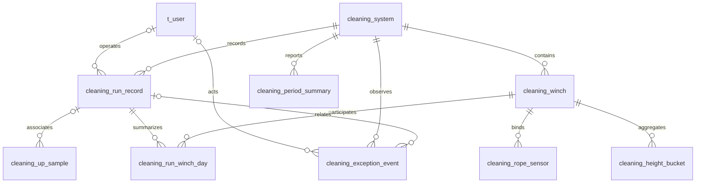

# 从页面字段倒推的数据库设计

日期：2026-10-23。本文是方案，不是已执行的建表或迁移；当前数据库仍为7表基线。

本轮新版点位、状态、M50急停和全链路口径统一以[新版统一方案](../unified-plc-business-and-data-plan.md)为准。本文继续提供十表字段和索引设计，已同步补充本机运动用途及系统时长限制。

依据：用户上传的《前端页面与后端数据字段对接说明》v1.0、当前后端代码，以及[实时、上行历史与详情口径](../realtime-upward-history-and-detail-plan.md)。没有前端仓库或页面截图可供核验，以下按附件列出的页面字段分析，不将演示值当现场数据。

边界：单PLC、四机八索；上行保存核心过程采样，正常下行不保存连续测量，下行异常保存事件点及必要快照；没有数据过期判断。现阶段RUN页面建议采用上行单程，不称为完整清洗轮次。

## 1. 从页面倒推，先分清哪些数据要存

| 页面需求 | 数据性质 | 处理方式 |
|---|---|---|
| 系统编号、设备名称、分组、额定值、阈值、维护日期 | 稳定档案/配置 | 存设备配置表，有来源才填写 |
| 当前状态、方向、拉力、高度、速度 | 当前事实 | 清洗服务最新快照，实时推送；不为每个页面建立实时表 |
| 某次起止、结果、参数、曲线、异常 | 运行事实 | 主记录、上行采样、异常事件分别保存 |
| 本机本次平均、极值、累计运动 | 运行摘要 | 保存可合并的设备分日摘要，避免反复扫原始帧 |
| 今日次数、月/年结果、平均曲线 | 周期统计 | 后台预计算并保存，查询直接读取 |
| 中文状态、显示单位、图表颜色、分页包装 | 展示结果 | 接口/前端生成，不逐项建库表 |

首页、单台详情和历史详情读取同一份事实，不各存一套重复运行数据。正常下行仍可实时查看，但不能提供未保存的完整历史曲线、原始导出或全程峰值。

## 2. 建议的目标结构：10张业务表

复用现有账号与三张拓扑表，增加六张历史/统计表。重算标记放在周期表，无需另建任务表。迁移期原三张批次历史表另外保留，因此实际表数会暂时多于目标结构，本文不删除旧表。

| 表 | 一行表示什么 | 对应页面 |
|---|---|---|
| `t_user`，沿用 | 一个登录账号 | 可验证后台操作的身份 |
| `cleaning_system`，扩展 | 一套系统与PLC绑定 | 首页档案 |
| `cleaning_winch`，扩展 | 一台动力设备 | 单机档案/配置 |
| `cleaning_rope_sensor`，扩展 | 一个逻辑钢绳位置与传感器绑定 | 两索身份/阈值 |
| `cleaning_run_record`，新增设计 | 一次已识别的上行记录 | 列表、当前/上一条、单次概况 |
| `cleaning_up_sample`，新增设计 | 一帧选中归档的上行测量 | 原始曲线、悬停、明细导出 |
| `cleaning_run_winch_day`，新增设计 | 一次运行、一台设备、一个采集日、一个运动用途的摘要 | 本机本次统计、跨日时长、参与记录去重 |
| `cleaning_exception_event`，新增设计 | 一次异常及有限事件快照 | 上/下行异常历史 |
| `cleaning_period_summary`，新增设计 | 系统或单机的一个自然周期结果 | 日/月/季/半年/年卡片、日期目录 |
| `cleaning_height_bucket`，新增设计 | 某周期、本机、某来源、一个高度区间的统计 | 高度—拉力平均曲线 |

概念关系如下，不代表每条关联都要求物理外键：

## 3. 身份、单位和时间约定

- 沿用系统、`deviceId`、`winchId`、`ropeId`、`sensorId`，不恢复盒子身份。显示编号不作为四台设备共有的内部主键。
- 新运行建议使用紧凑的`BIGINT UNSIGNED`内部主键及唯一公开`record_code`。页面`id/recordCode`用公开编号，采样关联内部键，避免每帧重复长编号。
- 采样内部自增ID只用于数据库定位；重放去重使用稳定的`device_id + capture_id + sample_seq`，采集实例跨重启不复用，重放沿用原标识。
- 库内统一kg、m、m/min；电机存公式对应的等效kg及必要原值，不标成N·m。页面t由kg除1000，单位转换只做一次。
- 时刻用`DATETIME(3)`保存UTC，应用与连接显式使用UTC；业务`DATE`按`Asia/Shanghai`计算。`DATETIME`类型本身不保存时区。查询使用开始包含、结束不包含。
- 不校验采集时间的早晚、年龄或与当前时钟的偏差，不因缓冲延迟、跨日或早于上一帧而拒收/丢弃。时间列只用于记录、查询、曲线位置、历时和日历统计；唯一采样标识负责去重，不以时间作数据有效性条件。
- 缺测不补0；正常下行未归档与传感器无效分别表达。下面数值类型为建议存储精度，不代表现场精度或机械范围。

## 4. 现有三张设备表如何扩展

保留现有身份、绑定和唯一约束，不为页面复制第二套设备档案。

| 表 | 保留字段 | 建议补充的页面配置 |
|---|---|---|
| `cleaning_system` | `system_id、device_id、tank_id、ring_id、ring_own_weight_kg` | `display_code、system_name、configured_height_m、height_limit_min_m、height_limit_max_m` |
| `cleaning_winch` | `winch_id、system_id、slot_no` | `winch_name、rated_load_kg、rated_speed_mpm、last_maintenance_at` |
| `cleaning_rope_sensor` | `rope_id、winch_id、slot_no、tension_sensor_id` | `sensor_name、business_role、installation_position、warning_threshold_kg、protection_threshold_kg、monitor_min_kg、monitor_max_kg` |

名称/编号用VARCHAR；高度建议DECIMAL(10,3)，负载/拉力DECIMAL(14,4)，速度DECIMAL(10,4)，维护时间DATETIME(3)。无来源的配置允许为空，不填27m、30m、1.4t等显示/示例值。

页面目前只有最近维护时间，先不增加维护工单体系；需要维护历史再扩展。单机独立限位有明确需求和配置时再增加，不复制系统限位冒充本机实测。

PLC连接地址与轮询参数继续按现有接入配置管理。页面阈值不代表已经支持写PLC保护参数，也不因此开放新控制接口。

## 5. 运行主表：直接支撑列表与七个概况

### `cleaning_run_record`

| 字段 | 建议类型 | 含义 |
|---|---|---|
| `id / record_code` | BIGINT UNSIGNED主键 / VARCHAR(64)唯一 | 内部关联与页面公开编号 |
| `system_id / device_id` | VARCHAR(64) | 所属系统、PLC来源 |
| `record_use / mode` | VARCHAR，允许未确认 | 生产/检修/回退等用途与AUTO/MANUAL模式，不混为启动方式 |
| `started_at / ended_at` | DATETIME(3)，可空 | 已确认实际边界，进行中不填未来结束时间 |
| `first_observed_at / last_observed_at` | DATETIME(3) | 首次/最后观测事实，不冒充未知实际起止 |
| `business_date` | DATE，可空 | 已确认开始时刻的北京时间日期，用于计数归属 |
| `state / result / termination_reason` | VARCHAR业务枚举 | 是否结束、是否确认完成、真实退出原因分开 |
| `start_method` | VARCHAR(24)，可空 | 有实际来源才填，不从AUTO推定定时 |
| `operator_user_id` | BIGINT，可空 | 可验证后台操作账号，现场动作不套用在线用户 |
| `rope_min_kg / rope_max_kg` | DECIMAL(14,4)，可空 | 本次PRODUCTION_UP有效钢绳极值，不含回退/检修、电机、总拉力、下行快照 |
| `abnormal_count / has_data_gap` | BIGINT UNSIGNED / BOOLEAN | 属于本次的异常数、已知数据缺口，不是过期判断 |
| `parameter_snapshot / identity_snapshot` | 有限JSON对象 | 本次实际参数、身份映射、单位/换算规则版本 |

本版`kind=RUN、recordScope=LEG、directionScope=UP`由接口约定输出，不必每行重复常量。一次系统同步上行是一条系统记录，四台参与不变成四次系统运行。

`durationSeconds`由已知起止相减，格式化时长不入库；有效运动时长另读分日摘要。列表常用极值和异常数存派生摘要，避免每页十条都读取十份原始曲线。

单条RUN的`runCount=1`及各结果计数0/1由结构化结果生成，不在主表重复保存一整套周期计数字段。开始未知时不造`started_at/business_date`，按首次观测在边界未确认范围查询，不混入已确认开始日计数。

## 6. 上行采样表：一帧一行

### `cleaning_up_sample`

| 字段 | 建议类型 | 含义 |
|---|---|---|
| `id` | BIGINT UNSIGNED主键 | 内部采样键 |
| `device_id` | VARCHAR(64) | PLC来源 |
| `capture_id / sample_seq` | BINARY(16) / BIGINT UNSIGNED | 稳定采集实例与序号，组合去重 |
| `record_id` | BIGINT UNSIGNED，可空 | 已确认业务归属，不强挂最近一条记录 |
| `sampled_at / received_at` | DATETIME(3) | 采集时刻/入库时刻，统计使用前者 |
| `group_speed_mpm` | DECIMAL(10,4)，可空 | 独立保存同步速度 |
| `system_state_code / wN_state_code` | SMALLINT，允许缺测 | 实际D201与D203～D206原码，状态缺测不当离线 |
| `wN_archived`，N=1…4 | BOOLEAN | 本帧本机上行测量是否归档 |
| `wN_motion_role / wN_segment_code` | VARCHAR(24) / VARCHAR(64) | 本机生产、回退、检修、未确认上行用途及连续分段；后端分类，不是猜PLC阶段码 |
| `wN_height_m / wN_speed_mpm` | DECIMAL(10,3) / DECIMAL(10,4)，可空 | 本机高度与独立速度 |
| `wN_rope1_kg / wN_rope2_kg` | DECIMAL(14,4)，可空 | 两根钢绳各自测量 |
| `wN_motor_raw / wN_motor_force_kg` | BIGINT / DECIMAL(14,4)，可空 | 正确解码原值及已明确公式的等效力 |
| `wN_quality` | SMALLINT UNSIGNED，通道质量标记 | 返回页面时展开到各通道，不是PLC寄存器编码 |
| `mapping_snapshot` | 有限JSON，可空 | 无记录或与记录快照不一致时保留必要身份/规则来源 |

`wN_...`落地时展开成四组固定数值列，不是一列自由拼装测量JSON。小型身份/规则快照可以JSON，核心曲线保留数值列。

混合方向仅归档UP正常测量，正常下降通道标记未归档；下行异常另存事件快照。上行某通道无效，保留质量和其他有效通道。

同一生产记录内也可能包含RECOVERY_UP，不能仅用主表record_use判断样本用途。默认生产摘要/平均只取本机PRODUCTION_UP；其余上行原始保留，不增加生产次数。

有真实依据修正用途时保留原采样标识/PLC事实，重建旧/新角色摘要、主记录生产极值及受影响周期，不复制原始点，不让旧用途统计残留。

同步速度和本机独立速度分别保存，只在工况已明确时选择适用值，不无条件复制整组速度冒充四个独立实测。帧标识只表示采集关联，采集实现仍须满足明确一致性口径，不能擅自设置同步容差。

不能只保存整米点：真实时间、速度、峰值和原始导出都依赖过程采样。高度桶用于统计/展示，不覆盖原始帧，不为0～30m补点。断线、换向或回退后的片段不能按高度排序串成同一条连续实线。

## 7. 运行设备分日摘要：处理单机与跨天

### `cleaning_run_winch_day`

主键建议`(record_id, winch_id, stat_date, motion_role)`，日期为采集/已确认运动区间所属的北京时间日期，用途按每台实际归属拆分。

| 字段组 | 内容 |
|---|---|
| `record_id、winch_id、stat_date、motion_role` | 一次运行、本机、一天、一个用途；跨午夜或用途不同分别成行 |
| `first_sample_at / last_sample_at` | 实际参与采样范围 |
| `motion_duration_ms` | 可空，当日本用途可靠上行区间毫秒数；未知不填0，不与其他用途混算 |
| `height_min_m / height_max_m` | 本机当日实际高度范围 |
| `rope1_* / rope2_* / motor_* / pair_*` | 各自的`sum_kg、valid_count、min_kg、max_kg`，pair仅来自同帧两索均有效集合 |
| `speed_sum / speed_valid_count` | 适用速度自己的有效和/数量 |
| `curve_rope1_count / curve_rope2_count / curve_motor_count / curve_pair_count` | 同时有有效本机高度并满足UP曲线规则的各来源样本数 |
| `has_data_gap` | 已知缺口说明 |

数值和建议DECIMAL(30,6)，数量BIGINT UNSIGNED，单值极值DECIMAL(14,4)。同次详情合并本机少量分日行：和/数量求平均、极值分别取最小/最大，不平均平均值。

默认本次生产摘要、周期生产计数对应测量、有效运动时长和曲线均明确筛选PRODUCTION_UP；检修/回退工时另列用途。平均曲线仍保留有效异常峰值，不能因报警就删去生产测量。

高度缺失但拉力有效时，仍可参加记录拉力极值，却不能成为高度曲线点，因此一般测量数量与`curve_*_count`分开。未归属记录的原始上行采样保留，不自动混入生产计数/均值。

本机今日次数按主表开始日及参与关系去重；不能因四台同步或跨日行数增加系统次数。某来源参与周期曲线的记录数，在目标采集日期内对`curve_*_count>0`的记录去重并预计算；一条运行跨两天，不能把两天各1条相加当月2条。

## 8. 异常事件表：下行仅在这里留事件点

### `cleaning_exception_event`

| 字段 | 规则 |
|---|---|
| `id / event_code` | 内部主键、唯一稳定公开事件编号，支持重放去重 |
| `system_id / device_id` | 系统、PLC来源 |
| `winch_id / record_id` | 可空；系统事件或无可靠运行关联时不强填 |
| `direction / fault_code / reason` | 实际方向、故障码/原因，不从曲线峰值推断 |
| `first_observed_at / recovered_at / terminated_at` | 已观测触发、恢复、终止时刻；没有依据为空 |
| `outcome` | 真实恢复/退出事实，允许未确认 |
| `trigger_snapshot / recovery_snapshot / termination_snapshot` | 有限JSON，仅事件点的高度、拉力、速度、电机、质量，不放连续采样数组 |
| `operator_user_id` | 仅有可验证后台操作时填写 |

无PLC准确发生时间时说明首次观测，不冒充精确物理发生时刻。通信失败没有测量时快照可空，不造全0。

同一异常持续十秒仍是一条事件，恢复后再次出现才新建。下行事件可没有上行record_id，系统异常入口按设备/时间仍可查询；结束后的独立下行事件不反向改写上行结果。

不建无来源的处理次数或五次尝试明细。D3=50留实际故障含义，不自行补出五次过程；真实急停/中断退出也不要求先凑五次失败。

## 9. 周期统计表：报表、计数、日期目录

### `cleaning_period_summary`

同一张表覆盖系统/单机及日/月/季度/半年/年。

| 字段组 | 内容 |
|---|---|
| `system_id、scope_kind、scope_id` | 范围仅SYSTEM/WINCH；scope_id非空，分别为真实系统/动力设备ID |
| `period_type、period_start、period_end` | 自然周期类型，按北京时间计算后存UTC，左闭右开 |
| `run_count` | 本周期确认开始的生产上行数 |
| `completed_count、normal_completed_count、recovered_count` | 上述记录中完成、正常、异常恢复后完成的数量 |
| `terminated_count、ongoing_count、unconfirmed_count` | 明确终止、仍进行、结果未确认的数量 |
| `up_event_count / down_event_count` | 按事件观测日期统计，与记录计数分开 |
| `motion_duration_ms` | 落在本周期内的可靠上行运动区间合计 |
| `rope_min_kg / rope_max_kg` | 本周期采集日期内有效上行钢绳极值 |
| `curve_any_record_count / curve_rope1_record_count / curve_rope2_record_count / curve_motor_record_count / curve_pair_record_count` | WINCH范围曲线组及各来源参与本期曲线的去重记录数；组数量按来源并集去重，不相加各来源数 |
| `data_from / data_through / has_data_gap` | 已纳入的数据范围与已知缺口，不用于过期判断 |
| `rule_version、rule_snapshot、computed_version、requested_version、needs_rebuild、built_at` | 规则版本与有限规则快照、计算版本及持久重算标记 |

唯一键`(system_id, scope_kind, scope_id, period_type, period_start)`。不以`winch_id=NULL`代表系统构造可空唯一键，否则MySQL可能允许重复系统周期行。

**归属分开：记录计数与结果按开始日；测量/曲线按采集日；事件按实际可确认发生/观测日；时长按区间交集拆分。** 例如22日23:58开始、23日00:08结束，结果回填22日记录组；可靠运动时长拆为两日2/8分钟，采样各归实际日期。

周期测量摘要可合并设备分日摘要，因此不会把跨日整条记录的极值全归开始日；没有高度的有效拉力也不因未进高度桶而遗漏。单机参与曲线的记录数从轻量分日摘要去重，不能相加每日参与数。

系统同步运行次数不相加四台设备行。系统运动历时与四台设备工时合计分别命名。单机累计小时读取不重叠的“已结束年＋当前年已结束月＋当前月已结束日＋当日”运动时长，除3600000，不把年/月/日重复相加，不由采样数乘固定间隔推算。

本版没有独立、可持久重建的系统上行运动区间来源时，SYSTEM范围的motion_duration_ms为空；四台日总量既不能求和当系统历时，也不足以还原区间并集。WINCH范围默认只累计PRODUCTION_UP，未知部分保留覆盖说明，不能让SUM忽略NULL后冒充完整累计。

原始数据/事件/结果提交时，同事务将受影响日范围标记待更新并推进requested_version。后台重建日结果/高度桶，提交时推进计算版本并标记上级周期。若期间又有数据，保留后续重算标记，不清掉新工作。

无需新增任务表。首次未算好的built_at为空，显示统计准备中，不把占位行当0次。历史月份提前生成保存，查询只读结果；补传或结果变化仅重算受影响范围，重试覆盖结果而非在旧总数上再加一次。

## 10. 高度统计表：为附件平均曲线单独设计

### `cleaning_height_bucket`

| 字段组 | 内容 |
|---|---|
| `system_id / winch_id` | 实际系统、本机身份 |
| `source_role` | SENSOR1/SENSOR2/SERVO/PAIRED_SUM，配对总力单独累计 |
| `period_type / period_start / period_end` | 日/月/季度/半年/年实际范围 |
| `height_rule_version / bucket_index` | 明确的高度分箱规则与区间编号 |
| `height_from_m / height_to_m` | 统计高度边界，不是机械限位 |
| `sum_kg / valid_count` | DECIMAL(30,6)建议 / BIGINT UNSIGNED，有效和与数量 |
| `min_kg / max_kg` | DECIMAL(14,4)，该桶原始有效值极值 |
| `speed_sum / speed_valid_count` | 对应速度自己的和与数量 |
| `data_from / data_through / computed_version` | 实际参与范围、结果版本 |

唯一键`(system_id, winch_id, source_role, period_type, period_start, height_rule_version, bucket_index)`。按定义只聚合UP，生产用途/有效性/分箱规则固定在规则版本中。换规则需重建受影响结果，查询不能混合两个版本。

宽度依据确认的测量精度配置，本文不猜现场数值。平均=sum/valid_count，合并日/月保留和/数量/极值，不等权平均均值。配对总力只用同帧两索均有效集合，不把独立均值直接相加。

周期曲线按逻辑钢绳位置/电机角色聚合；更换传感器时，不能用当前sensorId冒充整个历史的物理来源，具体原始身份从记录/采样快照追溯。

`points[].sampleCount`来自桶内该来源的有效数量；`units[].sampleCount`来自本曲线组的`curve_any_record_count`，表示至少一个组内来源有参与的去重运行数。各来源可能不同，`series`应扩展独立的参与记录数，读取周期表对应来源计数；不能承诺每条系列都参与了组内全部记录，也不能相加各来源计数作为组计数。

无样本高度为空，不按数组下标拼同高度，不造0线；平均点标为统计坐标，不能冒充真实采样时间/高度。

单次顶部极值、周期原始测量极值、平均曲线各桶均值的极值三者分开，默认均按已明确的生产UP范围，不纳入回退/检修。不能从已简化图表反推原始极值。已结束月份的高度统计提前保存，不能用时间桶平均代替高度桶。

## 11. 页面字段与数据库逐项对应

| 页面字段 | 来源 | 接口处理 |
|---|---|---|
| 首页编号/名称/配置高度 | `cleaning_system` | 配置与当前高度分别命名 |
| 首页状态/方向/当前拉力高度速度 | 最新业务快照 | 上下行都推送，不轮询数据库最新一行 |
| 单机名称/分组/额定值 | `cleaning_winch` | 按winchId关联，kg转t一次 |
| 两索身份/角色/阈值 | `cleaning_rope_sensor` | 与实测值、传感器状态分开 |
| `maintenanceAt` | `cleaning_winch.last_maintenance_at` | 无来源显示暂无数据 |
| `currentLoad / torqueForce` | 最新快照 | 两索严格配对求和；电机独立反馈，不用两索之和替代 |
| `todayRunCount / todayCompletedCount` | DAY＋WINCH周期行 | 今日开始的上行及其中已完成数 |
| `runningHours` | 不重叠周期PRODUCTION_UP运动时长 | 明确已确认覆盖范围，不混入回退/检修或假称完整上下行累计 |
| `currentRecord / previousRecord` | 运行主表＋本机参与关系 | 稳定排序、无记录为空 |
| 历史`entries / total` | 运行主表分页/条件计数 | 每页10条，不含曲线数组 |
| `availableDates / dataRange` | DAY周期目录＋记录边界 | 不从当前页猜日期，未确认边界单独说明 |
| 单次entry七项概况 | 主表＋结构化异常 | 时长计算、单位/结果文案转换 |
| `sensors / servos[].points` | 上行采样表的选定范围 | 有界曲线，缩放后取细节 |
| 本次右侧平均/极值 | 运行设备分日摘要 | 合并本次本机少量摘要行 |
| 悬停实际值 | 指定记录/分段/帧的上行采样 | 本机高度，不用别的时间拼同步读数 |
| `exceptionEvents / abnormalCount` | 事件表＋记录摘要 | 当前页长度与异常总数分开 |
| 独立下行异常 | 事件表DOWN事件 | 无上行记录关联也可查，不画正常下行完整曲线 |
| 日/月等平均`units / series` | 周期摘要＋高度桶 | UP、来源、范围、数量、版本明确；无去年数据不造线 |
| 原始明细导出 | 后台读上行采样和身份快照 | 不用图表降采样结果代替原始数据 |

`name、rangeLabel、中文statusText、格式化时长、图表颜色/量程、勾选状态、鼠标高度、entries包装`由适配/显示生成。progressPercent无可靠依据不生成，不用高度除30补造；环体高度无独立来源不取四机均高替代。

## 12. 索引与受限查询

| 查询 | 建议索引/方法 |
|---|---|
| 系统历史倒序 | 主表`(system_id, started_at, id)`，常用结果筛选再按实际查询补组合索引 |
| 单机当前/上一条及参与历史 | 分日表`(winch_id, record_id)`；主表EXISTS或先去重，防跨日重复 |
| 本次曲线 | 采样`(record_id, sampled_at, id)`，精确帧用稳定采样标识 |
| 设备原始时间范围 | 采样`(device_id, sampled_at, id)` |
| 采样重放去重 | 唯一`(device_id, capture_id, sample_seq)`，内容冲突要暴露 |
| 分日汇总/来源参与去重 | 分日表`(winch_id, stat_date, record_id)`，用途结合主表筛选 |
| 系统/单次异常时间轴 | 事件`(device_id, first_observed_at, id)`和`(record_id, first_observed_at, id)` |
| 周期/高度结果 | 使用相应唯一键完整定位或前缀查询 |
| 后台待更新扫描 | 周期`(needs_rebuild, period_start)` |

主键已覆盖的索引不重复建立；原始表不为每个测量值都建索引。先取一页主记录，再批量取摘要，避免旧DAO逐段查多组测点的附加查询。

曲线必须指定设备、记录/周期、来源和范围，限制单序列及总响应点数。COUNT“全部次数”代表筛选范围，曲线分批加载并说明已加载数量；详情/事件按需取，大范围CSV后台分文件生成，不把数据库全部交给浏览器。

## 13. 写入、迁移和当前缺口

拟议写入为：PLC有序帧 → 上层表示入口/大厅 → 清洗编排选择上行与异常 → 持久待保存缓冲 → 统计保存器/DAO短事务。事务处理采样去重、运行/分日摘要、事件与待更新标记，提交后确认缓冲消费。下层不回调上层，门面委派辅助类。

待保存记录使用稳定的公开record_code关联。数据库暂时不可用时仍沿用该编号；DAO入库时取得内部主键再关联采样，不能在重试时生成另一条运行或因暂时没有自增ID而丢掉原有关联。

摘要只累计本次真正新接受的数据，或按确定范围重算覆盖；提交响应丢失后的重放不能重复增加次数、时长和数值之和。页面摘要与原始事实用一套权威口径维护，不各算一套。

采样大表不依赖逐行跨表外键维护生命周期，业务关联由同事务和稳定标识保证；轻量配置/摘要表可保留外键。未来分区须重新审阅MySQL唯一键/外键限制，不能保证现有键不变就直接按月分区。

当前三张旧历史表`cleaning_telemetry_batch、cleaning_telemetry_segment、cleaning_segment_measurement`只有批次/分段统计时，不能迁成假原始点或假高度曲线。实施先新增并验证新链路，旧数据按真实来源保留，审阅迁移后决定退役，不混写两套并称作同一权威。

当前转换器的单机方向仍沿用系统方向，混合方向归档前必须正确取得本机方向事实。当前实时缓冲还会合并旧帧，可靠历史须在覆盖前选出并接收上行/异常。这两项不是新增数据库表就能解决。

永久数据按实际上行归档时长、异常快照及摘要/高度桶/索引/备份估算，不假定恰好减少50%。上行原始与事件不自动删除；已确认入库的待保存文件可回收，不等于删除业务历史。

实施顺序：档案/身份 → 运行、采样、事件 → 分日摘要与列表/详情 → 周期及高度预计算。未确认的上行完成点位、处理次数、启动来源、精确同步、限位不补写算法。

本轮只形成表、字段、关联、索引和页面映射设计，没有执行建表、迁移、删表或修改后端实现。当前7表与真实接口仍按原代码运行。
