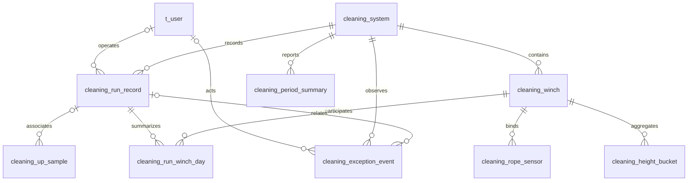

# 从页面字段倒推的数据库设计

日期：2026-10-25。已结合《前后端职责与页面接口修订说明_20261024》和新增《当前项目总结与详情拉力对比图数据处理说明_20261024》更新。本文是方案，不是已执行的建表或迁移；当前数据库仍为7表基线。

新版点位、M50急停和历史保存规则见[新版统一方案](../unified-plc-business-and-data-plan.md)；新页面职责、公共编号、单位和接口修订见[前后端对接修订](../frontend-backend-contract-alignment.md)。本文提供目标十表、字段、索引及页面查询设计，不把当前旧接口行为当成新的页面契约。

本次图表的分组、统一采样键、曲线统计与原始统计定义见[详情拉力对比处理方案](../detail-force-comparison-processing.md)，附件现状见[原文](../reference/detail-force-comparison-report-20261024.md)。

依据：上述两份修订说明、此前页面字段说明、当前后端代码，以及[实时、上行历史与详情口径](../realtime-upward-history-and-detail-plan.md)。新增附件报告前端仍在配对求和、取点和计算统计；本仓库没有该前端源码可独立核验，不将附件中的演示值、51/601点或测试结果当现场数据与后端验收。

边界：单PLC、四机八索；上行保存核心过程采样，正常下行不保存连续测量，下行异常保存事件点及必要快照；没有数据过期判断。现阶段RUN页面建议采用上行单程，不称为完整清洗轮次。

## 1. 从页面倒推，先分清哪些数据要存

| 页面需求 | 数据性质 | 处理方式 |
|---|---|---|
| 系统编号、对象名称、分组、阈值、维护日期 | 稳定档案/配置 | 存设备配置表，有来源才填写；额定载荷/额定速度已退出本次页面需求 |
| 当前状态、方向、拉力、高度、速度 | 当前事实 | 清洗服务最新快照供首页每秒推送；单机详情主动查询快照，不为每个页面建立实时表 |
| 已保存参数、已确认生效参数、当次设定速度 | 版本化配置及历史快照 | 区分平台保存和设备生效；详情不拿实际速度或额定速度填设定速度 |
| 某次起止、结果、参数、曲线、异常 | 运行事实 | 主记录、上行采样、异常事件分别保存 |
| 本机本次平均、极值、累计运动 | 运行摘要 | 保存可合并的设备分日摘要，避免反复扫原始帧 |
| 今日次数、月/年结果、平均曲线 | 周期统计 | 后台预计算并保存，查询直接读取 |
| 状态/结果中文、实际名称、总拉力及统计 | 后端业务结果 | 根据真实配置、事实和规则生成；历史保留必要来源快照，前端不推导 |
| 字体颜色、显示小数位、图例与分页交互 | 前端展示 | 不建业务表；前端可做明确单位格式化，不重算业务结论 |

首页、单台详情和历史详情读取同一份事实，不各存一套重复运行数据。正常下行仍可实时查看，但不能提供未保存的完整历史曲线、原始导出或全程峰值。

新增附件的模拟平均包含上下行及回退；正式统计继续只取PRODUCTION_UP，其他UP用途留原始、正常DOWN不补存。图表的“全部次数”是多组叠加展示，右侧取点与统计属于当前unit，不能按全日所有组重新计算。默认分组defaultUnitId由后端查询结果确定，不为页面默认选择增加数据库状态表。

正式页面由`/api/command-center/...`按`systemCode`查询，具体契约见[对外接口说明](../external-api-contract.md)。当前`/api/cleaning/devices/{deviceId}`仍是已实现代码的设备接口，不继续作为新页面历史设计的另一套入口。

## 2. 建议的目标结构：10张业务表

复用现有账号与三张拓扑表，增加六张历史/统计表。重算标记放在周期表，无需另建任务表。迁移期原三张批次历史表另外保留，因此实际表数会暂时多于目标结构，本文不删除旧表。

这里“无需另建任务表”指统计重算。导出记录列表另需`cleaning_export_task`技术表，目标为10业务表＋1导出任务表；字段及流程见[导出方案](../data-export-plan.md)。文件本体使用持久文件存储，不放数据库BLOB，当前7表不因设计而变更。

| 表 | 一行表示什么 | 对应页面 |
|---|---|---|
| `t_user`，沿用 | 一个登录账号 | 可验证后台操作的身份 |
| `cleaning_system`，扩展 | 一套系统与PLC绑定、版本化参数 | 首页档案、系统上下文、参数查询 |
| `cleaning_winch`，扩展 | 一台动力设备 | 单机档案/配置 |
| `cleaning_rope_sensor`，扩展 | 一个逻辑钢绳位置与传感器绑定 | 两索身份/阈值 |
| `cleaning_run_record`，新增设计 | 一次已识别的上行记录 | 列表、当前/上一条、单次概况 |
| `cleaning_up_sample`，新增设计 | 一帧选中归档的上行测量 | 原始曲线、悬停、明细导出 |
| `cleaning_run_winch_day`，新增设计 | 一次运行、一台设备、一个采集日、一个运动用途的摘要 | 本机本次统计、跨日时长、参与记录去重 |
| `cleaning_exception_event`，新增设计 | 一次事件及有限快照，告警是其中明确标记的业务视图 | 告警中心、上/下行异常历史，不恢复旧通用告警表 |
| `cleaning_period_summary`，新增设计 | 系统或单机的一个自然周期结果 | 日/月/季/半年/年卡片、日期目录 |
| `cleaning_height_bucket`，新增设计 | 某周期、本机、某来源、一个高度区间的统计 | 高度—拉力平均曲线 |

概念关系如下，不代表每条关联都要求物理外键：

## 3. 身份、单位和时间约定

- 内部仍沿用`system_id、device_id、winch_id、rope_id、tension_sensor_id`及其现有关系，不将通信身份改成页面编号，不恢复盒子身份。
- 页面公共编号为`systemCode、winchCode、sensorCode`，分别映射`system_code、winch_code、sensor_code`。例如QJXT-01是系统公共编号，不是四台设备共用的内部键；WJ-01、PS-01也是配置值，不按数组位置或后缀猜身份。公共编码的唯一映射由服务端完成，响应、推送、命令和导出使用同一编号。
- 新运行建议使用紧凑的`BIGINT UNSIGNED`内部主键及唯一公开`record_code`。页面`id/recordCode`用公开编号，采样关联内部键，避免每帧重复长编号。
- 采样内部自增ID只用于数据库定位；重放去重使用稳定的`device_id + capture_id + sample_seq`，采集实例跨重启不复用，重放沿用原标识。
- 库内统一kg、m、m/min；电机存公式对应的等效kg及必要原值，不标成N·m。新页面接口由后端输出t；前端切换kg时按明确单位格式化，不能把已为t的数值再除1000。当前旧设备接口输出kg属于代码现状，不能混入新契约。
- 时刻用`DATETIME(3)`保存UTC，应用与连接显式使用UTC；业务`DATE`按`Asia/Shanghai`计算。`DATETIME`类型本身不保存时区。查询使用开始包含、结束不包含。
- 不校验采集时间的早晚、年龄或与当前时钟的偏差，不因缓冲延迟、跨日或早于上一帧而拒收/丢弃。时间列只用于记录、查询、曲线位置、历时和日历统计；唯一采样标识负责去重，不以时间作数据有效性条件。
- 数据库可空字段保存NULL，新页面声明的可空字段保留键并明确返回JSON null，不能沿用当前NON_NULL序列化的省略行为。正常下行未归档、传感器无效和配置未取得分别说明；有效0保留。下面数值类型为建议存储精度，不代表现场精度或机械范围。
- 页面五态的待机名称统一为`IDLE`；当前代码`STANDBY`需要在实施中适配。数据表保留PLC原始状态及业务规则来源，不能将修改页面枚举理解为改写PLC码或以时间推断离线。

## 4. 现有三张设备表如何扩展

保留现有身份、绑定和唯一约束，不为页面复制第二套设备档案。

| 表 | 保留字段 | 建议补充的页面配置 |
|---|---|---|
| `cleaning_system` | `system_id、device_id、tank_id、ring_id、ring_own_weight_kg` | `system_code、system_name、configured_height_m、height_limit_min_m、height_limit_max_m`及下述参数版本/快照 |
| `cleaning_winch` | `winch_id、system_id、slot_no` | `winch_code、winch_name、last_maintenance_at` |
| `cleaning_rope_sensor` | `rope_id、winch_id、slot_no、tension_sensor_id` | `sensor_code、sensor_name、business_role、installation_position、warning_threshold_kg、protection_threshold_kg、threshold_version、threshold_rule_snapshot` |

名称/编号用VARCHAR；高度建议DECIMAL(10,3)，拉力DECIMAL(14,4)，速度DECIMAL(10,4)，维护时间DATETIME(3)。`system_code`唯一；`(system_id, winch_code)`唯一；`sensor_code`唯一并通过钢绳位置关联本机。公共编号选定后保持稳定，名称变化不改变内部关联。

此前拟议的`display_code`改由`system_code`表达公开系统编号，不再同时保留两套含义相同的页面系统编码。若未来迁移来源已有display_code，应显式映射而非自动猜值。`tank_id`只是现有内部关联，不作为页面systemCode的默认替代。

`rated_load_kg、rated_speed_mpm、monitor_min_kg、monitor_max_kg`不再作为本次页面要求新增的列；这不授权删除已有数据库扩展列或历史数据。预警/保护各自使用明确配置及规则，缺少配置保存NULL，不填27m、30m、1.4t等显示/示例值。

阈值版本及有限规则快照记录实际比较含义、适用对象和已确认生效范围，不能仅凭字段名补出未知上下限算法。清洗模块根据配置与PLC事实返回传感器最终状态、中文说明和缺失原因；配置不全时不能以0阈值或“没有配置”等同正常。若无依据判断状态，应明确未确认，不影响其他真实有效测量的保存。

页面目前只有最近维护时间，先不增加维护工单体系；需要维护历史再扩展。单机独立限位有明确需求和配置时再增加，不复制系统限位冒充本机实测。

PLC连接地址与轮询参数继续按现有接入配置管理。页面阈值不代表已经支持写PLC保护参数，也不因此开放新控制接口。

### 4.1 三参数的保存与生效

为保持目标表数量，当前系统参数在`cleaning_system`内存储有限版本快照，不新增另一套设备配置表：

| 字段组 | 作用 |
|---|---|
| `settings_saved_version / settings_saved_snapshot / settings_saved_at` | 平台已成功保存的版本、三参数值与保存时刻 |
| `settings_applied_version / settings_applied_snapshot / settings_applied_at` | 经过已明确设备反馈确认生效的版本与值；未确认时可空 |
| `settings_apply_state / settings_message / settings_source_snapshot` | 保存、下发、未确认或生效的真实阶段，以及来源/反馈证据的有限快照 |

版本建议BIGINT；参数快照只放启动时间、运行间隔、运行速度及明确单位/规则版本。内部间隔可继续统一秒；页面`intervalMinutes`与内部秒数由后端转换。页面`speedMPerMinute`和详情`setSpeedMPerMinute`均为设定速度，不读取D61～D65实测速度来补值。

`setSpeedMPerMinute`作为成功详情的必返有效配置，应取已确认适用版本中的设定速度及作用范围。平台保存但设备尚未确认生效时，不覆盖已确认生效视图；从未取得有效设定值时不能用0、默认值或额定速度满足字段要求，应返回配置尚未就绪的明确结果。具体响应由接口契约统一。

尚未明确D100～D103、D105～D108的编码和读回关系，本轮不填映射，也不宣称这些参数已经联通。未来确认生效需要数据库快照和设备反馈共同闭环；当前仅内存设置视图不满足本设计。保存时刻、确认时刻只记录配置事实，不增加采集数据时间校验。

## 5. 运行主表：直接支撑列表与七个概况

### `cleaning_run_record`

| 字段 | 建议类型 | 含义 |
|---|---|---|
| `id / record_code` | BIGINT UNSIGNED主键 / VARCHAR(64)唯一 | 内部关联与页面公开编号 |
| `system_id / device_id` | VARCHAR(64) | 所属系统、PLC来源 |
| `record_use / mode` | VARCHAR，允许未确认 | 生产/检修/回退等用途与AUTO/MANUAL模式，不混为启动方式 |
| `started_at / ended_at` | DATETIME(3)，可空 | 已确认实际边界，进行中不填未来结束时间 |
| `first_observed_at / last_observed_at` | DATETIME(3) | 首次/最后观测事实，不冒充未知实际起止 |
| `business_date` | DATE，可空 | 已确认开始时刻的北京时间日期，用于计数归属 |
| `state / result / termination_reason` | VARCHAR业务枚举 | 是否结束、是否确认完成、真实退出原因分开；清洗模块负责最终判定 |
| `start_method` | VARCHAR(24)，可空 | 有实际来源才填，不从AUTO推定定时 |
| `operator_user_id` | BIGINT，可空 | 可验证后台操作账号，现场动作不套用在线用户 |
| `rope_min_kg / rope_max_kg` | DECIMAL(14,4)，可空 | 本次PRODUCTION_UP有效钢绳极值，不含回退/检修、电机、总拉力、下行快照 |
| `abnormal_count / has_data_gap` | BIGINT UNSIGNED / BOOLEAN | 属于本次的异常数、已知数据缺口，不是过期判断 |
| `parameter_snapshot / identity_snapshot` | 有限JSON对象 | 开始时已确认的参数值/生效版本、作用范围；当时公共编码/名称与内部身份映射、单位/换算规则版本 |
| `result_rule_version / result_snapshot` | VARCHAR / 有限JSON，可空 | 形成结果的实际规则版本和依据；必要的历史说明保留来源，不拿当前状态重算旧结果 |

本版`kind=RUN、recordScope=LEG、directionScope=UP`由接口约定输出，不必每行重复常量。一次系统同步上行是一条系统记录，四台参与不变成四次系统运行。

`durationSeconds`由已知起止相减，格式化时长不入库；有效运动时长另读分日摘要。列表常用极值和异常数存派生摘要，避免每页十条都读取十份原始曲线。

后端返回`runResultText、endReasonText、startMethodText`及本次设定速度、间隔等直接展示字段；文本根据保存的结论码、规则版本及历史快照生成，前端不从事件数组推测结果。无来源的启动方式或参数显式返回null及说明；不以当前已修改参数补写旧记录，不为历史处理次数制造0或五次。

单条RUN的`runCount=1`及各结果计数0/1由结构化结果生成，不在主表重复保存一整套周期计数字段。开始未知时不造`started_at/business_date`，按首次观测在边界未确认范围查询，不混入已确认开始日计数。

## 6. 上行采样表：一帧一行

### `cleaning_up_sample`

| 字段 | 建议类型 | 含义 |
|---|---|---|
| `id` | BIGINT UNSIGNED主键 | 内部采样键 |
| `device_id` | VARCHAR(64) | PLC来源 |
| `capture_id / sample_seq` | BINARY(16) / BIGINT UNSIGNED | 稳定采集实例与序号，组合去重 |
| `record_id` | BIGINT UNSIGNED，可空 | 已确认业务归属，不强挂最近一条记录 |
| `sampled_at / received_at` | DATETIME(3) | 采集时刻/入库时刻，统计使用前者 |
| `group_speed_mpm` | DECIMAL(10,4)，可空 | 独立保存同步速度 |
| `system_state_code / wN_state_code` | SMALLINT，允许缺测 | 实际D201与D203～D206原码，状态缺测不当离线 |
| `wN_archived`，N=1…4 | BOOLEAN | 本帧本机上行测量是否归档 |
| `wN_motion_role / wN_segment_code` | VARCHAR(24) / VARCHAR(64) | 本机生产、回退、检修、未确认上行用途及连续分段；后端分类，不是猜PLC阶段码 |
| `wN_height_m / wN_speed_mpm` | DECIMAL(10,3) / DECIMAL(10,4)，可空 | 本机高度与独立速度 |
| `wN_rope1_kg / wN_rope2_kg` | DECIMAL(14,4)，可空 | 两根钢绳各自测量 |
| `wN_motor_raw / wN_motor_force_kg` | BIGINT / DECIMAL(14,4)，可空 | 正确解码原值及已明确公式的等效力 |
| `wN_quality` | SMALLINT UNSIGNED，通道质量标记 | 返回页面时展开到各通道，不是PLC寄存器编码 |
| `mapping_snapshot` | 有限JSON，可空 | 无记录或与记录快照不一致时保留必要公共编码、名称、内部身份/换算规则来源 |

`wN_...`落地时展开成四组固定数值列，不是一列自由拼装测量JSON。小型身份/规则快照可以JSON，核心曲线保留数值列。

混合方向仅归档UP正常测量，正常下降通道标记未归档；下行异常另存事件快照。上行某通道无效，保留质量和其他有效通道。

同一生产记录内也可能包含RECOVERY_UP，不能仅用主表record_use判断样本用途。默认生产摘要/平均只取本机PRODUCTION_UP；其余上行原始保留，不增加生产次数。

有真实依据修正用途时保留原采样标识/PLC事实，重建旧/新角色摘要、主记录生产极值及受影响周期，不复制原始点，不让旧用途统计残留。

同步速度和本机独立速度分别保存，只在工况已明确时选择适用值，不无条件复制整组速度冒充四个独立实测。帧标识只表示采集关联，采集实现仍须满足明确一致性口径，不能擅自设置同步容差。

两索总拉力由后端以已明确的同帧、本机、方向、用途和通道有效性证据配对，再输出`ROPE_TOTAL`序列、质量及统计；不能靠相同高度或最接近时间补配。配对不成立时总拉力为null，原两路有效值仍保留。用于核对配对的来源事实不构成采样时间年龄/早晚校验，也不删除没有合计条件的原始采样。页面统一使用`sampleKey`，取代此前未实施的pointKey；按稳定帧、本机和分段关联生成，同一unit各来源共享可对照键，不因高度相同复用其他经过的键。sampleFrameId仍指实际帧，不与页面键合并，也无需为改名另建采样表。

总拉力点的速度来自该帧本机已确认适用速度，未知为null，不相加两索速度或默认复制钢绳1。周期总力速度只合并配对集合内有效速度的和/数量，其有效数可以少于有效拉力数。GOOD/PARTIAL仅在该测量有有效依据时计数，合法0正常保留；原始点sampleCount有效为1、无效为0，聚合点为真实有效数，缺失不按1补权重。

不能只保存整米点：真实时间、速度、峰值和原始导出都依赖过程采样。高度桶用于统计/展示，不覆盖原始帧，不为0～30m补点。断线、换向或回退后的片段不能按高度排序串成同一条连续实线。

## 7. 运行设备分日摘要：处理单机与跨天

### `cleaning_run_winch_day`

主键建议`(record_id, winch_id, stat_date, motion_role)`，日期为采集/已确认运动区间所属的北京时间日期，用途按每台实际归属拆分。

| 字段组 | 内容 |
|---|---|
| `record_id、winch_id、stat_date、motion_role` | 一次运行、本机、一天、一个用途；跨午夜或用途不同分别成行 |
| `first_sample_at / last_sample_at` | 实际参与采样范围 |
| `motion_duration_ms` | 可空，当日本用途可靠上行区间毫秒数；未知不填0，不与其他用途混算 |
| `height_min_m / height_max_m` | 本机当日实际高度范围 |
| `rope1_* / rope2_* / motor_* / pair_*` | 各自的`sum_kg、valid_count、min_kg、max_kg`，pair仅来自同帧两索均有效集合 |
| `speed_sum / speed_valid_count` | 适用速度自己的有效和/数量 |
| `curve_rope1_count / curve_rope2_count / curve_motor_count / curve_pair_count` | 同时有有效本机高度并满足UP曲线规则的各来源样本数 |
| `curve_rope1_* / curve_rope2_* / curve_motor_* / curve_pair_*` | 与上述count同一集合的sum_kg、min_kg、max_kg；支持完整COUNT曲线统计，不能直接套用包含缺高度测量的原始摘要 |
| `pair_speed_sum / pair_speed_valid_count` | 配对有效拉力集合中、本机适用速度有依据的和/数量；速度未知不补0，也不沿用独立单绳集合 |
| `has_data_gap` | 已知缺口说明 |

数值和建议DECIMAL(30,6)，数量BIGINT UNSIGNED，单值极值DECIMAL(14,4)。同次详情合并本机少量分日行：和/数量求平均、极值分别取最小/最大，不平均平均值。

默认本次生产摘要、周期生产计数对应测量、有效运动时长和曲线均明确筛选PRODUCTION_UP；检修/回退工时另列用途。平均曲线仍保留有效异常峰值，不能因报警就删去生产测量。

高度缺失但拉力有效时，仍可参加记录拉力极值，却不能成为高度曲线点，因此一般测量数量与`curve_*_count`分开。未归属记录的原始上行采样保留，不自动混入生产计数/均值。

COUNT的series.statistics使用完整本机PRODUCTION_UP曲线集合，metricBasis=RAW_CURVE_SAMPLES，合并curve_*的和、数量及极值。series.rawStatistics使用原始rope1/rope2/motor/pair摘要，metricBasis=RAW_VALID_SAMPLES，保留缺高度但拉力有效的测量。两者均不随图表分页、图例选择或降采样改变。unit.ropeExtrema取两条单绳曲线集合的最大/最小，不含ROPE_TOTAL和SERVO；总拉力极值来自逐点配对合计后的pair集合，不能将单绳各自最大或最小相加。

本机今日次数按主表开始日及参与关系去重；不能因四台同步或跨日行数增加系统次数。某来源参与周期曲线的记录数，在目标采集日期内对`curve_*_count>0`的记录去重并预计算；一条运行跨两天，不能把两天各1条相加当月2条。

## 8. 异常事件表：下行仅在这里留事件点

### `cleaning_exception_event`

| 字段 | 规则 |
|---|---|
| `id / event_code` | 内部主键、唯一稳定公开事件编号，支持重放去重 |
| `system_id / device_id` | 系统、PLC来源 |
| `winch_id / rope_id / sensor_id / record_id` | 可空；定位真实动力设备、钢绳位置或触发传感器及可靠运行关联，系统事件不强填某一台 |
| `target_type / target_snapshot` | SYSTEM/WINCH/SENSOR等已明确对象类型及有限身份/名称快照；多对象事件快照记录相关对象，不复制成四起本机故障 |
| `source_kind / is_alarm` | 来源为PLC事实或已确定的后端规则；是否进入告警页面由业务规则明确，不把所有技术记录自动称告警 |
| `direction / fault_code / reason` | 实际方向、故障码/原因，不从曲线峰值推断 |
| `occurred_at / occurred_at_source` | 可空的真实发生时刻及事实来源；只有首次观测时不冒充实际发生，未知保存NULL |
| `first_observed_at / recovered_at / terminated_at` | 已观测触发、恢复、终止时刻；没有依据为空 |
| `outcome` | 真实恢复/退出事实，允许未确认 |
| `alarm_state / archived_at` | 告警是否确认恢复与归档时间分别保存；事件终止、已归档均不能自动证明恢复 |
| `category / severity / threshold_kind` | 已确定规则提供的类别、级别、阈值类别；无来源允许空，不根据中文关键词补猜 |
| `trigger_value_kg / threshold_kg / threshold_version / threshold_snapshot` | 触发读数、当时适用阈值、版本及有限配置/生效范围快照；非拉力告警无相应值时为空 |
| `rule_version / explanation_snapshot` | 形成类别/级别/状态结论的规则版本及必要说明来源；支持categoryText、levelText、stateText、handlingText、thresholdKindText的后端输出 |
| `trigger_snapshot / recovery_snapshot / termination_snapshot` | 有限JSON，仅事件点的高度、拉力、速度、电机、质量，不放连续采样数组 |
| `operator_user_id` | 仅有可验证后台操作时填写 |

无PLC准确发生时间时occurred_at为NULL并说明首次观测，不冒充精确物理发生时刻。查询与事件日期统计使用已确认occurred_at，否则使用first_observed_at；同一规则用于列表、周期和导出，不校验采样时间新旧。通信失败没有测量时快照可空，不造全0。

同一异常持续十秒仍是一条事件，恢复后再次出现才新建。下行事件可没有上行record_id，系统异常入口按设备/时间仍可查询；结束后的独立下行事件不反向改写上行结果。

该表同时支撑新的告警中心，`alarmCode`可以映射同一稳定event_code，不再增加另一份通用`t_alarm`或复制一套告警事实。只有`is_alarm=true`的数据进入告警计数；业务异常事件数、告警数和处理尝试数分别命名。无已确认告警规则时不补分类、严重等级或自动保护算法。

单个传感器故障关联该sensor_id及当时对象快照，不因此宣称本机电机故障；系统共享急停的影响作为已确认业务原因展示，仍保留各机原码。传感器更换后，旧事件的名称、阈值和传感器身份继续读触发快照，不用当前绑定覆盖。

`activeCount`统计本系统全部历史中已经触发、尚未确认恢复的告警，包含恢复未确认部分；另给`recoveryUnconfirmedCount`说明不确定范围。`seriousActiveCount`只计算其中已有明确严重级别的部分，等级未知不猜严重。当前未恢复列表同样不被TODAY/7D历史日期条件截掉；历史视图才按实际事件日期筛选。

`todayCount`按今日实际发生/首次观测统计，`todayRecoveredCount`按今日明确恢复统计，后者可以包含此前发生的告警。统计卡片固定全系统口径并回传，列表可另按设备、传感器、类别和历史范围筛选；前端不能把当前页total当全系统未恢复数。列表和统计由后端读取同一查询快照，返回asOf；这不是改变采集时间或判数据过期。

不建无来源的处理次数或五次尝试明细。D3=50留实际故障含义，不自行补出五次过程；真实急停/中断退出也不要求先凑五次失败。

## 9. 周期统计表：报表、计数、日期目录

### `cleaning_period_summary`

同一张表覆盖系统/单机及日/月/季度/半年/年。

| 字段组 | 内容 |
|---|---|
| `system_id、scope_kind、scope_id` | 范围仅SYSTEM/WINCH；scope_id非空，分别为真实系统/动力设备ID |
| `period_type、period_start、period_end` | 自然周期类型，按北京时间计算后存UTC，左闭右开 |
| `run_count` | 本周期确认开始的生产上行数 |
| `completed_count、normal_completed_count、recovered_count` | 上述记录中完成、正常、异常恢复后完成的数量 |
| `terminated_count、ongoing_count、unconfirmed_count` | 明确终止、仍进行、结果未确认的数量 |
| `up_event_count / down_event_count / stopped_event_count / unknown_direction_event_count` | 按已确认发生/首次观测日期统计，与记录计数分开；已知停止和未知方向分别留存 |
| `motion_duration_ms` | 落在本周期内的可靠上行运动区间合计 |
| `rope_min_kg / rope_max_kg` | 本周期采集日期内有效上行钢绳极值 |
| `rope1_* / rope2_* / motor_* / pair_*` | WINCH范围各来源sum_kg、valid_count、min_kg、max_kg等可合并统计，提前供页面statistics及归档比较使用；不从曲线缩减点反推 |
| `curve_any_record_count / curve_rope1_record_count / curve_rope2_record_count / curve_motor_record_count / curve_pair_record_count` | WINCH范围曲线组及各来源参与本期曲线的去重记录数；组数量按来源并集去重，不相加各来源数 |
| `data_from / data_through / has_data_gap` | 已纳入的数据范围与已知缺口，不用于过期判断 |
| `rule_version、rule_snapshot、computed_version、requested_version、needs_rebuild、built_at` | 规则版本与有限规则快照、计算版本及持久重算标记 |

唯一键`(system_id, scope_kind, scope_id, period_type, period_start)`。不以`winch_id=NULL`代表系统构造可空唯一键，否则MySQL可能允许重复系统周期行。

**归属分开：记录计数与结果按开始日；测量/曲线按采集日；事件按实际可确认发生/观测日；时长按区间交集拆分。** 例如22日23:58开始、23日00:08结束，结果回填22日记录组；可靠运动时长拆为两日2/8分钟，采样各归实际日期。

周期测量摘要可合并设备分日摘要，因此不会把跨日整条记录的极值全归开始日；没有高度的有效拉力也不因未进高度桶而遗漏。单机参与曲线的记录数从轻量分日摘要去重，不能相加每日参与数。

系统同步运行次数不相加四台设备行。系统运动历时与四台设备工时合计分别命名。单机累计小时读取不重叠的“已结束年＋当前年已结束月＋当前月已结束日＋当日”运动时长，除3600000，不把年/月/日重复相加，不由采样数乘固定间隔推算。

本版没有独立、可持久重建的系统上行运动区间来源时，SYSTEM范围的motion_duration_ms为空；四台日总量既不能求和当系统历时，也不足以还原区间并集。WINCH范围默认只累计PRODUCTION_UP，未知部分保留覆盖说明，不能让SUM忽略NULL后冒充完整累计。

原始数据/事件/结果提交时，同事务将受影响日范围标记待更新并推进requested_version。后台重建日结果/高度桶，提交时推进计算版本并标记上级周期。若期间又有数据，保留后续重算标记，不清掉新工作。

无需新增任务表。首次未算好的built_at为空，显示统计准备中，不把占位行当0次。历史月份提前生成保存，查询只读结果；补传或结果变化仅重算受影响范围，重试覆盖结果而非在旧总数上再加一次。

“数据归档”页面的变化图、左右比较序列和summary由统计模块从已保存周期/分日摘要准备。自选范围保留左图、当前和参考三组完整边界；后端回传实际范围和对应轴，不让浏览器按数组下标拼接。同比采用接口约定的真实同期，不能把整年和今年截至时刻混作等长比较；无参考数据、参考均值为0或覆盖不足时，变化率为null并说明。历史月份继续复用已算结果，不以页面一次请求为由重新扫描全年原始帧。

## 10. 高度统计表：为附件平均曲线单独设计

### `cleaning_height_bucket`

| 字段组 | 内容 |
|---|---|
| `system_id / winch_id` | 实际系统、本机身份 |
| `source_role` | SENSOR1/SENSOR2/SERVO/ROPE_TOTAL，配对总力单独累计；此前方案PAIRED_SUM统一映射为ROPE_TOTAL，本表尚未实施 |
| `period_type / period_start / period_end` | 日/月/季度/半年/年实际范围 |
| `height_rule_version / bucket_index` | 明确的高度分箱规则与区间编号 |
| `height_from_m / height_to_m` | 统计高度边界，不是机械限位 |
| `sum_kg / valid_count` | DECIMAL(30,6)建议 / BIGINT UNSIGNED，有效和与数量 |
| `min_kg / max_kg` | DECIMAL(14,4)，该桶原始有效值极值 |
| `speed_sum / speed_valid_count` | 对应速度自己的和与数量 |
| `data_from / data_through / computed_version` | 实际参与范围、结果版本 |

唯一键`(system_id, winch_id, source_role, period_type, period_start, height_rule_version, bucket_index)`。按定义只聚合UP，生产用途/有效性/分箱规则固定在规则版本中。换规则需重建受影响结果，查询不能混合两个版本。

宽度依据确认的测量精度配置，本文不猜现场数值。平均=sum/valid_count，合并日/月保留和/数量/极值，不等权平均均值。配对总力只用同帧两索均有效集合，不把独立均值直接相加。

周期曲线按逻辑钢绳位置/电机角色聚合；更换传感器时，不能用当前sensorId冒充整个历史的物理来源，具体原始身份从记录/采样快照追溯。

`points[].sampleCount`来自桶内该来源的有效数量；unit.includedRunCount来自`curve_any_record_count`，unit.sourceIncludedRunCounts分别映射各来源去重记录数。目标页面不再用units.sampleCount表示运行数，也不并列保留旧recordCount别名。统一对比一次准备四来源及统计，前端切换图例只选择已返回结果，不相加各来源次数或重算并集。

PERIOD的series.statistics明确metricBasis=HEIGHT_BUCKET_MEANS：averageTension为完整基础高度桶的sum之和/count之和，validSampleCount为相应有效原始样本数，maxTension/minTension为这些非空基础桶均值的最高/最低。series.rawStatistics另从周期原始摘要返回metricBasis=RAW_VALID_SAMPLES及瞬时原始极值，含缺高度有效测量，不拿桶内min/max冒充“最高/最低平均”。ROPE_TOTAL的桶独立累积共同有效配对集合，不将两个独立单绳均值直接相加。

基础高度规则版本固定，右侧统计和unit.ropeExtrema依据完整基础桶集合；PERIOD的ropeExtrema取两条单绳基础桶均值集合的极值并标明同一metricBasis，不含总力/伺服。为显示预算合并桶、分批加载或减少曲线点，不改变这些统计。后端可直接在已预计算基础桶上聚合均值极值，无需新增业务表，也不扫描全年原始帧。平均点sampleKey由unit、本机、规则/计算版本及桶定位关联，sampleFrameId/time为null，不能当作一个现场采样。

无样本高度为空，不按数组下标拼同高度，不造0线；平均点标为统计坐标，不能冒充真实采样时间/高度。

单次顶部极值、周期原始测量极值、平均曲线各桶均值的极值三者分开，默认均按已明确的生产UP范围，不纳入回退/检修。不能从已简化图表反推原始极值。已结束月份的高度统计提前保存，不能用时间桶平均代替高度桶。

## 11. 页面字段与数据库逐项对应

| 页面字段 | 来源 | 接口处理 |
|---|---|---|
| `systemCode / systemName / systemHeight` | `cleaning_system.system_code / system_name / configured_height_m` | 公共编号映射真实内部系统，配置高度与当前高度分别命名，不默认TANK-03 |
| 首页状态/方向/当前拉力高度速度 | 最新业务快照＋已确认配置 | 上下行每秒完整推送，状态/质量/说明均由后端给出，不轮询数据库最新一行 |
| `systemCurrentHeight` | 独立系统/机构高度来源 | 无来源返回null及说明，不拿四机均高冒充 |
| `winchCode / winchName / groupNo` | `cleaning_winch`公共编号、名称、slot_no | 服务端解析内部winch_id，直接返回名称；额定载荷/速度退出本次页面字段 |
| `sensorCode / sensorName / metric / alarmThreshold / safetyValue` | `cleaning_rope_sensor`及有效阈值版本 | 后端返回真实身份、t单位阈值及状态结论；前端不根据读数与阈值推导 |
| `maintenanceAt` | `cleaning_winch.last_maintenance_at` | 无来源显示暂无数据 |
| `setSpeedMPerMinute` | `cleaning_system.settings_applied_snapshot`及已确认作用范围 | 成功详情必返真实有效设定速度；无值返回配置未就绪，不用实测速度或默认值填补 |
| `ROPE_TOTAL / torqueForce` | 最新快照或相应历史事实 | 后端两索严格配对求和并返回质量；电机独立反馈，不用两索之和替代 |
| `todayCompletedCount` | DAY＋WINCH周期行 | 今日开始的上行中确认完成的数量，不改成所有今日结束记录 |
| `runningHours` | 不重叠周期PRODUCTION_UP运动时长 | 明确已确认覆盖范围，不混入回退/检修或假称完整上下行累计 |
| 可选当前/上一条记录 | 运行主表＋本机参与关系 | 最小详情不强制这些未展示字段；确有用途时稳定排序，无记录返回null |
| 历史`entries / total` | 运行主表分页/条件计数 | 每页10条，按一次生产上行；不含无限原始曲线数组 |
| `availableDates / dataRange` | 真实记录日期目录或轻量主记录索引 | includeAvailableDates时返回全系统真实可查询日期，不受当前页/当前日期筛选截断；未确认边界单独说明 |
| 单次entry及结果中文、设定速度/间隔 | 主表＋历史参数/身份/结果快照 | 直接给最终结论、实际起止、时长和单位；不取当前参数补旧记录 |
| `sensors / servos / ropeTotals`曲线及statistics | 上行采样选定范围＋分日/周期摘要 | 后端准备四个来源、统计和配对点键；有界返回，缩放后取细节 |
| `series.statistics / rawStatistics` | 运行设备分日摘要或完整基础高度桶＋原始周期摘要 | COUNT完整可绘曲线与PERIOD基础桶均值统计分别标metricBasis；rawStatistics保留全部有效生产UP原始测量统计 |
| `unit.ropeExtrema / defaultUnitId` | 两单绳完整逻辑曲线集合／真实分组查询 | 后端返回单绳集合极值与默认组，不把全部次数叠图解释为右侧全日统计，不需新增表 |
| 悬停实际值和总力 | 指定记录/分段/帧的上行采样 | 后端提供sampleKey及已处理读数，前端不自行配对，不用别的时间拼同步读数 |
| `exceptionEvents / abnormalCount` | 事件表＋记录摘要 | 当前页长度与异常总数分开 |
| 独立下行异常 | 事件表DOWN事件 | alarm-dashboard以recordKind=EVENT、view=HISTORY分页查询，无上行记录关联或is_alarm=false也可发现，不画正常下行完整曲线 |
| 告警列表、类别/级别/处理说明、触发阈值 | 事件表is_alarm事件及触发快照 | 后端筛选、去重、排序、分页和结果解释；阈值变更不覆盖旧事件 |
| 未恢复/严重未恢复/今日发生/今日恢复 | 事件明确告警状态及发生/恢复事实 | 未恢复覆盖全部历史，归档不自动等于恢复；返回统计口径和asOf |
| 统一对比`units / series / statistics` | 运行摘要、周期摘要＋高度桶 | COUNT/DAY/MONTH/YEAR分组由后端准备；UP、来源、实际范围、数量、版本明确；无去年同期不造线 |
| 归档`changePoints / comparisonCurrent / comparisonPrevious / summary` | 已保存周期/分日统计 | 后端对齐两图、比较范围与变化率；分母0或无可比数据为null并说明 |
| 原始明细导出 | 后台读上行采样和身份快照 | 不用图表降采样结果代替原始数据 |

名称、rangeLabel、中文statusText、结果文案、缺失原因和entries包装由后端根据配置/事实准备；前端只做字体颜色、小数位、明确单位格式化、勾选和鼠标交互。progressPercent无可靠依据不生成，不用高度除30补造。首页取初始快照后每秒推送；详情和对比图为查询快照，不每5秒刷新，也不复用首页订阅偷偷更新详情。

全系统availableDates只由实际记录生成，不能用尚未计算的周期占位行补日期。可用主表`(system_id,business_date,id)`轻量索引按真实日期去重，或由保存器同步维护DAY目录中的真实记录存在标记；不扫描原始采样，也不从当前筛选结果推算完整日期。日期项目虽可覆盖多年，响应不携带对应原始采样。

## 12. 索引与受限查询

| 查询 | 建议索引/方法 |
|---|---|
| 公共编号解析 | system_code唯一键、`(system_id,winch_code)`唯一键、sensor_code唯一键；同时核对真实系统归属 |
| 系统历史倒序 | 主表`(system_id, started_at, id)`，常用结果筛选再按实际查询补组合索引 |
| 全系统可查询日期 | 主表`(system_id,business_date,id)`去重真实日期或同步维护的轻量DAY目录，不套列表日期筛选 |
| 单机当前/上一条及参与历史 | 分日表`(winch_id, record_id)`；主表EXISTS或先去重，防跨日重复 |
| 本次曲线 | 采样`(record_id, sampled_at, id)`，精确帧用稳定采样标识 |
| 设备原始时间范围 | 采样`(device_id, sampled_at, id)` |
| 采样重放去重 | 唯一`(device_id, capture_id, sample_seq)`，内容冲突要暴露 |
| 分日汇总/来源参与去重 | 分日表`(winch_id, stat_date, record_id)`，用途结合主表筛选 |
| 系统/单次异常时间轴 | 事件`(device_id, first_observed_at, id)`和`(record_id, first_observed_at, id)` |
| 当前未确认恢复告警 | 事件`(system_id,is_alarm,alarm_state,first_observed_at,id)`；按状态查询全部历史，不限定今日 |
| 告警历史及测点筛选 | 事件`(system_id,is_alarm,first_observed_at,id)`，按实际使用补`(sensor_id,first_observed_at,id)`或本机/类别索引 |
| 今日已恢复告警 | 事件`(system_id,is_alarm,recovered_at,id)`，只依据明确恢复事实 |
| 周期/高度结果 | 使用相应唯一键完整定位或前缀查询 |
| 后台待更新扫描 | 周期`(needs_rebuild, period_start)` |

主键已覆盖的索引不重复建立；原始表不为每个测量值都建索引。先取一页主记录，再批量取摘要，避免旧DAO逐段查多组测点的附加查询。

新页面曲线由统一对比/历史详情接口接收systemCode及本机、记录/周期和范围，后端准备来源序列与statistics，仍限制单序列及总响应点数。COUNT“全部次数”代表筛选集合，按接口的有界分组或续读契约交付并说明完整性；不能因页面希望“一次返回”就交付无限原始点。详情取消周期刷新，告警服务端筛选分页，大范围CSV后台生成，不把数据库全部交给浏览器。

## 13. 写入、迁移和当前缺口

拟议写入为：PLC有序帧 → 上层表示入口/大厅 → 清洗编排选择上行与异常 → 持久待保存缓冲 → 统计保存器/DAO短事务。事务处理采样去重、运行/分日摘要、事件与待更新标记，提交后确认缓冲消费。下层不回调上层，门面委派辅助类。

清洗模块负责状态、阈值结论、告警归属和记录结果，统计模块负责可靠保存、预计算、查询组合和导出；配置身份由设备管理/DAO提供。新增页面职责不增加第五个清洗业务服务。新页面的中文结论、ROPE_TOTAL、最终统计由对应模块辅助类准备，不能塞回前端或集中在服务门面。

待保存记录使用稳定的公开record_code关联。数据库暂时不可用时仍沿用该编号；DAO入库时取得内部主键再关联采样，不能在重试时生成另一条运行或因暂时没有自增ID而丢掉原有关联。

摘要只累计本次真正新接受的数据，或按确定范围重算覆盖；提交响应丢失后的重放不能重复增加次数、时长和数值之和。页面摘要与原始事实用一套权威口径维护，不各算一套。

采样大表不依赖逐行跨表外键维护生命周期，业务关联由同事务和稳定标识保证；轻量配置/摘要表可保留外键。未来分区须重新审阅MySQL唯一键/外键限制，不能保证现有键不变就直接按月分区。

当前三张旧历史表`cleaning_telemetry_batch、cleaning_telemetry_segment、cleaning_segment_measurement`只有批次/分段统计时，不能迁成假原始点或假高度曲线。实施先新增并验证新链路，旧数据按真实来源保留，审阅迁移后决定退役，不混写两套并称作同一权威。

当前转换器的单机方向仍沿用系统方向，混合方向归档前必须正确取得本机方向事实。当前实时缓冲还会合并旧帧，可靠历史须在覆盖前选出并接收上行/异常。这两项不是新增数据库表就能解决。

永久数据按实际上行归档时长、异常快照及摘要/高度桶/索引/备份估算，不假定恰好减少50%。上行原始与事件不自动删除；已确认入库的待保存文件可回收，不等于删除业务历史。

实施顺序：公共编号/对象名称及参数保存与生效来源 → 运行、采样、含告警快照的事件 → 分日摘要与列表/详情 → 周期/高度预计算与归档比较。未确认的上行完成点位、处理次数、启动来源、配对条件、阈值/保护和限位不补写算法。

本轮只形成表、字段、关联、索引和页面映射设计，没有执行建表、迁移、删表或修改后端实现。当前7表与真实接口仍按原代码运行。
