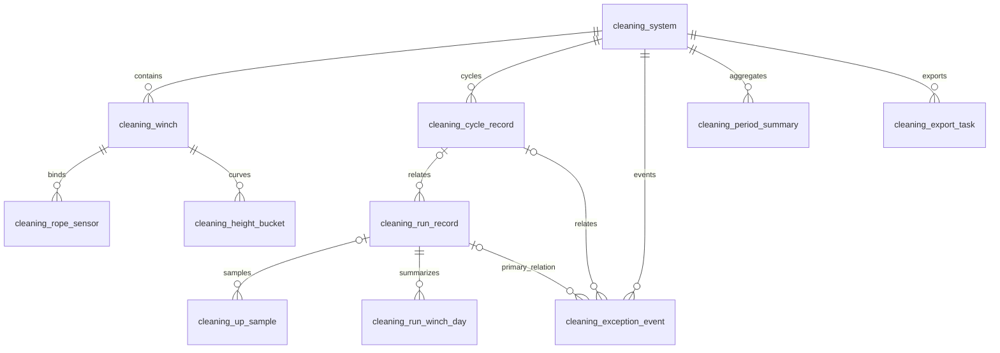

# 实时与历史数据库表清单及问题核对

2026-10-26后续定义以[M106整轮历史与统计](../updates/2026-10-26/realtime-history-statistics-overview.md)为准。当前主列表一条对应整个M106周期，不再以M204/D10或一次UP边沿划分；本页及较早17表设计中的上行/往返关系留待按此统一。本轮不修改SQL或数据库。

2026-10-26后续落实：现行SQL已扩展为17表，见[数据库实施清单](../updates/2026-10-26/README.md)。本页的“当前7表”和未生成DDL描述保留为2026-10-25审阅记录；当时7表定义已固定在`src/main/resources/db/legacy-compatible-base.sql`，不再用当前schema.sql反证旧状态。

最新补充：用户已选择每0.5m留上行历史点，并补充每机两传感器合计、系统八传感器合计、单次统计、月按日/季度按月/年按月或季度展示，以及统计/错误/远程操作日志。上行25～27m、最快10m/min、最短间隔30min、磁盘约1.5TB。详见[高度历史、周期统计与容量核对](height-history-period-capacity-20261025.md)。本页先前的全采集帧解释及“至少12表”还需按该补充形成最终DDL，不直接当成定稿。

日期：2026-10-25。依据当前仓库建表脚本、原目标数据库设计和本次PLC补充。本文供审阅，**没有执行建表、迁移、删表或查询现场数据库，也没有将建议当成已确定的DDL**。

最新口径：系统→4台动力设备→每台2个传感器；历史一次上行一条，关联所属往返轮次；M204表示自动上去再下来一轮完成；正常读点直接处理，连接状态由PLC TCP层提供；正常DOWN不保存连续测量，异常和必要边界留存。Unit ID=1，IP按局域网部署配置。

## 1. 仓库当前建表基线：7张

依据当时7表基线，现存[兼容快照](../../src/main/resources/db/legacy-compatible-base.sql)。下表反映评审时的仓库脚本，不声称现场数据库已经执行了相同结构。

| 表名 | 一行含义 | 当前主要列 | 后续处理 |
|---|---|---|---|
| `t_user` | 一个账号 | id、username、password、real_name、status、role_code、create_time等 | 复用；若显示真实最近登录，需另补来源/记录 |
| `cleaning_system` | 一个系统与PLC绑定 | system_id、tank_id、device_id、ring_id、ring_own_weight_kg、created_at | 扩展公开编号、名称和参数快照 |
| `cleaning_winch` | 一台动力设备 | winch_id、system_id、slot_no | 扩展公开编号、名称及需要的配置 |
| `cleaning_rope_sensor` | 本机一个索位与传感器绑定 | rope_id、winch_id、slot_no、tension_sensor_id | 复用每机两个位置；补公开传感器编号/名称 |
| `cleaning_telemetry_batch` | 一个旧历史保存批次 | device_id、batch_id、first_sequence、last_sequence、received_at | 迁移期保留旧历史，不作为新原始点主表 |
| `cleaning_telemetry_segment` | 一个旧历史分段 | device_id、batch_id、telemetry_sequence、session_id、round_no、direction、started_at、finished_at、start_height_m、end_height_m等 | round_no已存在，但未接按M204形成往返轮次的生产流程 |
| `cleaning_segment_measurement` | 分段中某通道的测量摘要 | metric_type、channel_no、target_id、minimum_value、maximum_value、average_value、latest_value、sample_count等 | 保留旧摘要；不能还原原始逐点曲线 |

既有关系：系统→动力设备→索位/传感器；批次→分段→测量摘要。当前没有独立的生产上行主记录、逐帧原始上行和完整往返实体。

## 2. 之前整理的目标：10业务表＋1导出任务表

原方案见[页面驱动数据库设计](page-driven-database-design.md)，不是已经执行的SQL。

| 序号 | 表名 | 作用 | 相对当前基线 |
|---|---|---|---|
| 1 | `t_user` | 登录账号 | 复用 |
| 2 | `cleaning_system` | 系统、PLC绑定和当前参数 | 扩展 |
| 3 | `cleaning_winch` | 动力设备档案及配置 | 扩展 |
| 4 | `cleaning_rope_sensor` | 两索/传感器身份与有效配置 | 扩展 |
| 5 | `cleaning_run_record` | 一次上行记录 | 新建方案 |
| 6 | `cleaning_up_sample` | 原始上行采样 | 新建方案 |
| 7 | `cleaning_run_winch_day` | 某上行、本机、某日、某用途的摘要 | 新建方案 |
| 8 | `cleaning_exception_event` | 故障/异常持续过程和有限事件点 | 新建方案 |
| 9 | `cleaning_period_summary` | 日/月/季/半年/年统计 | 新建方案 |
| 10 | `cleaning_height_bucket` | 按高度统计的曲线数据 | 新建方案 |
| 11 | `cleaning_export_task` | 后台导出任务及文件清单 | 新建技术表方案 |

## 3. 结合M204后，本次建议审阅的表结构

建议在上述结构中补一张独立往返表`cleaning_cycle_record`，形成**至少11张业务表＋1张导出任务表，共12张目标表**。这是本次评审建议；是否进一步增加事件关联、配置/命令审计表，取决于后续明确的需求，不为维持固定表数挤掉必要关系。

| 表名 | 建议主要字段组 | 与其他表的关系 |
|---|---|---|
| `t_user` | 沿用账号、密码哈希、角色、状态和创建时间 | 真实后台操作/导出创建者 |
| `cleaning_system` | system_id、system_code、system_name、device_id；settings_saved/applied版本、值与时间 | 一个系统包含4台动力设备和多个轮次；PLC IP/站号继续由接入配置管理 |
| `cleaning_winch` | winch_id、system_id、slot_no、winch_code、winch_name；维护日期、两路阈值saved/applied版本快照 | 每台归属一个系统，含2个索位/传感器 |
| `cleaning_rope_sensor` | rope_id、winch_id、slot_no、tension_sensor_id、sensor_code/name；当前有效阈值及版本 | 每个位置绑定一个传感器；历史另留当次身份快照 |
| **`cleaning_cycle_record`** | id、cycle_code、system_id、device_id、mode、started_at、ended_at、state/result、M204完成观测与来源标识 | **新增评审建议：一次完整往返。关联上行记录，承接M204** |
| `cleaning_run_record` | id、record_code、system_id、**cycle_id**、mode/用途、起止、结果/原因、参数/身份/换算快照、生产拉力摘要 | **历史一行一次上行**，cycle_id关联有依据的所属往返，不在M204到来时复制新上行 |
| `cleaning_up_sample` | id、device_id、capture_id、sample_seq、record_id、sampled_at；系统/本机原码、各机方向、编码器原值、连续计时、两路拉力原值和kg、力矩原值和等效kg、高度和速度 | **一批一行、四机固定列组**，由各台0.5m高度点触发并标记选中本机；其他有限上下文供同批系统总力，不构成完整DOWN历史 |
| `cleaning_run_winch_day` | record_id、winch_id、stat_date、motion_role；各来源和/数量/极值、有依据的运动时长 | 上行、设备、自然日和用途联合定位；派生数据可重算 |
| `cleaning_exception_event` | id、event_code、system/device/winch/sensor身份；D3和补充故障原码、起止、revision、对象/参数快照、必要触发/结束点；主归属record_id及**cycle_id** | 一次持续过程一个事件；TCP断开/恢复作为连接来源事件；单一归属无法覆盖多运行关联时需另定关联结构 |
| `cleaning_period_summary` | system_id、scope_kind/id、period_type/start/end；上行次数/结果、事件数、统计数值、重算版本 | 汇总统计；上行次数和往返完成次数应分开命名与来源，新增往返统计时另补对应列 |
| `cleaning_height_bucket` | system_id、winch_id、source_role、period_type/start、规则版本、bucket_index；sum/count/min/max | 保存派生高度统计，不替代原始采样 |
| `cleaning_export_task` | id、task_code、creator_user_id、system_id、export_type、filter_snapshot、state、snapshot_at、file_manifest、结果与时间 | 文件内容保存在持久文件存储，数据库记录任务和归属 |

### 原始点与边界数据需要补入的内容

原方案采样表已经提出系统/本机状态、四组测量和motor_raw，但**尚未完整列出本次给定的编码器原值、轴连续计时、原始拉力、每台上下行位及M204/D10/D16过程事实**。

- 每台归档UP测量：D53～D60对应编码器计数，D66～D69计时，两路D30～D37原值和拉力，D70～D73原值和等效力；方向与换算后的高度/速度保持关联。
- 系统过程：D201、D202原值、M3、D3；D10、D16在必要采样/边界留值。M204完成观测必须进入轮次/边界处理，即使该时刻处于正常DOWN结束、没有UP样本。
- D300～D307故障补充原码可放有限事件快照，具体码义待PLC提供。
- 四台底部值、字序等作为接入配置，历史用有限换算快照保留当次来源/值；不要求再建每次轮询都查询的标定状态表。
- 采样时间、采集编号和序号服务定位与重放；按用户要求，正常读点不增加缺失/未知/未标定等逐字段业务状态，也不增加采样时间年龄/早晚拒收规则。

M204事件的完整保存是核心设计要求。仅在`cleaning_up_sample`追加M204一列无法满足它，因为完成事件发生时可能只有下降结束；需保留当前轮次的完成观测与可靠来源。若PLC提供额外可重放边界事件，是否单列技术接收/边界表在DDL阶段决定。

## 4. 关系概览

图表示建议关系，不代表已经新增外键。跨轮持续事件不能因主归属改变而新增第二个event_code；若详情必须列出事件影响的每条运行，需评审运行—事件关联表或明确的时间重叠规则，不能在事件JSON里无限追加运行列表。

## 5. 目前发现的问题

| 优先级 | 问题 | 依据/影响 | 建表前处理 |
|---|---|---|---|
| 高 | 原10表方案没有独立完整往返实体或上行到往返关联 | M204已确认整轮完成，原run_record仅表达上行；旧round_no也没有对应新轮次实体 | 确定cycle表、run.cycle_id及独立完成事实，PLC起点/保持规则暂不猜 |
| 高 | 原始采样字段未收齐本次点位，完成边界不能只依赖UP表 | 会遗漏原始编码器/计时以及下行结束后的M204 | 明确逐点列、必要边界保存位置和稳定标识；旧摘要不迁成假原始点 |
| 高 | 采样粒度和关联还需最后对齐 | 原数据库方案一帧一行，导出一帧中一台设备一行；它们可由展开转换兼容。但宽表只有一个record_id，同帧若允许不同设备分属不同上行记录，单一关联不够；若改成每机一行，原唯一键(device_id,capture_id,sample_seq)又将冲突 | 确认同帧是否统一归属一条系统RUN；多RUN时需每机记录归属或关联结构。首版保持帧宽表或明确改粒度，每机行则唯一键同时加入winch维度 |
| 高 | 旧迁移脚本的职责与目标升级不同 | migrate_legacy.sql会预检并移除空的cleaning_exception_event/cleaning_round等旧同名表，有数据则拒绝；它不是新目标升级脚本 | 新增版本化、非破坏性迁移；新表上线后不能直接照旧清理流程重跑 |
| 高 | 建表本身不能解决内部帧覆盖和断电恢复 | 当前最新帧可覆盖，历史待保存仍为内存，旧DAO主要保存摘要 | 数据表、采样生产者、有序消费、持久接收及提交确认一起设计，不能只接Controller |
| 中 | 最新要求与旧文档逐字段质量设计未统一 | 原方案wN_quality/UNKNOWN/未标定业务描述，与用户本轮正常读点直接处理要求不一致 | 新DDL不机械照搬这些额外判断；只保留必要PLC原码和TCP连接事实，过程边界未确认另外处理 |
| 中 | 当前拓扑约束不足以单靠数据库保证4×2 | slot_no唯一但没有1～4/1～2范围；当前系统ring_id也仍强制存在 | 补必要槽位约束与一次性4×2初始化事务；既有tank/ring字段先保留兼容，是否为新初始化必填单独对齐 |
| 中 | 快照与命令审计范围要明确 | 当前方案只在拓扑表保存最新saved/applied快照，不等于完整配置变更和跨重启命令历史 | 本期原始/上行闭环先留当次快照；若实施控制审计，再决定单独记录/命令表，不虚称12表已覆盖全部控制生命周期 |
| 中 | 持续事件跨多条上行的查询关系未闭合 | 原方案单个record_id只保存主归属，但事件可跨RUN/跨轮 | 在关联表与明确查询规则中择定，保持事件唯一，避免异常数重复 |
| 中 | 新Controller路径需要同步纳入鉴权 | 当前安全链专门保护/api/cleaning/**，其他路径仍有permitAll回退；目标接口将使用/api/command-center/**等新路径 | 接Controller时同时接鉴权、实际系统权限和真实查询/存储，不能只新增路由 |

## 6. 表数量与迁移范围

- 当前脚本：7表。
- 原方案：10业务表＋1导出表＝11张目标表。
- 本次加入独立往返后的评审建议：11业务表＋1导出表＝至少12张目标表。
- 若4张账号/拓扑表复用扩展，并保留3张旧历史表，同时增加上述7张业务表和1张导出表，迁移期共有15张；以后是否退役旧3表须按实际数据来源审阅。
- 若最终需要独立事件多运行关联、可靠接收或命令审计表，数量会继续增加，不能以固定表数替代业务完整性。

当前未连接数据库，不能断言现场表数量。也不执行旧表清理、数据回填或将既有表结构直接覆盖。

## 7. 建议实施顺序

1. 审阅本清单并确定上行/轮次关系、采样粒度、原值字段及边界保存位置，形成具体字段/索引清单。
2. 编写新库建表草案与独立升级迁移，核对现有DAO兼容；在隔离开发库验证，保留旧历史。
3. 打通采集→上层业务整理→持久待保存→DAO事务→历史查询。未取得现场起止依据时保留已收到事实，不写假成功记录。
4. Controller的请求/响应和鉴权可并行准备，已完成的存储/查询接真实服务；未接通的接口明确未就绪。
5. 日摘要、周期/高度统计和导出随后分阶段实施。每阶段以实际读写与故障重放验证，不以Controller数量当成整体完成度。

数据库是当前可以先推进的工作，但不能把全部PLC边界信号确认留到最后。开始、结束、M204和中断归属决定记录如何生成，需与字段设计并行核对。
