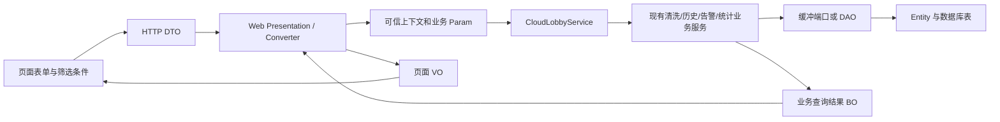

# 根据现有前端整理的 Java 云端类、表和表单设计

日期：2026-10-11。前端依据：`D:\javaweb\all\SmartWashCloud-Web`。目标后端：`D:\javaweb\all\SmartWashCloud-Server`。

2026-10-12 后续实施要求见 [盒子对齐要求入口](../CLEANING_BOX_ALIGNMENT_REQUIREMENTS.md)；云端新增数据访问以MyBatis-Plus为主、接口与手写实现分目录，参见 [开发约定](../CLEANING_SERVER_DEVELOPMENT_CONVENTIONS.md)。新3.0合同/目录仅为目标，本轮未迁移代码。

2026-10-12 基础表V1见 [数据库设计基线](../database/README.md) 和 [14表脚本](../database/cleaning_schema_v1.sql)：统一ID由云端生成、人工导入盒子，设备档案不走MQTT下发；原追加16表是完整历史草案，不应与V1混合执行。V1未执行数据库变更，也未接入全部DAO。

2026-10-12 最新讨论见 [完整数据流程与字段合同](END_TO_END_DATA_CONTRACT_20261012.md)：500ms采集、正常UP每0.5m保存真实点、正常DOWN不存测量曲线、下降异常单独保留、PLC自恢复不提前判故障。与旧曲线/存储建议冲突时以该最新口径为讨论依据；未实施的字段仍明确标注，不表示协议上线。

**本次交付是可实施的设计稿：逐页数据合同、可编译的 Java 模型参考、字段字典、建表草案和请求示例。尚未接入运行中的接口、DAO 或数据库，不能据此判断页面已能使用真实数据。**

## 1. 设计文件与适用范围

| 文件 | 用途 |
|---|---|
| [CommandCenterContractDraft.java](./CommandCenterContractDraft.java) | Java 17 的 DTO、页面 VO 及嵌套字段模型参考；位于 docs，后续按现有包拆分 |
| [field_dictionary.json](./field_dictionary.json) | 每个模型的字段名、Java 类型、业务含义、单位、来源及存储归属 |
| [business_model_inventory.json](./business_model_inventory.json) | 从当前源文件提取的15个已有业务/实体类，明确可复用字段 |
| [table_dictionary.json](./table_dictionary.json) | 与同份 SQL 自动对齐的表、列、类型、空值及业务含义 |
| [cleaning_page_schema_draft.sql](./cleaning_page_schema_draft.sql) | 基于现有基础表的增量表结构设计，不含演示种子数据 |
| [request_response_examples.json](./request_response_examples.json) | 参数转换、命令提交、未同步配置、历史响应和表单错误示例 |
| [validation.json](./validation.json) | 本次静态检查的范围及结果，不代表数据库执行或应用集成完成 |
| [SIMPLIFIED_TELEMETRY_AND_CURVE_PLAN.md](./SIMPLIFIED_TELEMETRY_AND_CURVE_PLAN.md) | 拉力上传与曲线筛选的简化讨论稿：先做真实点、单方向高度曲线和自然周期选择，不要求一次实现全部模型与16张表 |

首页、动力设备详情、历史列表/详情、告警、参数设置是本轮主范围。数据归档按已有实际页面设计。摄像头页目前调用本地 `MOCK_LIST`，用户管理仍是占位页，模型管理和数据分析为开发占位页：它们列入后续范围，不为尚无真实业务表单的页面批量生成 CRUD。

本稿复用项目的 Spring Boot 3.2.5、Java 17、现有 JDBC/MyBatis 使用方式和分层调用链。不替换模块、构建方式、缓冲中心或命令服务。现有 VO/DTO 中的大量旧设备模型不删除、不整体重命名；新页面使用有明确语义的专用模型。

## 2. 当前代码能确认的状态

| 核对项 | 当前实际情况 | 设计处理 |
|---|---|---|
| 前端入口 | `src/router/index.ts` 指向 `home`、`power-detail`、`history-list`、`history-detail`、`alarm`、`parameter-settings` | 以当前调用代码为准，旧页面设计文档作为业务参考 |
| 前端 URL | API 层主要使用 `/command-center/...`，实际还受 `CONFIG.apiBaseUrl` 影响 | 不把页面路由当后端 URL；联调时统一 API 层资源与地址映射 |
| 云端真实入口 | `CleaningWebService` 位于 `/api/cloud/cleaning/boxes/{boxId}`，有实时、配置、急停、命令状态查询 | 复用现有写操作与表示层；页面读模型补在同一受保护前缀下 |
| 已有 DTO/VO | `CloudCleaningSettingsDto`、`CloudSettingsUpdateDto`、`CloudEmergencyStopDto`；`CloudRealtimeVo`、`CloudSettingsVo`、`CloudCommandVo` | 不再创建重复的云盒操作模型；页面字段在 Converter 中适配 |
| 配置读取 | `CloudCleaningServiceImpl.settings()` 当前返回 `NOT_SYNCHRONIZED` 和空配置 | 必须取得盒子实际版本后才能编辑；演示默认值不代表当前配置 |
| 统计读取 | `CloudStatisticsServiceImpl.query()` 及轮次聚合/脏桶重算仍抛出未接入异常 | 本稿设计查询模型和表，后续才实现计算及 DAO，当前不返回模拟统计 |
| 基础持久化 | `JdbcCleaningDeviceDao` 已保存拓扑；`JdbcTelemetryHistoryDao` 保存批次、分段和逐通道摘要 | 保留现有6张基础表及调用；追加页面缺少的冷数据结构 |
| 历史模型 | 有 `CleaningSessionEntity`、`CleaningRoundEntity` 等实体和 DAO 接口，接口存在不等于 JDBC 实现完成 | 优先为已有 DAO 实现存储及查询，不另建平行业务服务 |
| 动力详情趋势 | 当前 `getCommandCenterWinchTrendUnitsApi` 在生产包装旧趋势为 `WHOLE`；DEV 才使用批次/周/月分组 | 新增明确的单位集合读取合同，返回真实单位/高度，不将降级包装当完整分组能力 |
| 历史详情冲突 | `systemHistory.ts` 和旧 `getCommandCenterRecordPageApi` 复用 `/command-center/history/detail`，期待不同响应 | 当前实际历史页采用 `SystemHistoryDetailVo`；旧归档详情单独迁移入口，不同结构不共用一条路径 |
| 参数表单 | 当前只有 `startTime/intervalMinutes/speedMPerMinute`，请求无盒子、requestId、expectedVersion | 目标从系统选择解析，保存复用云端已有配置 DTO，补齐幂等和版本 |
| 请求成功判断 | `src/utils/request.ts` 仅将 `res.code===200` 视为成功；云端命令在途返回 HTTP/body 202 | 前端允许202表示已提交，显示命令状态并查询回执，不能立即显示已生效 |

## 3. 分层关系和每类对象的职责

| 对象 | 应放入现有位置 | 包含什么 | 不包含什么 |
|---|---|---|---|
| Form | Vue 当前页面/API 类型 | 用户可编辑值、选择项、输入错误 | 数据库主键生成、可信操作身份、现场状态计算 |
| DTO | `dto/cloud` | HTTP 接收到的字符串、编号、查询选项和输入值 | 直接依赖数据库实体、自动读取 DAO、控制动作 |
| Param | `domain/param/cloud` | Converter 已验证的业务条件、`CloudOperationContext`、明确范围 | 页面文案和图表颜色 |
| BO | `domain/bo` 或现有 `domain/bo/statistics` | 同帧快照、查询结果、原始统计量和业务状态 | HTTP 字段别名、吨字符串、控制器状态码 |
| Entity | `domain/entity/cleaning` | 一张业务表的持久化字段、真实版本和事件身份 | 一整张页面混合字段 |
| VO | `vo/cloud` | 页面所需组合结果、单位、显示文本、有效性、数据截止时间 | 登录密码、内部异常堆栈、现场保护的重新判断 |

`Result<T>` 继续作为公共响应外壳。已有 `PageResult<T>` 只用于同构列表；当前历史页需要 `entries/anchor/asOf/enabledFrom/yearSummary`，应使用专用 `SystemHistoryListVo`，不要把响应偷换成 `list`。

## 4. 先固定业务身份、单位和记录口径

### 4.1 资源身份

数据库和业务使用独立的 `tankId / systemId / boxId / winchId / ropeId / sensorId`。前端当前 `tankCode`、`systemCode` 不保证与 `systemId` 等值，Converter 必须通过拓扑查询解析；有多套系统时要求用户选择，禁止默认取第一套或写死 `TANK-03`。

复用 `CleaningDeviceDao.findBySystemId()` 和 `CleaningSystemTopologyBo`。补充槽号、显示名称和位置的档案查询，历史绑定按版本保存。四台绞机、八根索、八个传感器的关系来自实际配置；数组顺序和 `PS-01` 等字符串规则不作为业务关联。

### 4.2 单位与未知值

- BO、数据库、盒子上传的力使用 kg，速度使用 m/min，高度使用 m，原始转矩使用 N·m；Java 数值优先 `BigDecimal`。
- 兼容页面 `pressure/averageTension/currentLoad` 时仅在 Converter 把 kg 转 t，除以1000；字段名 `pressure` 仍表示牵引索拉力。
- 原始转矩不能直接改单位成 t/kg。电机换算拉力来自独立伺服测量和现场确认机械参数，由盒子计算并附 `calculationVersion`；未提供时为空。
- 无测量/无配置/无完整统计时返回 `null`。已确认有效的0值保留0；已确认无记录返回 `[]`；“尚不知道是否有异常”不能返回空数组伪装“无异常”。
- Java 模型参考以包装类型表达未知值；这不表示合法请求中的必填字段也可省略，必填与条件必填见表单规则。
- `ForceDisplayUnit` 的前端 `T` 与业务的 `TON` 需要显式适配；每条响应声明解析后的单位。

前端 `number` 类型须按字段改成 `number|null`，未知状态须补 `UNKNOWN/INVALID` 或数据有效性分支。不得将 `null` 传给页面算术后转成0，不得用 `toFixed()` 展示假测量。

### 4.3 自动会话、轮次、检修

| 模型 | 一条记录代表什么 | 唯一身份 | 页面对应 |
|---|---|---|---|
| `CleaningSessionEntity` | 从一次自动作业启动到最终结束，可跨日、可含多轮 | `sessionId` | 作业归档/会话摘要；旧 `DecompositionRecord` 应映射这里 |
| `CleaningRoundEntity` | 四台共同完成一次下降和上升，异常中断也留记录 | `sessionId+roundNo`，另有稳定 `roundId` | 当前历史页 `kind=RUN`，详情页“批次”选择 |
| `MaintenanceOperationEntity` | 单机一次现场检修动作 | `operationId` | 后续检修记录，不能进入正常清洗次数 |
| `SystemHistoryEntryVo` 的周期行 | 日/月/季度/半年/年查询投影 | 系统+周期种类+起点 | 历史页日/月/年导航，不是新的设备作业 |

当前前端“第N次运行/批次”按完整清洗轮次设计，不能生成4份单机清洗主记录。`sequenceNo` 只是当日显示编号，不是主键，跨日不重建连续会话。

`SCHEDULED/MANUAL` 必须来自本轮实际现场启动事件。会话由人启动并持续自动多轮时，不能把所有轮次自动标为人工启动，也不能由异常状态推断来源。当前二值 `runResult` 不足以表达正常人工停止、计划结束、急停、断电；需要保留真实结束原因并扩展页面枚举。

### 4.4 统计和时间

业务时间使用 `Instant`；持久化 `DATETIME(3)` 以 UTC 存取，JDBC和数据库会话统一 UTC。日/月/年边界按 `Asia/Shanghai` 解析后转换为 UTC，查询用 `[fromInclusive,toExclusive)`。页面 `startDate/endDate` 是含首末日的显示范围。

轮次数按真实 `finishedAt` 归属自然日；跨日轮次仅计一次。曲线采样和告警事件按各自实际时间查询；这与“当日完成轮次”的口径分开。实时页和今日批次选项可含正在运行轮，但历史终态计数不能把未完成轮当完成。

`completedCount = normalCompletedCount + recoveredCount`。`recoveredCount` 表示发生异常后恢复并最终完成的轮次数；`abnormalCount` 表示异常事件数；`attemptCount` 表示一个异常的处理尝试数；`alarmCount` 表示去重告警事件数。四者不能混用。缺异常轨迹时标记 `dataComplete=false`，不推断正常完成。

同一完整八索帧的组平均由盒子计算。轮次和周期均值合并有效原始 `sum/count`；不等间隔采样采用原始时间权重。不要对抽稀点、月均值、轮次均值再等权平均。现有分段只有四舍五入的 `average/sampleCount`，不能反推精确总和。新增精确统计量从盒子轮次摘要接入；老数据明确标记统计能力不足。

全年计数和 `yearSummary` 在分页之前按全范围计算。没有基期或基期为0时 `changeRate=null`，同时给 `comparable=false` 和中文原因。当前周期同比/环比默认按同进度截止比较，并带配置变化提示。

## 5. 每张页面的类与数据来源

字段的完整展开见 Java 模型及字段字典，下表确定模型组合，避免一张页面对应一张数据库大表。

| 页面 | 输入 DTO/表单 | 主要 VO | 复用业务及存储 |
|---|---|---|---|
| 首页 | `HomeQueryDto`；系统选择 | `CommandCenterHomeVo`、`CleanScrapingWinchVo`、`CleanScrapingPressureSensorVo`、`FreshnessVo` | `TelemetrySample`、`CleaningSystemTopologyBo`、`CloudLobbyService.queryRealtime`；实时缓冲+档案 |
| 绞机详情 | `WinchDetailQueryDto` | `CommandCenterWinchDetailVo`、`TorqueForceVo`、`WinchRunRecordSummaryVo` | 首页同源采样、档案、`CleaningRoundDao`、维护记录 |
| 详情趋势/分组 | `WinchTrendQueryDto` | `WinchTrendUnitSetVo`、`TrendUnitVo`、`WinchTensionTrendSeriesVo`、`WinchTensionTrendPointVo` | `StatisticsQueryBo`、`StatisticsResultBo`、真实保留点和精确统计量 |
| 旧趋势兼容 | 同上 | `CommandCenterWinchTensionTrendVo` | 转换已有统计查询；与分组响应使用不同入口 |
| 历史列表 | `HistoryListQueryDto` | `SystemHistoryListVo`、`SystemHistoryEntryVo`、`SystemHistoryYearSummaryVo` | `CleaningRoundEntity`、会话、异常事件、周期聚合 |
| 当前历史详情 | `HistoryDetailQueryDto` | `SystemHistoryDetailVo`、`SystemHistoryCurveVo`、`HistoryTimelineItemVo` | 轮次、真实曲线点、周期子记录、对应配置版本 |
| 告警 | `AlarmDashboardQueryDto` | `CommandCenterAlarmDashboardVo`、`CommandCenterAlarmVo` | `CloudAlarm`、`CloudAlarmService`、告警事件及处置日志 |
| 参数设置 | 当前 `ParameterSettingsForm`；保存使用已有 `CloudSettingsUpdateDto` | 已有 `CloudSettingsVo/CloudCommandVo`；页面投影 `ParameterSettingsPageVo` | `CloudSettingsViewBo`、`CloudCleaningSettingsBo`、命令状态、已应用配置版本 |
| 数据归档 | `ArchiveQueryDto` | `CommandCenterArchiveVo`、`ArchiveSummaryVo` | 现有统计服务与告警聚合；左右范围独立 |

首页 `currentLoad` 是同帧两索实测合计，**不能乘以 `tensionAverage` 的通道数推断**。盒子已计算字段尚未上传时先为空，随后扩展协议。`averageTension` 只展示盒子完整八路帧的平均；新增有效通道数和 `complete`，缺测时不补零。

状态不能只靠 `hasWarning/hasCriticalAlarm` 判断：检修、运动方向、急停执行、正常空闲必须有盒子状态或事件依据。当前 `TelemetrySample` 的 `state` 是整数，需要按盒子实际枚举版本明确映射；缺方向时返回未知，不从速度正负或高度变化猜测。

首页推送使用同一采样序号，HTTP 初始查询和实时推送共享展示字段。`updatedAt` 保留兼容文案，同时返回采样时刻、接收时刻、新鲜度和应用版本；失联时最后一帧数值可作为历史缓存显示，并明确标陈旧。

## 6. 业务对象和实体的最小补充

### 6.1 优先复用、按需要补字段

| 现有类 | 可直接复用 | 需要补充或先核实 |
|---|---|---|
| `TelemetrySample` | 盒子同帧测点、组平均、原始转矩 | `streamId/roundNo/direction/complete/validCounts/appliedVersions`；两索合计、独立电机换算力；接收时间放入入站元数据或快照外壳 |
| `CleaningSystemTopologyBo` | 系统、盒子、圆环、四机八索身份 | 查询侧槽位、显示名称、机械行程、绑定版本；原业务拓扑约束继续复用 |
| `CloudCleaningSettingsBo` | LocalTime、秒间隔、挡位/整组速度 | 不重复封装；分钟→秒转换在 Converter，已应用状态归 `CloudSettingsViewBo` |
| `CleaningSessionEntity` | 自动会话主记录 | 绑定/配置快照、实际启动来源、事件revision、完整性 |
| `CleaningRoundEntity` | `sessionId+roundNo`、起止、实际行程 | 稳定roundId、结束原因、实际启动来源、完整帧数、异常摘要、配置/绑定版本 |
| `CleaningRoundSummaryBo` | 组指标、各索/绞机统计、最大单索、实际结果 | 先明确validSamples表示帧还是点；补实际异常事件与完整性、精确权重 |
| `MetricAccumulatorBo/MetricAggregateEntity` | sum/count/min/max 与周期桶 | 不等间隔权重、恢复后完成计数、其他结束计数、dirty/dataThrough |
| `CloudAlarm` | eventId、来源、类型、版本、发生时间 | 单索/传感器身份、阈值类别与值、单位、恢复时刻、实际动作、独立处置状态 |
| `CloudCommandStatusBo/CloudCommandVo` | 全部命令生命周期及查询响应 | 直接复用；持久化规范化请求指纹，重启后仍能辨认同ID同内容 |
| `MaintenanceOperationEntity` | 独立单机检修 | 真实检修原因和必要审计；当前页面无此表单，不开放新的远程单机控制 |

### 6.2 新增的业务查询组合

这些是后续实施时可新增的类设计，不是本次已经创建的运行时服务。

| 建议 BO | 字段/组合 | 存放与职责 |
|---|---|---|
| `CleaningPageSnapshotBo` | 已有 `CleaningSystemTopologyBo topology`、同一 `TelemetrySample sample`、接收元数据、已应用配置、档案 | `domain/bo`；保证一张页从同一帧投影，不逐路读不同版本缓冲 |
| `CleaningHistoryPageBo` | `List<CleaningRoundEntity>`、全条件total、自然周期边界、异常摘要、全年计数、dataThrough | `domain/bo`；历史查询结果，Converter 输出专用 VO |
| `HeightAlignedTrendBo` | 已验证范围、unit列表、真实来源、分方向高度桶、null缺测、样本权重、算法版本 | `domain/bo/statistics`；复用现有统计量，对齐规则独立显式保存 |
| `AlarmDashboardBo` | 源端唯一事件列表、当天发生/恢复数、当前未恢复数、筛选范围、分类计数 | `domain/bo`；复用CloudAlarm，计数不由前端数组长度推断 |

新的业务 Param 按现有 `domain/param/cloud` 补充：`HistoryPageQueryParam`、`WinchTrendQueryParam`、`AlarmDashboardQueryParam`、`ArchiveQueryParam`。每个都带可信 `CloudOperationContext`、已解析systemId/boxId、校验后的自然范围和受限分页；不把未解析 DTO 传入 DAO。

新持久化实体只对应新数据能力：`CleaningSystemProfileEntity`、`WinchProfileEntity`、`RopeBindingHistoryEntity`、`AppliedSettingsRevisionEntity`、`CleaningExceptionEventEntity`、`CleaningHistoryPointEntity`、`MotorForceCalibrationEntity`、`CloudAlarmHandlingEventEntity`。对应字段以 SQL 为准。已存在的会话、轮次、安全规则、聚合、检修实体扩展，不重建另一套同义实体。

## 7. 表结构与数据写入来源

### 7.1 继续使用的六张基础表

`cleaning_system`、`cleaning_winch`、`cleaning_rope_sensor`、`cleaning_telemetry_batch`、`cleaning_telemetry_segment`、`cleaning_segment_measurement` 来自现有 `docs/cleaning_foundation.sql`。本稿不改这些表、不重写现有 JDBC SQL。

### 7.2 追加的表及为什么需要

| 设计表 | 主键/去重键 | 数据来源 | 支撑页面 |
|---|---|---|---|
| `cleaning_system_profile` | system_id | 已确认系统档案，名称/机械行程 | 首页 |
| `cleaning_winch_profile` | winch_id | 已确认绞机档案、唯一运行计时来源、维护记录 | 动力详情 |
| `cleaning_rope_binding_history` | system_id+binding_version+rope_id | 物理索与传感器实际绑定版本 | 各页及历史准确归属 |
| `cleaning_settings_revision` | box_id+config_version | 盒子已应用配置快照，提交时不写成生效 | 参数页/历史快照 |
| `cleaning_safety_policy` | system_id+policy_version+scope+rule | 现场确认及盒子应用规则 | 阈值显示/历史告警 |
| `cleaning_session` | session_id | 盒子自动作业开始/结束事件 | 连续作业及历史上下文 |
| `cleaning_round` | session_id+round_no；round_id唯一 | 盒子轮次开始、结果、摘要修订 | 当前历史RUN及次数 |
| `cleaning_round_metric` | 轮次+维度+指标 | 盒子精确原始统计量/时间权重 | 均值/极值/周期聚合 |
| `cleaning_exception_event` | box_id+event_id | 盒子真实异常及处理轨迹 | 正常/恢复/故障历史计数 |
| `cleaning_motor_force_calibration` | box_id+winch_id+calculation_version | 现场确认电机力换算版本 | 独立伺服卡片与曲线 |
| `cleaning_history_point` | box_id+stream_id+sample_sequence+metric+channel | 盒子保留的真实时刻/高度/方向/测量点 | 高度曲线及单轮下钻 |
| `cleaning_alarm_event` | producer_id+event_id | BOX_DEVICE/BOX_SYSTEM原始事件或平台自身事件 | 告警、历史告警统计 |
| `cleaning_alarm_handling_event` | operation_id | 授权人员操作及源端回执 | 处置轨迹与版本冲突 |
| `cleaning_command_record` | box_id+request_id；cloud_command_id唯一 | 现有命令生命周期 | 急停/设置回执、审计 |
| `cleaning_metric_aggregate` | box+周期+起点+维度+指标 | 精确轮次统计的可重建投影 | 日/月/季度/半年/年 |
| `cleaning_maintenance_operation` | operation_id | 盒子已结束的独立检修操作 | 后续维护历史；不计清洗 |

表多于页面是因为一张页面同时使用档案、实时事实、作业事件和统计结果。所有测量、事件和配置字段都有来源，不给空表填随机数据以满足图表。

`cleaning_history_point` 与现有分段表用途不同：分段保存可追溯的压缩摘要，新点表保存实际保留的画图点。缺streamId时先补协议，不生成可能跨重启碰撞的“唯一序号”；补传批次不是采样唯一身份。原始数据已缺失时不从分段min/max/average伪造波形。

同一数据库事务保存轮次结果、精确指标与异常摘要后再确认处理完成。来源ID相同且revision不变是重传，不能累加轮次数；同ID不同版本采用有条件更新，补传影响周期桶时标dirty重算。表约束不能完全代替跨系统归属及状态机校验。

表草案的FK只约束可明确建立的关系；遥测和告警允许先到、关联元数据后到，使用现有入站缓冲/补关联流程。不因主记录尚未到达而编造会话，不将无法归属的数据纳入正常统计。落地前核对已有表的字符集、排序规则及编号大小写约定，关联列须一致；`IF NOT EXISTS`不能替代迁移比对。

## 8. 表单构建与校验合同

### 8.1 参数设置

| 表单/控制字段 | 当前前端 | Java业务转换 | 校验与保存规则 |
|---|---|---|---|
| startTime | `HH:mm`字符串 | `LocalTime`，已有`CloudCleaningSettingsDto.startTime` | 必填；24小时制；当前盒子只支持时/分，不带秒 |
| intervalMinutes | 数字，最小30，30递增 | `Math.multiplyExact(minutes,60)`得到intervalSeconds；现有服务再乘1000发PLC协议runIntervalMs | 必填整数；页面当前规则与后台规则一致时才接受；校验乘法溢出和现场确认上限 |
| speedMPerMinute | 当前1～10的整数 | `BigDecimal groupSpeedMetersPerMinute` | 必填且>0；1～10为页面输入需求，现场是否允许仍需确认，不能生成安全策略 |
| target | 当前未传 | 当前系统解析到boxId，放入既有路径 | 必须唯一且属于当前业务资源，禁止默认选第一台盒子 |
| requestId | 当前未传 | 复用CloudSettingsUpdateDto.requestId | 保存时生成稳定ID；同一次超时重试保持相同ID和内容；改值视为新请求 |
| expectedVersion | 当前未传 | 复用CloudSettingsUpdateDto.expectedVersion | 来自盒子已应用配置查询，不能虚构0或使用浏览器保存版本 |
| operator | 不作为可编辑字段 | 已有Converter从Authentication/实际账号获取 | 不接受客户端自报人员身份 |
| defaults/limits | 当前写死演示默认值 | ParameterSettingsPageVo中返回经确认的默认值/输入规则 | 未同步时禁用保存并显示原因；恢复默认也走同一版本化提交 |

当前页面的 `default/custom` 是交互状态，只决定是否显示选择器，不需要单独写进工艺表。保存的是最终明确三项值及可信版本，除非业务明确要求审计用户是否按默认按钮选择。

建议先改前端API适配层：三项表单值转换为已有 `CloudSettingsUpdateDto`，调用 `/api/cloud/cleaning/boxes/{boxId}/settings`。不要另建第二条绕开命令服务的“直接保存并宣称生效”的接口。

保存流程：读取真实配置及版本 → 编辑三项值 → 前后端校验 → 发送稳定requestId → HTTP202显示“已提交，等待盒子确认” → 查询既有commands/{requestId} → SUCCEEDED后重新读取已应用配置 → 才显示“已生效”。UNCONFIRMED说明结果尚未确认；保留已知旧值和申请值各自标识。

### 8.2 其他查询和操作表单

| 表单 | 必填/条件必填 | 规则 |
|---|---|---|
| 首页选择 | 唯一systemId或可解析资源编号 | 未选择则提示选择；没有快照明确无数据 |
| 历史筛选 | systemCode、scope、page、pageSize；anchor可默认上海今天 | 日期真实有效且不晚于今天；YEAR支持明确yearGrouping；分页上限建议100 |
| 历史详情 | 系统+服务端返回recordCode | 轮次/周期ID先校验系统归属；不靠随意拆前端字符串访问任意会话 |
| 动力趋势 | 系统、绞机、范围、比较方式；unitIds按需要 | 绞机属于系统；单位ID由服务返回；REALTIME兼容解释为今日；当前页面不超过3组的叠加规则在API适配层保留 |
| 告警CUSTOM | startDate和endDate | 双方齐全、起点<=终点、末日<=今天；deviceCode属于当前系统 |
| 急停 | 目标盒子和requestId；reason可选 | 复用CloudEmergencyStopDto，reason<=512；现场动作以回执为准 |
| 告警处置（后续） | producerId+eventId、operationId、expectedRevision、目标处置状态 | 现前端无表单，暂不开放；人工“已处理”不改变现场active/recoveredAt |
| 归档比较 | 左图独立起止；右图两段各自完整起止 | 当前compareStart/compareEnd不足表达两完整范围，需要补终点或改为两个明确range对象 |

字段级错误可在 `Result.data` 内使用后续专用 `FormValidationVo`，例如 `fieldErrors[{field,message}]`，成功仍用原VO。前端将startTime/intervalMinutes/speedMPerMinute定位到对应表单，网络/权限/版本冲突使用全局提示。

## 9. 读接口的落地点与前端改动

新增读入口位于现有 `network_access_layer/web`，调用相应Web表示层和 `CloudLobbyService`，由大厅协调现有业务服务。必要时在已有接口上补查询方法；不让新Controller直接读缓冲、DAO或发布MQTT。

| 当前前端调用 | 建议云端页面入口（待实现） | 主要响应 |
|---|---|---|
| GET /command-center/home | GET /api/cloud/cleaning/systems/{systemId}/home | CommandCenterHomeVo |
| GET /command-center/winch/detail | GET /api/cloud/cleaning/systems/{systemId}/winches/{winchId} | CommandCenterWinchDetailVo |
| getCommandCenterWinchTrendUnitsApi | GET .../winches/{winchId}/trend-units | WinchTrendUnitSetVo |
| 旧 /winch/tension/trend 与 /run-comparison | GET .../winches/{winchId}/tension-trend | CommandCenterWinchTensionTrendVo，保持明确响应 |
| GET /command-center/history/list | GET .../history | SystemHistoryListVo |
| 当前 GET /command-center/history/detail | GET .../history/{recordId} | SystemHistoryDetailVo |
| 旧归档记录详情（不为当前历史页采用） | GET .../sessions/{sessionId} | 后续会话归档VO；与轮次详情分开 |
| GET /command-center/alarm-dashboard | GET .../alarms | CommandCenterAlarmDashboardVo |
| GET /command-center/archive | GET .../archive | CommandCenterArchiveVo |
| GET/PUT /command-center/parameter-settings | 复用 /api/cloud/cleaning/boxes/{boxId}/settings | CloudSettingsVo/CloudCommandVo；API层转表单结构 |
| POST /command-center/emergency-stop | 复用 /api/cloud/cleaning/boxes/{boxId}/emergency-stop | CloudCommandVo |

`...` 在本表中均表示 `/api/cloud/cleaning/systems/{systemId}`。本稿不修改现有路由。未来入口放在已有安全过滤前缀，调用现有可信身份/权限校验，不引入落在当前宽松旧过滤链中的同义写接口。

前端必要改动集中在 API/类型和缺测展示：统一资源编号；允许202；配置查询保留真实版本；重试保持requestId；历史改用唯一响应；批次/周/月使用真实单位列表；空值允许、未知工况允许、配置与原始测量单位明确。现有图表样式和页面布局可以保持。

## 10. 高度曲线、告警与安全参数的边界

两索合计、两索平均和独立伺服力是三个不同指标。`viewType=TOTAL/AVERAGE` 的派生曲线必须来自同帧两路有效值；任一路无效则该点为空。两索平均 `(A+B)/2` 可以用于与电机换算力的业务对比，但它不等于电机测量值。

月/年多轮高度对齐必须把上升和下降阶段分开，明确高度分桶、权重和算法版本。只有时间汇总且没有真实高度时，返回时间统计和能力说明，不画假的高度线；同高度多次经过不能随意拼接。

告警使用源端唯一 `eventId` 去重，类型 `alarmCode` 会重复。设备恢复和人工处置状态独立；归档不代表故障已消失。设备告警与云端平台告警统计分开，平台只显示链路/完整性等自己掌握的事实，不重新判断现场安全。

前端首页演示把1.3t作为safetyValue，详情演示使用0.8t/1.2t；盒子项目已有设计将1300kg定义为单索失效边界，要求预警值<已确认安全停机值<失效边界。当前演示值彼此不同，不能写入正式种子数据或据此生成控制规则。正式阈值只能查询盒子已应用的规则版本；本次普通参数表单不包含安全阈值修改。

## 11. 实施顺序及验收

1. 完成资源解析、拓扑显示档案、同帧快照和缺测语义；首页与单机详情先对接真实数据。
2. 对接盒子已应用配置查询与当前三项表单，复用命令生命周期，解决202和版本问题。
3. 明确盒子会话/轮次、streamId、异常轨迹、原始统计量和真实曲线点的上传合同；为现有DAO实现会话/轮次/事件落库。
4. 实现当前历史列表/详情，再补高度分组、精确聚合及归档；不能只建VO就宣称统计已经接入。
5. 补告警查询和去重统计；处置表单、检修页面和摄像头等按后续业务范围实施。

验收至少覆盖：重复批次/事件不重复计数；同requestId不同内容冲突；跨日轮次只计一次；全年统计不受分页影响；8路缺一路组平均为空；伺服原始Nm不变成吨；不同配置版本的阈值不串用；未知异常不算正常；检修不计清洗；202不显示已执行；未同步配置不能虚构expectedVersion；缺原始点时不伪造历史曲线。

本次验证仅针对设计文件：Java模型按项目Java17语法编译，JSON解析及模型引用检查，SQL表/列/键/外键的静态结构核对。未连接业务数据库，未执行DDL，也未运行或修改现有应用业务代码。
