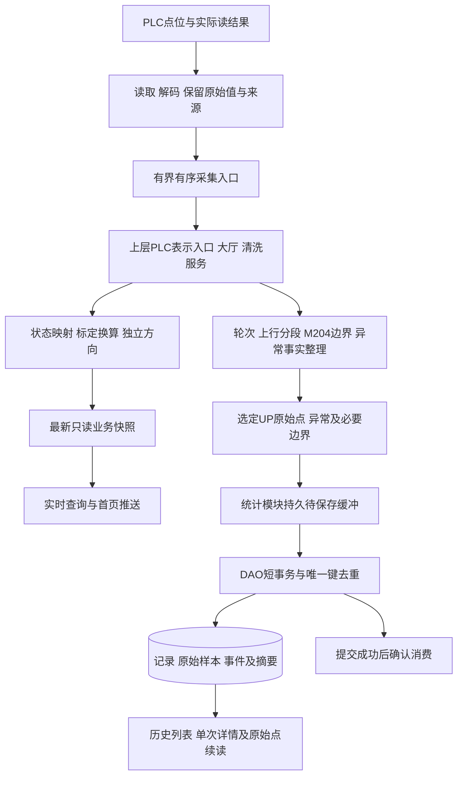

# PLC到实时与历史存储的主流程及待确认事实

2026-10-26后续口径见[实时、M106整轮历史与历史统计](updates/2026-10-26/realtime-history-statistics-overview.md)：M106为一次主历史开始/结束依据，M60/M61锁存决定结果，通信异常结束且不续接，检修只实时。本文此前“一次上行关联往返”、M204/D10边界和跨重启续接讨论保留为旧评审依据，不能代替新规则。

日期：2026-10-25。代码核对基线：`085f019`。用户最新确认：系统下四台动力设备，每台对应两个传感器；M3=1表示有故障；M204在自动模式一次运行结束触发，**上去再下去算一轮完成**；历史列表**一次上行一条，关联所属往返轮次**。M204的保持/脉冲和清零方式暂未确认。新点位及换算见[实时点位核对](plc-realtime-point-review-20261025.md)。

本次是流程分析和文档更新，未修改运行代码、未执行SQL、未连接或操作PLC。下文分别列出已确认事实、仍需现场确认的业务信号，以及后端应自行补齐的实现。

本轮进一步约定：正常读到的配置点按收到的数据直接处理，不新增“没有读到、原值未知、尚未标定”等逐字段业务状态。底部值、类型和字序作为接入配置事项。通信状态由PLC TCP连接层提供，连接断开表示系统与PLC通信中断；一台PLC下的四机八传感器共用该通道，不虚构各自TCP连接。设备/传感器故障继续由PLC状态码表达。当前数据遗漏逐项见[数据遗漏核对](plc-data-omissions-20261025.md)。本段为后续适配约定，已有协议解码和连接层异常处理没有在本轮修改。

## 1. M204补齐了什么

M204补齐的是“完整自动往返的一轮完成观测”。D10表示已完成上行计数，M204表示完整往返完成，两者分别保存，不相互替换，不用D10除以2计算轮数。

```text
一轮完整自动往返
  ├─ 上行阶段：保存选定用途的原始采样和相关事件
  ├─ 换向/等待阶段：保留有依据的边界
  └─ 下行阶段：实时展示；必要异常和轮次完成边界保存
       └─ M204完成观测
```

正常下行不保存连续测量的既有规则继续有效；即使整轮不保存下降曲线，轮次开始/完成等业务边界仍需留证。异常恢复、检修和用途不明的UP分别标记，不能都算生产上行。

用户已确认历史列表一条RUN表示一次生产上行，并关联所属完整往返轮次。保留稳定的上行记录编号和独立的往返轮次编号；上行结束时可更新上行记录，之后M204到来再更新所属轮次完成事实。不能等M204才结束上行，也不能因M204再新增一条重复的上行记录。轮次开始或关联尚无证据时，关联暂未确认，不硬挂到最近一条。

可靠观察到M204只说明PLC报告了一轮完成。缺少前面开始和关联依据时，可先保存“完成观测、关联未确认”，不能回填一个猜测的开始时间或补造整条曲线。

## 2. 当前代码实际经过哪些环节

```text
ModbusTcpDevice.poll逐块读取
  → PlcMessageBuffer.offerSnapshot（每台PLC仅保留最新一帧）
  → PlcDataIngress.dispatchCycle
  → PlcDevicePresentation / 大厅
  → CleaningServiceImpl
  → 最新业务快照 / 进程样本统计
  → 页面查询 / 当前SSE
```

现有历史保存是另一条入口：

```text
外部已经整理好的TelemetryBatchBo
  → 大厅.acceptHistoryBatch
  → 统计服务 / 内存历史队列
  → HistoryBatchPersistence
  → JdbcTelemetryHistoryDao事务
  → 批次表、分段表、测量摘要表
```

这两条路径之间缺少生产采集自动整理历史的实现。最新快照转换目前未接本次D201～D206、M120～M127和编码器标定规则。

已有代码的三个关键限制：

1. **采集到的帧可能在内部被覆盖。** `offerSnapshot`按PLC编号覆盖最新值，业务消费前的旧帧可能消失；这条通道适合实时视图，不适合完整原始历史或M204等边界事件。
2. **当前历史队列不能断电恢复。** 历史批次在内存中，失败可回队，但进程退出、磁盘未持久接收等情况不能靠该队列恢复。保存任务默认关闭。
3. **已有表主要保存分段测量摘要。** minimum/maximum/average/latest/sampleCount不能还原逐帧八路拉力、四台原始编码器、状态及完整点表。目标原始样本、运行/轮次和事件存储仍需实施。

## 3. 目标主流程



服务职责继续保留大厅和清洗、命令、安全、统计四个业务服务。清洗模块解释状态和生命周期、选择历史事实；统计模块可靠保存、查询和计算；DAO负责事务。采集驱动、缓冲和DAO不反调业务服务。

### 采集与进入业务

- 按已配置的地址、功能码、类型、字序读取；DINT一次覆盖两个寄存器。正常读到的数据直接处理，保留原始值、TCP连接状态和读取来源，不另增逐字段缺失/未知/未标定分类。
- 各读取块属于一次轮询批次，不自动等于PLC同一扫描周期的原子快照。需要严格配对时，须有PLC冻结/序号等明确依据；未经确认不拿邻近时刻数值拼成“同步帧”。
- 业务历史入口保留已接收采样的顺序和缺口，采用有界队列及明确容量处理。不得在最新值被覆盖后再从最新缓存回补原始历史。
- 先完成必要业务选择，再持久化选中的UP原始点、异常和边界；正常DOWN常规测量不整段落盘。方向/用途无法确认时保留未确认说明，不能擅自归生产统计。
- 时间保留用于显示、查询和日历归属；不增加采样年龄、时间偏差或前后时间拒收校验。顺序和去重使用身份/序号。

### 实时支路

清洗模块输出系统→四台动力设备→八个传感器的快照。D201决定明确系统状态来源，D203～D206分别提供本机状态，M120～M127提供各台方向，M3/D3提供故障及归属；测量使用已确认的公式和本机标定。

通信连接状态由TCP层提供，连接断开时表达PLC通道断开；各机运行/故障和传感器故障依据实际PLC状态。正常读取的字段直接按配置换算，不新增逐字段缺失/未知/未标定判断。四机均高、两索合计、电机等效力分别标名。

页面只读取业务快照，浏览器关闭、SSE变慢不能停止采集或历史保存。实时快照允许被新视图替换。

### 历史支路

清洗模块维护有依据的轮次、生产上行、用途分段和异常过程。每条记录分配稳定编号；未知开始/结束可为空，保留首次/最后观测与未确认原因。

每台UP原始采样绑定真实设备、两路传感器、来源标识、观测序号、用途和连续段。保存原始读数及转换结果的来源/配置版本，便于追溯不同底部值和换算规则。编码器底部值在现场测试后配置，按配置计算高度，不为正常收到的点新增标定状态判断。

一条轮次可有明确的参与设备和阶段；四台设备不是四个独立系统轮次。异常恢复提升不能仅因再次UP就新建生产记录。正常DOWN仍参与轮次状态观察，必要完成边界可以保存。

### 持久接收、事务和恢复

- 选中的事实先可靠写入待保存存储，再视为持久接收；尚未采到或尚未持久写入的数据不能承诺断电恢复。
- 接收标识、记录编号和批次编号在重试中保持不变。服务重启后从未确认提交的位置继续，不能重新生成另一套编号。
- DAO以短事务保存原始事实、对应记录/事件变更和必要待更新标记，提交成功后才确认消费。崩溃发生在提交之后、确认之前时，重放依靠唯一键验证，不重复计次或累加。
- 相同标识内容冲突要明确报错，不能只按INSERT IGNORE将不同内容静默视为同一事实。
- 缓冲满、磁盘不足、数据库不可用有独立归档状态及处理策略；不能静默覆盖或让PLC写入控制线程无限等待落库。
- PLC断联期间未采到的点和已进入后台持久缓冲但暂未落库的点分别处理。后台补存只能恢复后一类；前一类能否补采取决于PLC是否另有历史/事件保留能力。

## 4. M204怎样避免漏轮、重复计轮

### 必须分别处理的情况

| 情况 | 正确处理 |
|---|---|
| 正常连续读到M204=1多帧 | 属于同一完成事实，不按帧数计轮 |
| M204为短脉冲，后台没有读到 | 不能凭轮询间隔承诺捕获；需保持/事件序号/完成计数等补充机制 |
| 驱动读到M204，但帧被最新缓存覆盖 | 改造有序业务入口，边界在覆盖前进入历史处理 |
| 后台启动时第一帧M204已经为1 | 不知道是否此前已计过，保存观测；以持久状态及稳定PLC来源标识核对 |
| 通信断开后重连仍读到1 | 不能默认新完成一轮，先判断是否同一保留事件 |
| PLC断电重启后编号/计数复用 | 需控制器会话或已确认的复位识别，不能覆盖旧记录 |
| 一次自动启动后连跑多轮 | 每轮开始及完成需要分别识别，不把“启动按钮按下”默认等同每轮起点 |

只做M204上升沿检测能处理部分连续在线情况，但不能覆盖漏采、重启和跨断联去重。保持位加清零规则、稳定轮次编号、完成计数或可读取事件记录均可用于协议设计；最终采用现场确认的方案。若需要后台写确认位，必须单独约定，不擅自清M204。

M204说明的是完成，不自动说明完整过程没有发生异常。正常完成、异常后完成、终止和未确认，分别依据过程事实和观测覆盖表达。

## 5. 仍无法准确判断的事实

| 待确认事项 | 已知内容 | 仍缺什么 | 影响 |
|---|---|---|---|
| 每轮开始 | 已有自动运行与完整往返定义 | 哪个位/事件表示新一轮开始；自动循环是否每轮有信号 | 无法给出可靠轮次编号及开始时刻 |
| 自动/手动与生产用途 | D202仅自动模式有关，单机有上下行位 | 可靠模式来源；生产、恢复和检修动作的区分依据 | 手动/恢复UP不能准确计入生产 |
| 上行单程结束 | D10为完成上行次数 | 上行到位/单程结束的明确事件、计数复位规则 | M204发生较晚，不能用它代替上行结束 |
| M204保持和复位 | 自动上去再下来完成一轮 | 脉冲还是保持位、保持多久、谁清零、何时清零 | 决定能否捕获和重复识别 |
| 完成与异常退出 | M204为自动模式运行结束触发 | 故障/急停/中断是否触发；恢复后继续原轮还是开新轮 | 无法准确区分已完成、暂停、终止 |
| 启动/断联后的轮次关联 | 后台可以保存观测 | PLC稳定轮次ID/完成事件序号/计数与重启生命周期，或其他可验证依据 | 无法承诺跨重启不漏、不重并准确关联 |
| 高度与区间速度 | 编码器DINT、分层公式、轴计时秒 | 32位字序、四台底部值、轴计时类型/分辨率及连续段证据 | 原始值可留，高度/速度暂未确认 |
| 故障过程 | M3极性、D3代码已明确 | D3保持/清零、并发故障、同一过程开始/结束及补充码语义 | 可显示当前码，完整告警历史仍有缺口 |
| 实际采集与同步 | 点位标签明确 | 实际Modbus映射、类型；业务要求的采样节奏及PLC同步依据 | 影响正确解码、历史点密度与配对质量 |
| 轮次与上行关联 | 用户已确认一次上行一条历史，关联所属往返轮次 | 实际轮次开始、恢复后关联及稳定身份依据 | 页面口径已定，实际关联仍需事实支撑，不能挂到最近记录 |

其中M3和历史页面口径已经确认，不再提问；M204保持方式由用户明确表示暂未确认；底部值明确等待现场测试，不要求现在猜填。数据表、可靠队列和接口适配是后端实现工作，不能全部当成需要用户回答的PLC问题。

## 6. 后端尚需实现的工作

| 环节 | 实施内容 | 可先推进的部分 |
|---|---|---|
| 原始采集和质量 | 新点位、类型/字序配置、逐字段读结果、身份及标识 | 配置和解码结构、模拟测试；真实地址留待确认 |
| 实时状态与换算 | D201～D206、各台方向、故障对象、线性测量、标定高度、同段速度 | 已确认状态/公式可适配；标定缺失返回null |
| 有序入口 | 把历史事实和最新显示通道区分，避免捕获帧被覆盖 | 有界顺序消费、过载状态和验证 |
| 运行/轮次整理 | 明确开始/结束、用途与连续段、M204去重及未确认状态 | 状态与事实模型可搭建；未确认PLC规则不写死 |
| 原始与事件存储 | 逐帧/逐源测量、必要边界、轮次/上行关联和配置追溯 | 按已定范围设计迁移，保留旧数据；暂不执行现场迁移 |
| 持久待保存和恢复 | 持久接收、批量事务、确认消费、内容冲突和重放 | 后台故障与重启测试可独立进行 |
| 历史读取 | 分页列表、单次详情、按游标读取原始点 | 从已保存事实查询，不从实时缓存伪造历史 |

优先完成“实时正确映射＋选中原始点可靠保存”，随后以确认后的起止和M204关联运行/轮次。起止暂不明确也可以保存已采原始事实及未确认用途，不能因此补造完整成功记录。

## 7. 验证标准

1. PLC测试或模拟数据可追溯到系统、四台动力设备和八个传感器；各机独立方向且故障只定位到有依据对象。
2. 两次业务消费之间到达多帧UP数据，已接收且选中归档的原始点不会因实时覆盖而丢失。
3. 一次M204完成事实保持多帧只计一次；启动已为1、短脉冲漏采、PLC/后台重启、断联分别有可说明的处理。
4. 正常下行不连续保存，完成边界和必要异常仍能查询；未确认用途/关联如实保留。
5. 数据库失败和后台重启后可恢复已持久接收数据；提交后未确认的批次重放不新增重复记录、事件或测量。
6. 历史详情读到真实已保存原始点及缺口，不能用分段均值重新绘制成全量原始曲线。

代码依据：[采集缓冲](../src/main/java/com/company/project/info/buffer/plc/PlcMessageBuffer.java)、[PLC上层接入](../src/main/java/com/company/project/presentation/plc/PlcDataIngress.java)、[清洗服务](../src/main/java/com/company/project/service/cleaning/CleaningServiceImpl.java)、[历史保存器](../src/main/java/com/company/project/service/statistics/HistoryBatchPersistence.java)、[历史DAO](../src/main/java/com/company/project/repository/cleaning/JdbcTelemetryHistoryDao.java)、[当前建表基线](../src/main/resources/schema.sql)。
