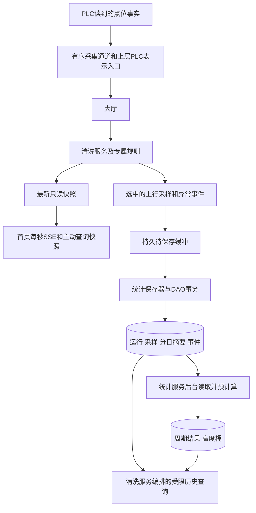

# 新版PLC点位、业务流程、页面与数据库统一方案

修订日期：2026-10-24。PLC事实依据用户最新点位表，包括D201～D206、M50、D105～D108；页面职责与字段依据本日上传的《前后端职责与页面接口修订说明》。前期页面说明仅作背景，新旧对齐见[本轮修订说明](frontend-backend-contract-alignment.md)。

本文统一PLC事实、业务与数据规则，不表示代码、点位配置、表结构或历史功能已经实现。页面采用本轮修订的systemCode、IDLE、t和显式null契约；未知点位编码不填、不猜，页面需求不自动成为已确认PLC能力。以下“上行/下行”指机械提升/下降，不指网络上传/下发。

按页面使用和一次记录生命周期阅读的说明见[业务流程与页面数据总览](business-flow-and-page-data-overview.md)，其中串联四服务、原始历史、计算公式、跨日示例与导出，沿用本文点位口径。

对应请求和响应契约见[对外接口说明](external-api-contract.md)，包括当前接口事实及后续历史、周期和导出设计，未实现项均明确标注。

## 1. 方案的总体范围

一套系统、一台PLC、四台动力设备、八路索拉力。后端通过Modbus TCP直连PLC；“云端用”是本次点位的用途描述，不表示重新引入盒子、MQTT或另一套上传服务。部署前提仍是服务端能够访问PLC通信地址。

保留大厅入口和清洗、命令、安全、统计四个业务服务。系统与运行过程状态只在清洗模块修改，命令状态只在命令模块修改，各服务委派自己的辅助类，上层调用下层，下层不回调上层。

后端提供最终状态、名称、中文结论、阈值判断、配对总力、曲线统计与比较范围；前端负责显示、单位/日期格式、输入及简单提醒，不再推导业务结论。页面以公开systemCode（如配置的QJXT-01）定位系统，winchCode/sensorCode定位动力设备/测点；后端映射到内部system_id、deviceId及各实体ID，内部主键不随对外命名改变。

归档规则：上行保留核心采样；正常下行只实时展示；下行异常保留事件点和必要快照。历史长期保留，不增加采样过期、新鲜度阈值或按时间推算离线的规则。

**采集数据不做时间校验。** 不比较采集时间与当前时间的偏差，不设最大数据年龄，不因时间早于上一帧、跨日或缓冲后延迟入库而拒收、丢弃、标成无效或判断离线。时间只记录并用于历史查询、曲线定位、历时计算和自然日历统计；这些查询/统计用途不是接收数据的校验条件。

重复数据按稳定采样标识去重，实时新旧顺序按采集实例/序号处理，不以时间先后拒绝历史数据。实际通信失败和PLC/通道无效事实仍各自表达，不由时间推断。

| 本轮变化 | 统一后的处理 |
|---|---|
| D201明确总状态 | 直接映射PLC状态，替代以零散运行位为主推导 |
| D203～D206明确单机状态 | 分别映射本机，补充检修和共享通信离线含义 |
| D202仅描述自动模式关联M201 | 不编UP/DOWN/STOP数字枚举，也不用于手动方向 |
| M50明确云端急停 | 新方案急停目标为M50写1；不双写M15，不自动回退到旧点位 |
| D105～D108新增当前参数/时间描述 | 不据地址顺序推定单位、编码、写后回读或生效关系 |
| 同一运行内存在异常反向动作 | 每台采样保留运动用途；回退提升不当成新生产上行 |
| 页面职责与身份修订 | 后端输出最终数据；公开systemCode贯穿查询、操作、推送和导出，实际名称来自配置 |
| 首页每秒推送、详情静态查询 | 首页完整快照每1秒发送；详情/趋势只在主动查询时更新，无5秒轮询 |
| 页面状态、单位及空值 | 页面IDLE对应内部STANDBY，拉力t对应内部kg；缺失测量显式null并附质量/原因 |

## 2. 点位如何分组使用

| 数据组 | 点位 | 业务用途与保存方式 |
|---|---|---|
| 系统状态 | D201 | 实时主状态；上行及异常快照保留原始码 |
| 单机状态 | D203～D206 | 分别对应四台；实时显示，随归档采样保留原始码 |
| 电源、模式、许可 | M0、M10、M4、M11、M12、M13 | 电源/模式/安全许可/自动已启动分别表达，不等同于实际运动 |
| 故障、急停 | M1、M2、M3、D3、M30～M37、M40 | 故障事实、原因及本机归属；变化时生成事件 |
| 方向与轴活动 | M20/M21、M22～M29、M110、M7 | 同步/独立方向指示、轴活动与自动运行事实分别解释 |
| 过程/回退 | M6、M201～M203、M210～M215 | 中断、阶段触发、异常回退上下文；不把触发脉冲当持续状态 |
| 正常完成事实 | M8、M9、M204、D10～D14 | 各自按原含义观察和留证，不合并成一种完成次数 |
| 核心测量 | D40～D47、D61～D65、D70～D73、D80～D83 | 八索、速度、电机等效力、四机高度；上行核心归档 |
| 异常细节 | M300～M306、M310/M311、D300～D307 | 异常时间轴、相关设备及事件快照 |
| 时间与计数原值 | D10～D16、D66～D69 | 保留已确认含义，边界/变化或异常时留必要原值，不直接当累计工时 |
| 新版远程急停 | M50 | 经过命令链路按已配置协议目标写1，不以标签数字代替协议地址 |

以下不作为每帧核心历史：D30～D37原始传感器数；D48～D52可重复计算的平均值；D53～D60、D85～D88原始编码器/转速；D1000～D1017标定与参考数据。需要诊断时另按明确来源使用，不称为无用PLC程序。

M100～M106、M205/M206属于受控/定时辅助，不独立证明轴实际运动或完整清洗。空白点位、D200未明确阶段数值、D202不完整方向编码、D105～D108未明确时间编码不进入本版可用业务字段。

计数/时间原值不必在每帧重复复制：在上行边界快照和异常事件中留必要证据。正常下行不连续保存，因此不能仅靠稀疏D11快照生成可靠的每日下行完成列表。

## 3. 系统状态和单机状态

### 3.1 系统状态

| D201原值 | PLC明确含义 | 内部状态与页面五态 |
|---|---|---|
| 1 | 运行 | RUNNING，运行 |
| 2 | 待机 | 内部STANDBY→页面IDLE，待机黄色 |
| 3 | 检修 | MAINTENANCE，检修 |
| 4 | 故障 | FAULT，故障 |

OFFLINE由实际连接/通信不可用事实补充，不是D201的某个额外编码。读不到状态码或出现未定义值，且没有其他明确故障/急停事实时，通信状态与状态有效性分开：显示“状态未确认”，不能把它伪装成正常或离线；这不是新增第六种业务状态。

页面权威系统字段为systemStatus/systemStatusText，单机为operatingStatus/statusText；不再返回两套旧tankStatus/status让前端猜优先级。无法确认的状态显式null，配有效性和原因；急停是FAULT的原因和真实结束原因，不新增EMERGENCY_STOP工况枚举，也不移除急停按钮。

明确M2急停、M1故障/急停或M3故障有效时，页面不能因为D201暂显示正常就隐藏这些安全事实。清洗模块统一处理：保留原始D201，明确急停/故障事实优先展示为故障并附原因；瞬间状态不一致不导致其他有效测量整帧被丢弃。

此时即使D201缺测，也保留其原始有效性问题；业务故障展示依据独立明确事实，不把缺测本身当成故障原因。

M0是24V控制电源，不是网络状态。D3是故障原因，非零码不能在缺少当前故障依据时随意当成新故障；D3=0也不能否定独立急停。许可、模式、自动已启动和方向作为独立字段输出。

### 3.2 单机状态

| 点位 | 设备 | 原始状态 |
|---|---|---|
| D203 | 动力设备1 | 0待机、1运行、2故障 |
| D204 | 动力设备2 | 0待机、1运行、2故障 |
| D205 | 动力设备3 | 0待机、1运行、2故障 |
| D206 | 动力设备4 | 0待机、1运行、2故障 |

单机五态由本机事实组合：实际PLC通信失败表示共享通信离线；本机故障码2或明确本机电机/编码器故障表示本机故障；本机正常且系统处于检修/手动模式时可展示检修，同时保留本机0/1原值和运动指示；其余正常工况映射待机/运行。原始状态缺失不套用另一台状态。

没有合法本机状态或独立故障事实时，单机状态未确认，不仅凭手动模式就认定本机正常。明确共享急停的处理见下一段。

系统普通故障不能无条件说成四台电机都坏了。共享急停应标明“系统急停影响”，本机M30～M37异常分别归属；单PLC不能声称已检测四台独立通信离线。

单传感器故障按sensorCode定位，只标记实际传感器，不由前端或后端缺省规则升级成电机本体故障；若D203～D206或明确本机电机/编码器故障同时存在，保留其独立依据。其他设备是否待机按其实际事实给IDLE，不能从系统FAULT推定全部待机。

已确认共享急停优先于检修：单机业务主态显示FAULT，后端原因说明SYSTEM_EMERGENCY，并保留D203～D206原码；这表示共享急停影响，不声称四台电机硬件故障。

运行状态不等于已经产生实际位移，不把D201=1、D203=1或下发了方向命令直接解释成精确机械位移。原始状态、方向指示、测量有效性和业务记录结果分开保存。

### 3.3 传感器、阈值与故障对象

传感器状态由清洗模块基于实际点位、测量质量和数据库中有效配置统一判断，页面只读NORMAL/WARNING/ALARM/FAULT/OFFLINE及statusText。WARNING/ALARM与硬件FAULT分开，缺配置不能当0、演示阈值或已确认NORMAL；无法形成结论时显式null并说明“阈值未配置”等原因，已知独立故障仍可返回。

不猜预警值、安全保护值、迟滞或恢复算法。实际阈值与规则确认后按所属业务规则执行，告警触发时保存配置值、类别、版本、对象及测量快照，当前配置变更不重写旧事件。后台做阈值判断不等于新增远程自动保护/复位能力，现场联锁仍归PLC。

faultSources按真实对象列出系统、动力设备或传感器及原因，前端不从颜色/文字推断归属。首页仅高亮对应对象，取消故障/离线和异常测点跳转告警页的入口；独立告警中心、正常查看详情和简单提醒保留。

## 4. 四机八索及单位统一

| 设备 | 两索拉力kg | 高度cm | 本机速度cm/s | 电机原值 | 独立方向 | 电机/编码器异常 |
|---|---|---|---|---|---|---|
| 1 | D40、D41 | D80 | D61 | D70 | M22、M23 | M30、M34 |
| 2 | D42、D43 | D81 | D62 | D71 | M24、M25 | M31、M35 |
| 3 | D44、D45 | D82 | D63 | D72 | M26、M27 | M32、M36 |
| 4 | D46、D47 | D83 | D64 | D73 | M28、M29 | M33、M37 |

D40～D47已经kg，保留PLC取整精度；D80～D83除100得到m；D61～D65乘0.6得到m/min。D70～D73保留原值，并按给定公式计算等效kg：

`等效kg = 原值 × 0.35 × 163.0883 × 1.0 ÷ (9.80665 × 0.16)`

内部计算和数据库继续kg，新页面接口统一t（kg除1000）、高度m、速度m/min，接口层只换算一次并标单位；前端可作显示单位格式化，不再计算业务合计。等效力不标为N·m。同步速度D65和单机D61～D64分开保存，当前工况不适用的值不冒充有效0；也不无条件复制D65成四个独立实测速度。

两索平均/合计要求本机两路独立有效值按明确采集口径配对，由统计模块输出ROPE_TOTAL独立系列、合计质量、pointKey及statistics；内部PAIRED_SUM名称可通过页面适配映射。缺一根或无法确认配对时总力显式null，前端不得自行相加补值。有效超限值仍应保留用于峰值和分析，不能仅因触发故障就删掉；明确传感器故障或读值无效才影响对应测量有效性。附件中的时间/高度/方向关联不引入采样时间校验，也不授权猜测同步容差或拿临近点拼合。

首页systemHeight来自实际系统总高度配置，不固定30m；systemCurrentHeight来自明确的系统实时高度来源，没有独立有效来源时显式null。四机均高、高度差可以显示为明确的计算指标，不能代替独立高度或反推机械限位。可空测量、状态与配置在新页面响应保留字段并返回null，不能依赖前端补值；已有接口NON_NULL行为属于当前代码差距。

## 5. 方向、运动用途和分段

D202目前没有完整方向枚举，手动模式又不变化，因此不将其作为生产方向来源。同步M20/M21和各机M22～M29按明确场景、参与轴解释；单机运行码本身不表示UP。相互矛盾或无法确认时保留未确认，不将系统方向无条件复制四台。

每台上行采样增加后端用途归属，不是新增PLC阶段编码：

| motion_role | 含义 | 留原始上行 | 新增生产次数 | 生产平均 |
|---|---|---|---|---|
| PRODUCTION_UP | 已识别的生产上行 | 是 | 仅明确新业务开始时一次 | 有效测量参与 |
| RECOVERY_UP | 已确认的异常回退/恢复提升 | 是 | 否 | 否 |
| MAINTENANCE_UP | 已确认的手动检修提升 | 是 | 不混入生产 | 否 |
| UNCLASSIFIED_UP | 方向UP但业务用途未确认 | 是 | 不补造 | 否 |

M210～M215作为回退上下文。M214触发提升不能当作一条新生产上行；触发位恢复0也不能自行认定回退已经结束。恢复到正常业务的边界没有依据时不强行归为生产，原始上行仍留存，后续有依据才修正归属并重算。

采样保存本机`motion_role`及连续分段标识，避免一条生产记录内的恢复动作被主记录的PRODUCTION用途掩盖。暂停、换向、用途变化、通信中断后的点不能在图上直接跨段连接。

后续有依据修正归属时，原采样标识和原始PLC事实保持不变；重建旧/新角色对应摘要、主记录生产极值和受影响周期，移除旧贡献，不能新增一份同样原始点或只往新角色累加。

## 6. 单次记录与完成次数

本版RUN页面使用已识别的生产上行单程，公开recordCode对应一条系统记录，四台参与不会变成四次。上行单程与完整往返清洗的业务含义不同；只保存上行测量也不改变完整清洗的实际定义。

| 事实 | 能说明什么 | 不能据此直接做什么 |
|---|---|---|
| M8约1秒正常回原位 | 已观察到PLC正常返回本次原位 | 不适用于所有上行单程完成，不能保证无漏采 |
| M9约1秒下降到位 | 下降正常到位 | 不当完整往返或上行完成 |
| M204本轮完成描述 | PLC上去再下去的本轮完成观测 | 不假定与M8在所有初始原位都等价 |
| D10、D11 | PLC上/下行完整单程计数原值 | 不相加除2，不补造逐条开始/结束及曲线 |
| D12～D14 | PLC故障/中断相关计数事实 | 不直接当后台异常事件数或新运行数 |

不以速度、固定高度、理论时长或两段反向曲线补算完整次数。计数清零、回绕、位宽和生命周期未明确前，不编计数修正算法。PLC原始计数与后台已识别记录数分别命名，不强行使二者相等。

记录流程：明确开始→建立记录；过程持续归档生产上行/相关异常；异常停止、回退先关联同一次过程；只有明确结束依据才补结果。未确认实际起止时保存首次/最后观测和未确认说明，不生成假的正常完成。当前仍不能从这份表独立确定所有上行开始/正常到位组合，本版不补写该算法。

单次结果分为已确认完成、明确终止、仍进行或未确认；完成后再按相关异常是否真实恢复区分正常/异常完成。急停、中断等退出不用凑五次失败。现场动作没有可验证后台账号时，操作人留空。

后端同时返回runResultText、endReasonText、startMethodText等展示结论，前端不从事件数组或当前状态反推。历史当次设定速度、运行间隔和阈值使用已保存快照，缺失就明确null，不能回填当前配置。todayCompletedCount仍统计今日开始的记录中已确认完成数，回显countBasis=STARTED_DATE，不因页面泛称“今日完成”改成结束日口径。

## 7. 架构与数据流

| 入口/服务 | 负责内容 | 由模块内辅助类承担 |
|---|---|---|
| 大厅 | 用户查询、操作、内部设备事实的统一入口 | 路径编排，无独立业务状态 |
| 清洗服务 | 原始状态映射、系统/单机/测点最终状态与中文原因、阈值/事件事实、记录与用途、操作和查看编排 | 状态容器、点位及有效配置规则、上行过程/事件整理、归档选择 |
| 安全服务 | 登录账号、设备访问/操作权限及已确定规则 | 统一权限策略，不逐层重复检查 |
| 命令服务 | 幂等、排队、下发和命令生命周期 | 命令状态、编码、提交规则 |
| 统计服务 | 可靠历史保存、两索配对总力、分日/周期/高度预计算、告警统计、同比环比/归档双图、历史查询与导出 | 配对计算器、保存器、摘要/周期计算器、查询器和导出器 |
| 设备管理/DAO | 公开编码与内部身份映射、实际名称及有效配置、采集事实接口、事务与数据库读写 | 不依赖或回调业务服务，不自行判断状态/结果 |

以下箭头表示数据经过的路径，底层业务分发由上层主动读取完成：

查询：页面→表示层→大厅/安全服务→清洗服务→只读快照或统计查询→DAO→响应。操作：用户→表示层/登录身份→大厅/安全→清洗编排→命令服务→缓冲→PLC；写结果由上层取回，再由清洗编排主动交命令服务处理。

表示层负责HTTP/推送和PLC边界对象转换；不直接查表或把业务状态写进网络组件。服务门面只组合调用，不集中堆放点位解析、状态、统计、SQL和线程逻辑。

后端表示层将已有业务结论映射为页面字段、中文说明、t单位和显式null，不在这里重新推导状态或统计。权限、安全输入规则和数据库唯一键各在所属位置处理，前端基本提示不替代后端必要检查，也不增加同一规则的多层重复检查。

## 8. 实时与归档的不同用途

| 场景 | 实时 | 永久历史 |
|---|---|---|
| 生产上行 | 显示状态与有效测量 | 核心采样、记录、异常；生产统计纳入明确PRODUCTION_UP |
| 检修/回退提升 | 显示实际事实 | 上行原始留存并带用途，不增加生产次数 |
| 正常下行 | 正常显示 | 不留连续测量或假上行记录 |
| 下行异常 | 显示原因和测量 | 一条事件，触发/恢复/终止时必要快照 |
| 异常持续 | 持续显示 | 更新同一事件，不每帧新增异常 |
| 断线或部分读值失败 | 分开显示通信与字段有效性 | 实际错误/恢复和缺口，不造连续值 |

同帧其他正常下行设备的常规测量不因某台UP就顺带连续归档。事件快照可留相关设备读数解释不平衡，但不是保存完整下行窗口。无可靠运行关联的下行事件按设备/时间独立可查，不绑定最近一条上行。

实时最新值可覆盖；历史入口必须在旧帧被覆盖前选择上行和异常。后台不依赖用户打开页面，慢连接不阻塞历史保存或PLC控制。

首页先获取HTTP完整快照，再每1秒通过SSE发送同结构完整视图，即使采集序号没有变化也按节奏发送。updatedAt保留真实数据时间，发送时刻另列，不假装数据刚采到。前端连接中断只提示数据连接问题；实际离线仍由后端通信事实判断。详情/拉力对比只响应进入、主动刷新、重试和范围切换，不复用首页推送持续改写其查询快照。

有界有序内存入口→业务选择→持久待保存数据→短事务批量提交→成功后确认消费。正常下行只在内存中处理，不先全量落磁盘再称未保存。稳定采集/事件/记录标识支持重放去重，已确认入库的缓冲文件可回收，数据库业务历史继续保留。

数据库暂不可用时已持久接收数据等待恢复补入；磁盘满或接收失败明确记录归档问题。尚未采到或尚未可靠刷盘的数据不能承诺断电后恢复；重试不能补出停机期间从未取得的采样。

## 9. 数据库目标：复用4表，新增6表

| 表 | 职责与关键归属 |
|---|---|
| t_user | 已有账号，后台操作身份来源 |
| cleaning_system | 已有系统/PLC绑定，补公开systemCode、实际名称及有效参数/版本和系统总高度配置 |
| cleaning_winch | 已有四机档案，补公开winchCode、实际名称、已知最近维护；本次不为未展示额定值新增字段需求 |
| cleaning_rope_sensor | 已有两索/传感器绑定，补已确认角色、阈值 |
| cleaning_run_record | 上行记录、实际/观测边界、结果、原因、生产测量极值和参数/身份快照 |
| cleaning_up_sample | 一帧核心上行；本轮补原始系统/单机状态、本机motion_role及连续分段 |
| cleaning_run_winch_day | 按记录、本机、采集日和motion_role分开累计，防恢复动作混入生产摘要 |
| cleaning_exception_event | 上/下行异常/告警、系统/设备/测点定位、触发配置/阈值快照、分类及恢复/归档事实和有限快照；运行关联可空 |
| cleaning_period_summary | 系统/单机五类自然周期预计算，含持久待更新标记 |
| cleaning_height_bucket | 本机、来源、自然周期、高度区间的生产UP和/数量/极值 |

当前7表里的旧三张批次/分段统计表在迁移期保留，不将缺少原始帧的旧摘要变成假曲线。目标十表是方案，不是本轮已经执行的DDL。

为支持导出任务及导出记录列表，另补一张`cleaning_export_task`技术表，形成目标10张业务表＋1张导出任务表；文件不存数据库大BLOB，统计重算仍复用周期标记。详见[导出方案](data-export-plan.md)，当前实际7表未改变。

上行采样除数值/有效性外，保存`system_state_code`与`wN_state_code`等实际状态事实，`wN_motion_role`和`wN_segment_code`区分本机用途/片段。分日摘要键明确为`(record_id, winch_id, stat_date, motion_role)`，生产极值、均值和曲线默认只取PRODUCTION_UP；回退/检修原始仍可追溯。

记录、事件、参数、身份与计算规则有各自稳定标识或快照。测量用数值列，少量身份/事件快照可用有限JSON；不为每根钢绳、每个月或每个页面建一套原始表。

有效配置不能只保留当前待下发值：详情setSpeedMPerMinute须来自已确认生效版本，记录使用当次快照；事件保存当时阈值和对象名称/归属。对外中文结论由保留事实与规则生成并保持可追溯，不以新配置解释旧事件。告警中心复用这套权威事件，不重新混入旧t_alarm。

计数按记录开始日；测量按采集日；事件按已确认发生/首次观测日；运动区间按跨日交集拆分。记录开始未知不造business_date。时刻统一UTC，业务日历按Asia/Shanghai，前端返回带时区时间。

系统运动时长不能由四台每日时长相加或仅凭每日总量还原区间并集。本版先显示系统记录历时和本机有依据的有效上行时长；没有独立、已持久留证的系统上行运动区间时，SYSTEM范围的有效运动时长为空，不把工时合计当成系统时长。

单机有效运动时长也只有可靠区间依据才填写；不可靠时为空或说明已观测部分，不能以采样数量乘固定轮询间隔。D16、D15和D66～D69会重新计时，不能直接当累计上下行工时。

默认生产统计的运动时长和runningHours同样只取PRODUCTION_UP。回退、检修工时若需展示，应另列用途和名称，不默认混加。汇总要保留未知/缺口覆盖说明，不能因SQL的SUM自动忽略NULL，就把已确认的部分时长叫作完整累计工时。

## 10. 页面与查询契约

| 页面 | 返回内容 | 数据来源 |
|---|---|---|
| 首页实时 | systemCode/systemName、systemHeight/systemCurrentHeight、五态、各机operatingStatus、测点状态/质量/阈值、故障对象 | 同一清洗只读快照，先查询后每秒完整推送，含下行实时 |
| 单机详情快照 | 本机/两测点/伺服当前读数、模式、有效setSpeedMPerMinute、今日完成数、累计小时和维护 | 主动查询快照＋有效配置＋统计；不定时刷新，不要求额定载荷/额定速度 |
| 历史列表 | 每页10条上行摘要、结构化结果与中文说明、当次参数、筛选总数和全系统真实日期目录 | 主记录与轻量日期索引；日期目录不局限当前页或当前筛选 |
| 单次详情 | 概况、各机两索/ROPE_TOTAL/SERVO曲线与statistics、恢复/检修标识、异常与参数 | 同一recordCode关联事实，后端整理有界结果；前端不算总力/极值 |
| 告警中心 | 系统/设备/测点定位、类别/等级/状态/处理文字、发生时阈值与事件点快照 | 后端筛选/去重/分页，未恢复涵盖全历史，不要求有recordCode |
| 周期卡片 | 已保存次数、结果分布和有依据的时长 | 周期预计算 |
| 日/月/年等平均 | UP、来源、本机高度桶、实际数据范围与数量 | 持久高度统计，不交浏览器重算 |
| 数据归档 | 左图变化、右图对比、对齐轴、实际三组范围及summary | 后端读取可比统计并组织两图，变化率不能由前端补算 |
| 导出 | 范围内记录摘要或实际保存的上行原始采样；下行异常另列 | 后台范围读取/大任务分文件 |

导出覆盖已提交筛选范围的全部记录，不受每页10条限制。运行摘要、上行原始、异常事件、周期统计分别使用固定模板；所有导出共用后台任务和导出记录列表。后台在同一一致性快照读取并流式生成文件，完整后才允许下载，不让浏览器分页拼接全量数据。文件列、技术任务表、快照与失败处理见[导出细化方案](data-export-plan.md)。

新正式页面路径采用`/api/command-center/home`、`winch/detail`、`winch/tension/trend`、`alarm-dashboard`、`history/list`、`history/detail`、`archive`、`parameter-settings`等，统一systemCode。首页SSE目标为`/api/command-center/home/stream`，具体字段/请求见接口文档。旧rangeType趋势、独立run-comparison和torque-force/trend不再作为本轮正式契约。

当前真正存在的是`/api/cleaning/devices/{deviceId}/realtime`及其SSE、settings、commands、emergency-stop等接口；statistics仍是PROCESS统计。这些只说明代码现状，不作为新页面未来地址或兼容别名承诺；Cloud/box路径不恢复。新页面路径与新序列化尚待实施。

曲线按选中记录/周期、设备、来源、时间/高度范围查询，限制单序列和整个响应的点数，返回真实粒度/聚合说明；缩放后读取局部细节。COUNT“全部次数”表示筛选范围，实际分批加载并说明进度，不一次取全部原始曲线。

同一帧、设备、来源、分段定位悬停读数，后端提供pointKey和已配对值，前端直接索引，不取相同高度但不同时间凑同步表。原始线按采集顺序和分段连接，不跨下行、回退、断线。降采样仍保留峰值和缺口，精确悬停读取真实帧或明确显示聚合区间。

维护、阈值、独立系统高度、真实进度没有来源时显式null并说明；额定载荷/额定速度从本轮详情要求删除。设定速度是成功详情必返的真实有效值，无APPLIED依据返回409/CONFIGURATION_NOT_READY，不用实际或额定速度补齐。新页面返回真实updatedAt/asOf作为快照说明；每秒推送不改旧数据时间，不校验采集时间，不据其判接收、过期或离线。

告警activeCount统计全部历史isAlarm=true且尚未确认恢复的告警（含恢复未确认），不受今日起点限制；终止或归档不等于恢复，非告警事件不计入。todayCount/todayRecoveredCount分别按发生/恢复事实日期计算。独立事件列表同样支持无RUN关联的下行异常。字段类别、等级、处理要求和历史阈值文字由后端提供，前端不从内容关键词推断。日期目录使用轻量维护结果，可按独立目录游标分批，但范围始终是该系统真实历史，不假报当前列表筛选范围为全量。

## 11. 日历统计与高度平均预计算

以2026-10-23为固定示例，起点包含、终点排除：

| 周期 | 起点 | 终点 |
|---|---|---|
| 当日 | 2026-10-23 00:00:00 | 2026-10-24 00:00:00 |
| 当月 | 2026-10-01 00:00:00 | 2026-11-01 00:00:00 |
| 第四季度 | 2026-10-01 00:00:00 | 2027-01-01 00:00:00 |
| 下半年 | 2026-07-01 00:00:00 | 2027-01-01 00:00:00 |
| 当年 | 2026-01-01 00:00:00 | 2027-01-01 00:00:00 |

自然月不固定30天，闰年按日历。尚未结束周期只累计已保存部分，未来不补0；已结束月份后台提前算好，用户查询直接读持久结果，不再扫整月/全年原始数据。

主流程：原始/事件/结果与待更新标记同事务提交→日摘要/高度桶→受影响月/季度/半年/年→保存结果版本。迟到数据按原采集时间修正，跨日结束则回填原开始日记录结果。后台失败保留上一成功版本与重算要求，重放/重算不能再次累加。

高度曲线按本机高度及明确分箱规则聚合；只取已识别PRODUCTION_UP的有效测量。钢绳1、钢绳2、电机、严格配对的两索总拉力分别保存sum/count/min/max。速度使用自己的有效数量，月/年合并和与数量，不平均平均值。

三种数量分开：曲线组参与记录数按来源并集去重；单来源参与记录数按recordId去重；高度点sampleCount是该桶有效采样数。跨日记录、四台设备或多个高度桶不增加系统运行次数。

有有效拉力但高度无效的点参与生产测量摘要/极值，不进入高度曲线。单次原始极值、周期原始极值、平均曲线的最高/最低均值分别命名；下行事件快照不混入任何生产UP平均或极值。

没有去年数据不造去年线，没有样本高度不造0点。分箱宽度按已确认精度配置，不能把图上每米刻度当存储间隔或物理限位。

## 12. 远程操作与参数边界

新版急停业务目标为M50写1，通过真实登录账号、安全检查、清洗编排、命令队列下发。M15保留旧点位含义但不作为新版写目标，不双写、不自动故障回退；不写0解除，不猜脉冲保持时间。

M50只是现场标签，协议地址、功能码、极性和类型依实际映射配置，不能直接用地址50发报文。M4不允许运行或M11不安全，不应成为拒绝有权限急停申请的理由；现场最终联锁仍由PLC执行。

命令分清“请求已受理、PLC写应答已确认、实际停止事实”。M2按表描述是控制柜按钮/HMI急停，不承诺远程M50必使M2置1。远程急停的反馈关联未明确前，只能报告已取得的写应答/设备事实，不能冒充已验证的M50执行成功。

参数区：D100～D103为写入意图描述，D110/D114/D116为相关存放说明，D105～D108为新增当前时间类描述。编码、单位、位宽、生效条件和读回对应未全部明确，不按位置一一配对；尤其D107“运行时间”不对应D102“速度”。D105也不能直接当现有HH:mm启动时刻。

现有三参数接口仍是已有代码范围，不代表新版现场参数已联通。D103/D108出现不意味着已开放中转时间修改。远程启动、复位、解除急停、暂停/恢复、单机升降继续不属于开放能力。

## 13. 故障解释

| D3 | 已提供含义 |
|---|---|
| 0 | 无故障码，不能否定其他独立急停事实 |
| 10、11、12 | 电机1、2、3使能故障 |
| 13 | 表中文字仍为电机3使能故障，与12重复；不擅改电机4归属 |
| 15～18 | 电机1～4运行故障 |
| 20～27 | 拉力1～8异常，不等同传感器硬件故障 |
| 28～35 | 传感器1～8故障 |
| 40～43 | 编码器1～4读数异常 |
| 50 | 五次尝试仍无法移动，不包含逐次尝试的时间明细 |

D300～D303为驱动使能error id组，D304～D307为运行error id组，按明确设备配置关联或在异常快照保留原组。M300～M306、M310/M311作为具体异常事实保留，不从曲线峰值倒造事件、预警级别或处理次数。

## 14. 现有代码与新方案的差距

| 当前情况 | 本方案要求 |
|---|---|
| 转换器仍靠旧位推导状态，状态缺测可被判OFFLINE | 接入D201、D203～D206；状态有效性与真实通信分开 |
| 单机方向仍沿用系统方向 | 分机方向与本机motion_role/分段正确归属 |
| 模板未接新版状态码/M50，拉力仍有raw-unit=N | 后续实施按新点位适配，D40～D47原始已经kg |
| 最新快照可覆盖，历史队列仅内存 | 覆盖前选择归档，持久待保存与去重重放 |
| 当前只已有三张批次统计历史表，任务默认关闭 | 逐帧/运行/事件/分日/周期/高度链路及迁移仍待实施 |
| statistics是进程样本累计 | 不冒充日/月/年或单次运行历史 |
| 参数编码仍限定旧三参数和启动时刻编码 | 不将未知新版时间值强行绑定为旧字段 |

当前代码、数据库和实际PLC没有因文档更新而自动适配。物理协议地址、数据类型、字序、倍率、真实记录边界及反馈关联没有依据的部分，本轮不生成配置或代码。

## 15. 实施与验收顺序

1. 接入已明确的新状态与核心测量，分清通信、状态有效性、单位和四机身份；M50按现场协议映射独立核验。
2. 有序采集、用途/分段及持久接收；确认上行业务边界后生成记录，先闭环上行原始和下行异常保存。
3. 新增目标事实/摘要表并审阅迁移，完成列表、详情、独立异常及有界曲线；旧摘要不补造原始帧。
4. 完成自然日历与高度预计算、迟到修正、分页导出，按实测上行数据量验证容量与恢复。

验收重点：D203=0是有效待机；缺失D201不是离线；单机故障不污染其他电机；手动方向不使用D202旧值；回退UP不加生产次数/均值；正常下行只有实时、异常可独立查询；跨日与重放不重复；曲线保峰值/缺口；不把四机工时当系统时长；M50写确认不假报实际停止。

详细字段和索引见[页面驱动数据库设计](database/page-driven-database-design.md)；页面映射见[实时、上行历史与详情方案](realtime-upward-history-and-detail-plan.md)。历史文档仅作为前期推导材料，不再分别定义另一套状态、急停点和统计口径。
