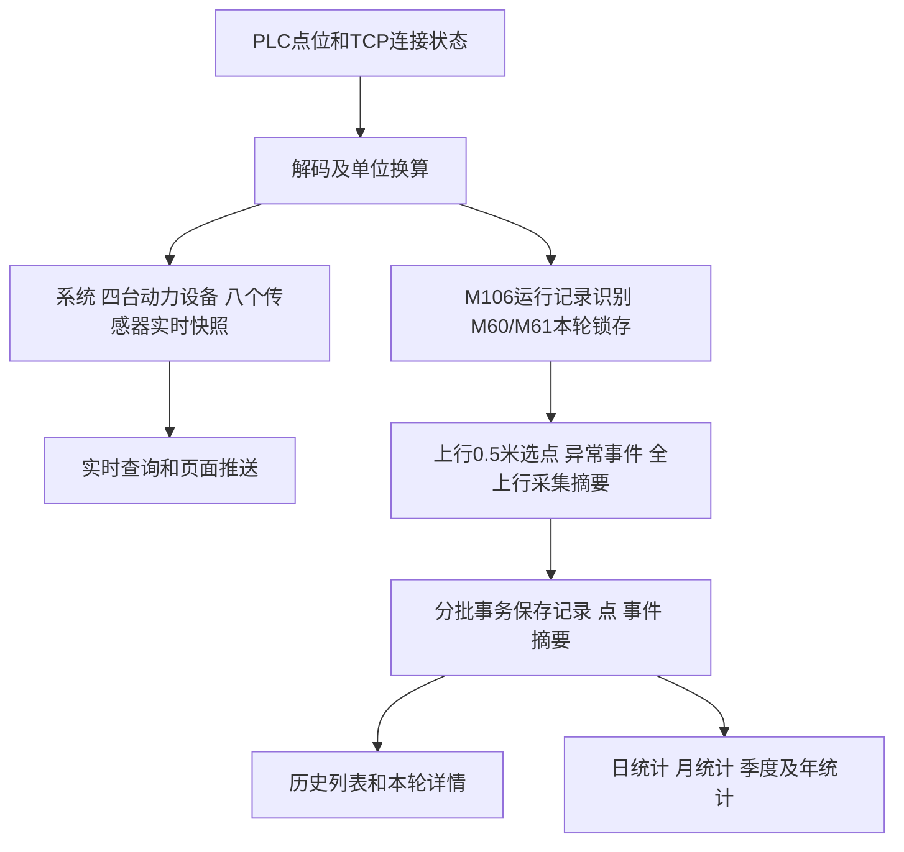

# 实时、历史与历史统计统一口径

日期：2026-10-26。依据用户最新PLC点位与本轮讨论，统一后续处理规则。本轮只整理方案和文档，不修改Java、SQL、现场配置，不连接或操作PLC/数据库。

**当前主历史定义：一次M106从0变1开始、从1变0结束的自动运行，保存为一条系统历史记录。** 四台动力设备共同属于这条记录。详情测量曲线仍按各台上行高度每0.5米留点。此定义替代此前“一次上行一条，另外关联往返”的主列表口径。

| 内容 | 什么时候处理 | 保存/展示什么 | 依据 |
|---|---|---|---|
| 实时数据 | PLC连接正常时持续处理，包括运行、待机、检修和下行 | 系统、四机、八传感器当前状态和测量；当前报警、累计计数 | 实际采集值和TCP连接状态 |
| 一次历史 | 明确观测到M106开始边沿后，到结束边沿或通信异常收尾 | 开始/结束、结果、上行保留点、异常、当次测量摘要和参数 | M106、锁存的M60/M61及采集事实 |
| 历史统计 | 随记录和摘要提交更新，按自然日/月/季度/年查询 | 次数、三类结果、时长、设备和系统上行测量统计 | 已保存主记录及分日摘要，不从实时缓存或PLC累计计数猜算 |

完整点位和换算见[实时点位契约](realtime-point-contract.md)，统计细则见[历史统计契约](history-statistics-contract.md)。

## 1. 统一处理主流程

后台通过Modbus TCP读取PLC；页面实时推送和历史保存分开消费，浏览器是否在线不影响历史保存。实时视图可替换为最新值，历史边界和统计需要在替换前顺序处理。沿用正常读值直接处理的要求，不增加逐字段“缺失、未知、未标定”状态或采样时间过期规则。

## 2. 实时数据归属

系统为根，下有4台动力设备，每台关联2个传感器。

- D201：1运行、2待机、3检修、4故障；TCP连接状态由连接层提供。
- D203～D206分别表达四台状态，M120～M127分别表达四台上/下行，不能用一个总方向覆盖四台。
- D53～D60编码器结合各自底部值换算高度；D66～D69为各轴连续运行秒计时，停止后重计，用同段高度增量/计时增量计算区间速度。
- D30～D37换算八路拉力；每机总拉力是其两传感器同批之和，系统总拉力是八传感器同批之和。
- D70～D73的电机力矩换算为等效拉力，单独标明来源，不加进传感器总拉力。
- M3/D3和D300～D307用于显示总故障、原因及驱动器error ID；M60/M61用于本轮异常及结果判断。
- D10/D11/D12/D13分别为PLC成功上行、成功下行、故障上行、故障下行累计计数。保留PLC口径，不直接命名为今日次数。

检修时只显示实时数据，不建立运行历史、不持续保存测量点，也不进入正式历史次数和测量统计。D201=故障不自动等于M106已经结束，异常重试运行仍按本轮事实处理。

## 3. 一次历史的开始、过程和结束

| 观测情况 | 本轮处理 |
|---|---|
| M106从0变1，且不是检修 | 新建一条系统记录，分配唯一记录号，保存开始时间、当次参数和身份/换算配置 |
| M106持续为1 | 只更新同一条记录，不按采集帧数、设备数重复创建 |
| 读到M60=1 | 记住本轮曾有异常；后来恢复0也不清除本轮事实 |
| 读到M61=1 | 记住本轮异常结束事实；后来恢复0也不清除，结果优先于M60 |
| 本轮内部下行回退、调整、再次上行 | 仍是同一条主历史；保留必要事件和连续段，不另加运行次数 |
| M106从1变0 | 先纳入结束帧能读到的M60/M61，再保存结束时间、最终结果和摘要，只关闭一次 |
| 本轮进行时TCP断开，或已确认PLC重启 | 当前记录按异常结束收尾，保留已经采到的数据；恢复后不续接 |
| 没有活动记录时故障/断联 | 更新实时/故障事件，不凭空生成一条运行历史 |
| 初次接入或重连时第一帧M106已经为1 | 只提供当前实时，不冒充已看到完整开始；等下一次明确0→1再建立新记录 |

开始/结束使用后台观测到对应采集状态的时间，通信异常收尾使用后台确认连接中断的时间；不冒充PLC内部精确事件时间。采集时间、保存时间分别保留。

本轮锁存事实在新一轮开始时重新初始化，并纳入新一轮实际读到的异常值。PLC负责M61复位，后台不擅自写位清零。用户已说明M61会提供可读取时间；因此收到后就锁存，不只在结束那一帧看瞬时值。

只有存在活动记录时才结算结束。已经因断联等原因收尾的记录，不因后来补读到M106下降沿、连续读到0或重复提交而再次计次，也不把原结果改成正常完成。

### 本轮最终结果

| 优先级 | 条件 | 结果 |
|---|---|---|
| 1 | 本轮出现过M61=1，或由通信中断/已确认PLC重启收尾 | 异常结束 |
| 2 | M106正常结束，未出现M61=1，但本轮出现过M60=1 | 异常完成 |
| 3 | M106正常结束，M60/M61均未出现过1 | 正常完成 |

进行中的记录不提前标记正常完成。M3/D3用于说明原因，不用故障码非0一律替代M61；设备故障、急停导致本轮终止时，应与PLC的M61异常结束事实相符。

运行中主动切入检修的收尾，整理默认按“当前记录异常结束，之后只实时”处理，需在现场走一次模式切换确认PLC信号顺序；不是新增一种运行结果。

### D3=50：回退、重试和跨轮报警

D3=50按PLC提供的结痂无法拉动处理逻辑保留：存在反向退回、调平、再尝试和提前结束等过程；报警可跨轮保持，设备仍按间隔继续运行，直到某一轮完整上下运行后自动解除。

原始标题“五次尝试仍无法移动／告警重试”、三次回原提前结束及超过三轮的描述同时保留，内部计数层级由PLC解释；后台本轮不重建这套重试控制算法。

因此：回退并不直接结束本条历史；同一持续报警不因每次轮询或每一轮而新增一个故障起点；本轮是否异常结束看M61/M106事实。M60在新一轮仍为1时，表示这一轮期间仍存在异常，应保留为本轮异常事实。

## 4. 历史详情保存哪些内容

| 层次 | 内容 |
|---|---|
| 本轮主记录 | 系统/记录编号、开始/结束、进行中或三类结果、结束原因、本轮M60/M61事实、参数/配置快照 |
| 设备测量点 | 各台实际高度、目标节点、采集时间、连续段和序号、编码器、轴计时、两路原始/换算拉力、本机总力、原始/换算力矩、速度、状态/方向 |
| 系统同批快照 | 八传感器及四机总力的同批来源、系统总力和各台实际高度 |
| 异常与边界 | 异常发生/解除、回退重试、运行开始/结束、通信异常及必要当时快照 |
| 单次与分日摘要 | 各机上行测量的sum/count/min/max及极值时刻/高度，系统上行窗口总力摘要，本轮总历时及上行运动时间 |

只在本轮活动且对应设备上行时，按该台实际高度每0.5米选点；另外保留必要的上行起止和异常事实。任意一台选中时，整批四机快照一行，共享同批来源；其他设备的同行读数不自动成为其高度点。

实际采到0.53米就保存0.53米，不改成0.50米，不插值补未采到的点。回退再上行会再次经过同一高度，按连续段和序号区分，不能用高度唯一键覆盖。正常下行不存连续曲线；整个M106周期的起止、结果和历时仍保存。

每0.5米约束的是长期留点，单次/分日测量摘要仍使用本轮相应上行阶段的全部已接收采集。各台按各自上行范围统计；系统上行窗口取任一台上行时的同批八索总力，明确统计窗口，不能改用四机各自不同时间的峰值相加。

## 5. 历史统计统一口径

- 一次M106开始只计一次系统运行，四台不计四次，回退重试不另增次数。
- 开始次数、已结束次数、三类结果、进行中分别表达；未结束的记录不能预先算成功。
- 正常完成、异常完成、异常结束三类结果互斥。正常完成与异常完成都已完成，但“正常次数”与“完成次数”字段需分别命名。
- 本轮次数及最终结果按开始日归属；跨日运行的历时和测量摘要按实际上海自然日拆分。迟到结束后更新原开始日的结果统计。
- 整轮历时、各机上行运动时间、上行测量统计分开，不能把往返总历时叫作上行时间。
- 日统计可展开每条本轮记录，月按日、季度按月、半年按月、年按月或季度展示。均值合并sum/count，不平均每日均值，不混加日/月/年重叠结果。
- D10～D13只是PLC累计数据；M204和这些计数均不参与新主历史边界判断，也不以计数差直接代替日历报表。

完整字段和跨日例子见[历史统计契约](history-statistics-contract.md)。

## 6. 后续数据库与业务接入

先前[17表SQL实施记录](README.md)按“一次上行主记录＋独立往返”编制并验证。本次主历史口径已经改变，不能将先前SQL验证结果理解为M106业务链路已实现。

后续实施需统一主记录与现有run/cycle关系，补核M106开始/结束来源、M60/M61本轮锁存、终止原因和新统计计次口径；用户页面只出现一条M106本轮主历史，不把技术子记录再次展示或计次。本轮不修改已验证SQL，不执行数据库升级。

持续异常可跨多个M106周期，事件与受影响记录的关联也需一起核对，不能因为旧事件表只有一个cycle_id就按每轮复制一条故障起点。

已有最新采集工具/点位文件能够承载数据采集，不等于采集→本轮识别→选点/摘要→事务保存→查询/报表已接通。后续代码与SQL必须按本文规则一起适配。

## 7. 现场核对和验收

业务边界已明确；接入配置仍需实测D/M协议地址、编码器32位字序、四台底部值、INT秒计时分辨率以及远程参数的地址/单位。D202完整枚举及D100/D110、D101/D114含义不清的部分单列核对，不猜填。

建议按以下实例核对一遍信号和最终历史：

1. 一次正常运行：M106开始、上行留点、下行、M106结束，只一条正常完成。
2. M60出现1后恢复0，再正常结束：仍是一条异常完成。
3. M61出现1，结束时已回0：仍判异常结束。
4. 同时有M60/M61：异常结束优先。
5. D3=50反向重试及跨轮报警：本轮不拆记录，后续新M106边沿才新建，持续报警不重复创建故障起点。
6. 中途断联并在M106仍为1时重连：原记录异常结束，不续接；等下一次完整开始。
7. 检修实时有数据：不产生正式运行历史和统计。
8. 跨日运行：总次数只一次，测量和历时按自然日拆分。

本节是后续验收清单，不声称这些业务测试已经执行通过。
